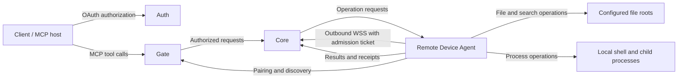

# Agent architecture

Remote Device Agent executes file, search, process and opt-in browser operations on one device for Remote Device Hub (RDH). Remote Device Server provides Auth, Gate, Core, Business and Admin. Auth owns customer sign-in and MCP OAuth; Gate owns device pairing, credentials, assignment and MCP routing; Core owns Agent connections, execution admission, consumption and receipts. Business serves the product website and exports entitlements; Admin serves staff management. See [Terminology](terminology.md).

The Agent authenticates discovery at Gate with its long-lived device credential, then opens an outbound WSS connection to the assigned Core with a short-lived, single-use admission ticket. The Agent does not expose a local HTTP or MCP listener.

## Components

| Source | Responsibility |
| --- | --- |
| [main.rs](../src/main.rs), [cli.rs](../src/cli.rs) | Parse start, unbind and update; help and version do not create a runtime. |
| [app.rs](../src/app.rs), [pairing.rs](../src/pairing.rs), [config.rs](../src/config.rs) | Validate local state, pair or reuse identity, coordinate launch and cleanup. |
| [profile_lock](../src/profile_lock/mod.rs), [process_identity.rs](../src/process_identity.rs), [storage](../src/storage/mod.rs) | Enforce profile exclusion using PID and process start identity, with private platform storage. |
| [session.rs](../src/session.rs), [transport.rs](../src/transport.rs), [rpc.rs](../src/rpc.rs) | Session state, request admission, bounded output, dispatch and deadlines. |
| [files](../src/files/mod.rs), [searches.rs](../src/searches.rs) | Shared file/search contracts with POSIX descriptor and Windows handle backends. |
| [processes/mod.rs](../src/processes/mod.rs) | Own process jobs, pipes, output and POSIX process-group or Windows Job Object cleanup. |
| [policy.rs](../src/policy.rs), [sandbox.rs](../src/sandbox.rs), [audit](../src/audit/mod.rs) | Local restrictions, command isolation, redacted durable audit records. |
| [startup](../src/startup/mod.rs) | Local approval, future startup registration and cancellation. |
| [binding](../src/binding/mod.rs), [self_update.rs](../src/self_update.rs) | Durable unbind intent, process coordination and verified binary replacement. |
| [xtask](../xtask/src/main.rs) | Native artifacts, provenance, license collection and archive round-trip checks. |

## Startup and connection

`rdh` resolves one local binding using the committed default Hub. A saved binding retains its Hub and file roots. First use asks for a directory and records it in `settings.json`; subsequent launches reuse those roots. There is no command-line or environment Hub selector.

Unbound startup persists a locally generated token and reserved device identity before printing the pairing code/link and opening the browser. Approved configuration must match that device, Hub and the locally chosen roots. Bound startup reuses the private configuration without opening the browser.

`rdh unbind` records durable intent before contacting Gate. The running Agent observes intent, stops admitting operations and shuts down its jobs. The command revokes its own credential, cancels pending pairing and disables the recorded startup registration. It removes credentials only after those steps succeed. Failure leaves intent that blocks the old binding; retrying an interrupted unbind finishes cleanup and exits before a subsequent manual launch can pair again.

After configuration and hardening validation, discovery-enabled Agents authenticate to the Gate with their saved device credential and receive a single-use v2 ticket. They connect to the assigned Core at `/agent/<device_id>` using only that ticket, send `hello` with device information, and complete the `ready`/`ready_ack`/`active` handshake before the connection becomes active. The ticket binds the device, assignment, Core node and boot, credential version, and Agent process instance. Gate accepts pairing and discovery requests; Core accepts Agent connections authenticated by admission ticket. A configuration without discovery requires a server supporting direct bearer authentication and is incompatible with the five-service deployment. Device information includes operations, limits, and effective restrictions. Session heartbeats detect lost connections. See [Hardening configuration](hardening.md) for policy reporting and configuration privacy.

## Request execution

The Agent validates each request envelope and request ID before dispatch. At most eight operations may be in flight. Dispatch applies operation and file-write policies, records any required pre-execution audit event, and calls the file, process, or search component. The reply contains the same request ID and enters a bounded send queue.

The default RPC response deadline is 20 seconds. Expiring a response or losing its socket does not cancel underlying filesystem I/O; that operation keeps its concurrency slot until it settles. An expired mutation can still have effects. Inspect the target state before retrying an operation with an unknown outcome.

Execution admission and control-generation changes share one lock. A disconnect
disables the old control entry; queued requests that have not passed execution
admission are rejected. Already admitted operations keep their concurrency slots
and original receipts while a replacement control connection becomes active.
They do not have to finish before reconnecting. After activation, pending receipts
wait for capacity in the existing bounded writer; the session continues handling
incoming frames and shutdown while waiting. Recovery by the original operation
ID does not execute the operation again. See [Cluster discovery](network.md#cluster-discovery) for
the bounded recovery sequence and timing records.

The Agent retains at most 1,024 receipts. At capacity it evicts the oldest settled
receipt already acknowledged by Core; running and unacknowledged receipts
remain protected. Core acknowledges durable completion and never
dispatches an already claimed operation ID again. Its separate result-retention
and preparation limits still apply; Agent eviction does not increase those limits.

Starting a process returns a job that can continue after the RPC finishes. Its execution timeout is separate from the response deadline. A later `process_exit` audit event records final status and exit code; a successful `start_process` response alone does not establish command success.

Background search uses `start_search`, `get_search_results`, `stop_search`, and `list_searches`. Defaults allow two concurrent tasks, a 30-second active lifetime, traversal depth 30, and 10,000 visited entries. Results stop at 1,000 matches or 256 KiB, with at most 200 results per page. At most 16 task records are retained, and finished tasks expire after up to five minutes. Responses report `status`, `truncated`, `truncated_reason`, and `skipped` so callers can distinguish a complete search from a bounded result.

Search result paths are relative to the named root, including searches started
with an empty path. `read_multiple_files` takes a `root` and `paths` array;
`move_file` takes `root`, `source` and `destination` and moves only within that root.
File, directory, process and search offsets are unsigned 64-bit integers. JSON
numbers with an integral value, such as `1.0`, are accepted within that range.
File fingerprints are opaque metadata identifiers, not content hashes. Their
integer fields retain native precision, and timestamps use Unix milliseconds.

## State and resource lifetime

| State | Storage and lifetime |
| --- | --- |
| Device pairing and policy | Private configuration and sidecar files on disk; reused at startup. |
| Profile ownership | A directory lock held until shutdown has completed sufficiently to release it. |
| Process jobs and captured output | Memory in the running Agent. Output is bounded; Agent restart does not recover jobs or captured output. |
| Search tasks | Memory with concurrency, traversal, result-size, and expiration limits. Cancellation retains the concurrency slot until worker cleanup completes. |
| Local audit | Redacted JSONL files on disk, retaining at most 1,000 records per device across restarts, subject to byte and rotation limits. |
| Executable | One binary replaced by `rdh update` after validation; binding state remains separate. |

An ordinary network disconnect retains managed processes and bounded output for up to five minutes. Successful reconnection cancels the offline cleanup timer. Authorization rejection, prolonged disconnection, or explicit shutdown stops managed work. Shutdown stops accepting requests and closes processes, searches, audit handles, and profile ownership; an unresolved cleanup can leave an operation's outcome unknown.

After a crash, startup can reclaim the instance lock when the recorded PID and
process start identity no longer identify a live process. This permits restart
without replaying old operations. External commands may survive the Agent,
especially on POSIX; their state and lost output are not recovered. A live Agent
continues to hold ownership while its admitted work is shutting down.

## Permission boundaries

File-tool roots and write policies restrict file operations. They do not confine a shell command, which runs with the Agent OS user's authority. Linux bubblewrap can provide additional command isolation when explicitly configured. Path identity checks and guarded replacement still have races with concurrent external path or file changes.

Platform behavior differs for private file permissions, shell syntax, and process-tree termination. See the [platform implementation](code-structure.md) and [Hardening configuration](hardening.md). Build outputs, distribution formats, and release operations are described in [Maintenance and releases](maintenance.md) and [Distribution](distribution.md).

## Native platform boundary

The Tokio runtime uses at most four scheduler workers. Blocking operations,
search workers and process supervision have their own admission and lifetime
rules; that worker count is not a bound on all threads. Shared modules own the
wire contract and policy; OS modules own filesystem handles, process cleanup,
startup registration and private storage. Platform support is enabled by default
in a normal build. The `experimental-*` Cargo features select platform backends in reduced builds.

The updater requires the Agent to be stopped and holds the binding lock while replacing the executable. The installer writes the single binary to a stable command path. Binding credentials, policy, roots and startup registration are independent of the executable replacement.
