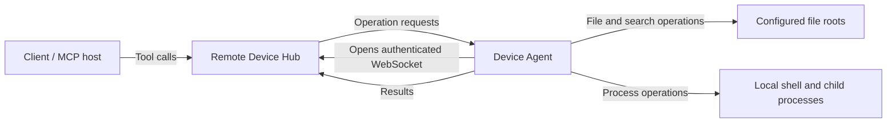

# Agent architecture

The Agent executes file, search, and process operations on one device for a Remote Device Hub. The Hub handles client-facing tool access and routes requests to the selected device. The Agent initiates an authenticated WebSocket connection to the Hub; it does not expose a local HTTP or MCP listener.

## Components

| Source | Responsibility |
| --- | --- |
| [main.rs](../src/main.rs), [cli.rs](../src/cli.rs) | Parse commands; synchronous management avoids creating an async runtime. |
| [app.rs](../src/app.rs), [pairing.rs](../src/pairing.rs), [config.rs](../src/config.rs) | Validate local state, pair or reuse identity, coordinate launch and cleanup. |
| [profile_lock](../src/profile_lock/mod.rs), [storage](../src/storage/mod.rs) | Enforce profile exclusion and private platform storage. |
| [session.rs](../src/session.rs), [transport.rs](../src/transport.rs), [rpc.rs](../src/rpc.rs) | Session state, request admission, bounded output, dispatch and deadlines. |
| [files](../src/files/mod.rs), [searches.rs](../src/searches.rs) | Shared file/search contracts with POSIX descriptor and Windows handle backends. |
| [processes/mod.rs](../src/processes/mod.rs) | Own process jobs, pipes, output and POSIX process-group or Windows Job Object cleanup. |
| [policy.rs](../src/policy.rs), [sandbox.rs](../src/sandbox.rs), [audit](../src/audit/mod.rs) | Local restrictions, command isolation, redacted durable audit records. |
| [startup](../src/startup/mod.rs), [service_host](../src/service_host/mod.rs) | Future startup approvals and platform registration; native service entry and shutdown. |
| [native_install](../src/native_install/mod.rs), [service_install](../src/service_install/mod.rs) | User/system installation, ownership and retained native versions. |
| [upgrade_cli.rs](../src/upgrade_cli.rs), [service_controller.rs](../src/service_controller.rs) | Version selection, offline updates, verified Linux automatic updates and recovery. |
| [xtask](../xtask/src/main.rs) | Native artifacts, provenance, license collection and archive round-trip checks. |

## Startup and connection

Startup uses `--server`, then `RDH_SERVER`, then the committed public deployment origin. It performs no direct-origin probe. The exact public and MCP origins shipped together share profile locks; unrelated custom servers remain isolated. Runtime disconnections use WebSocket reconnection.

The two default origins are aliases for one Hub and can reuse an existing pairing. Custom Hubs retain same-origin pairing validation and credential separation. Profile locks cover the configuration paths used for reuse. Pairing requests browser approval before the Agent saves and uses a new device credential.

After configuration and hardening validation, the Agent connects to `/agent/<device_id>` with a bearer token, sends `hello` with device information, and waits for `ready` before accepting requests. Device information includes operations, limits, and effective restrictions. Session heartbeats detect lost connections. See [Hardening configuration](hardening.md) for policy reporting and configuration privacy.

## Request execution

The Agent validates each request envelope and request ID before dispatch. At most eight operations may be in flight. Dispatch applies operation and file-write policies, records any required pre-execution audit event, and calls the file, process, or search component. The reply contains the same request ID and enters a bounded send queue.

The default RPC response deadline is 20 seconds. Expiring a response or losing its socket does not cancel underlying filesystem I/O; that operation keeps its concurrency slot until it settles. An expired mutation can still have effects. Inspect the target state before retrying an operation with an unknown outcome.

Starting a process returns a job that can continue after the RPC finishes. Its execution timeout is separate from the response deadline. A later `process_exit` audit event records final status and exit code; a successful `start_process` response alone does not establish command success.

Background search uses `start_search`, `get_search_results`, `stop_search`, and `list_searches`. Defaults allow two concurrent tasks, a 30-second active lifetime, traversal depth 30, and 10,000 visited entries. Results stop at 1,000 matches or 256 KiB, with at most 200 results per page. At most 16 task records are retained, and finished tasks expire after up to five minutes. Responses report `status`, `truncated`, `truncated_reason`, and `skipped` so callers can distinguish a complete search from a bounded result.

## State and resource lifetime

| State | Storage and lifetime |
| --- | --- |
| Device pairing and policy | Private configuration and sidecar files on disk; reused at startup. |
| Profile ownership | A directory lock held until shutdown has completed sufficiently to release it. |
| Process jobs and captured output | Memory in the running Agent. Output is bounded; Agent restart does not recover jobs or captured output. |
| Search tasks | Memory with concurrency, traversal, result-size, and expiration limits. Cancellation retains the concurrency slot until worker cleanup completes. |
| Local audit | Redacted JSONL files on disk, retaining at most 1,000 records per device across restarts, subject to byte and rotation limits. |
| Runtime installation | Version directories and active/previous records used by upgrade and rollback; Windows uses records and native launchers rather than symlinks. |

An ordinary network disconnect retains managed processes and bounded output for up to five minutes. Successful reconnection cancels the offline cleanup timer. Authorization rejection, prolonged disconnection, or explicit shutdown stops managed work. Shutdown stops accepting requests and closes processes, searches, audit handles, and profile ownership; an unresolved cleanup can leave an operation's outcome unknown.

## Permission boundaries

File-tool roots and write policies restrict file operations. They do not confine a shell command, which runs with the Agent OS user's authority. Linux bubblewrap can provide additional command isolation when explicitly configured. Path identity checks and guarded replacement still have races with concurrent external path or file changes.

Platform behavior differs for private file permissions, shell syntax, and process-tree termination. See the [platform table](../README.md#platform-behavior-and-limits) and [Hardening configuration](hardening.md). Build outputs, distribution formats, and release operations are described in [Maintenance and releases](maintenance.md) and [Distribution](distribution.md).

## Native platform boundary

The Tokio runtime uses at most four scheduler workers. Blocking operations,
search workers and process supervision have their own admission and lifetime
rules; that worker count is not a bound on all threads. Shared modules own the
wire contract and policy; OS modules own filesystem handles, process cleanup,
startup registration and private storage. Platform support is enabled by default
in a normal build. Historical feature names remain available for reduced builds.

Installed Agents hold a shared installation lease while running. An updater takes
exclusive ownership and locks registered profiles before switching a verified
candidate. Pending records prevent normal launch after an interrupted switch.
System-service programs remain administrator/root owned while credentials and
mutable state belong to the service account. Windows stable command executables
select and pin the recorded version before forwarding the original argument
vector and standard streams.

Version changes apply to native installations. They retain the previous native
executable and validate registered profiles before selecting either version.
The repository has no installer for migrating an earlier Node installation.
