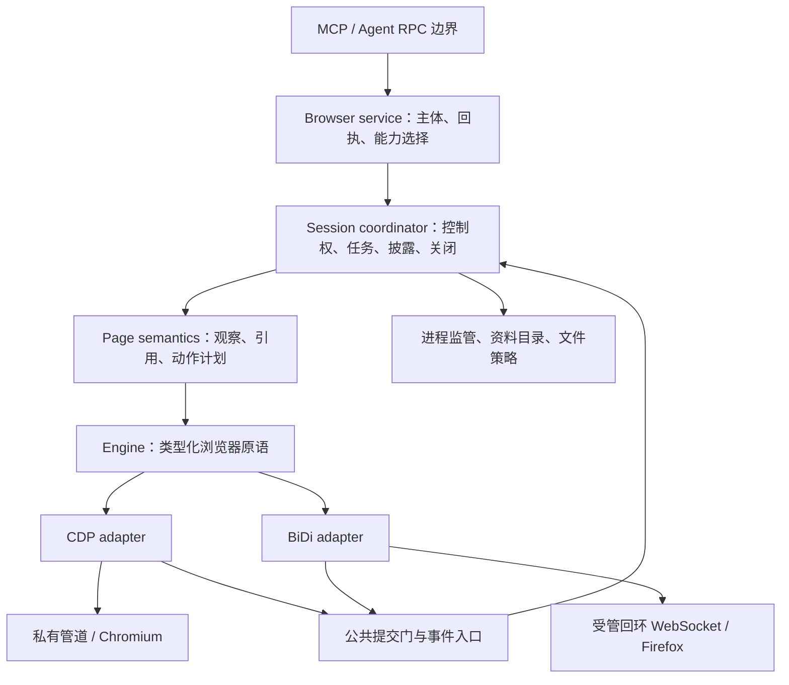
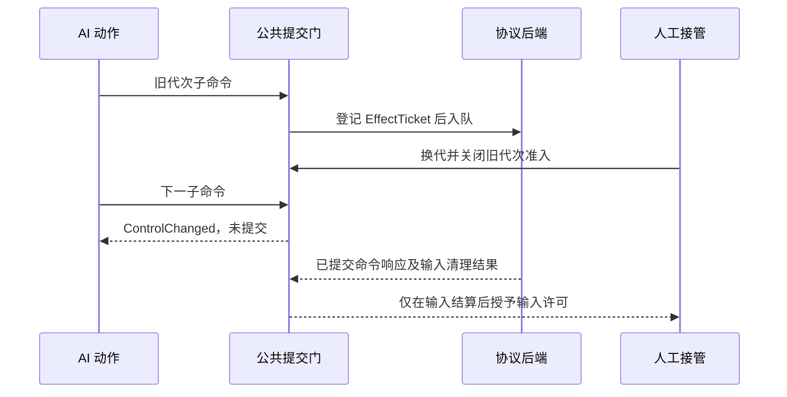

# 原生浏览器后端规约与架构方案

状态：经代码与协议评审修订，可开始 D1 的分步迁移；D2～D4 的能力与发布门槛仍须取得实施证据。本稿不代表 Firefox/BiDi 已实现或验收通过。

版本：0.2，2026-11-16。评审结论及本次取舍见第 14 节。

代码基线：Agent `06e43b18763292a89fe79f2df1992e4053225ff2`；配套 Server `be90380f8acde29c07d7e93c83c292ccc5bd1949`。

配套文档：[验收指标与实施门槛](browser-backend-acceptance-zhCN.md)。

## 1. 决策与目标

采用“公共浏览器语义层 + 类型化引擎接口 + 原生协议适配”的分层。公共层定义观察、引用、动作、控制权和恢复的含义；CDP、BiDi 后端负责把有明确前置条件和结果语义的浏览器操作映射到各自协议。后端不能自行改变引用有效期、授权范围、重试规则或观察完整性的含义。

部署约束保持不变：Agent 使用 Rust，适配代码编入同一二进制，复用用户已安装的受支持浏览器。运行时不要求 Node、Puppeteer、ChromeDriver、GeckoDriver、扩展或独立代理，不自动下载浏览器。开发和 CI 可以使用测试工具；这些工具不得进入用户运行时依赖。

首批实现 Chromium/CDP 和 Firefox/BiDi。浏览器品牌、内核、协议和操作系统分别记录，不把“支持 CDP”视为对所有 Chromium 版本的兼容承诺。已安装浏览器不满足能力要求时，返回具体不可用原因。

本设计先确定行为边界和可执行验收，再逐段迁移现有 CDP 实现，最后接入 BiDi。D1 保留现有 v1 页面算法、输出和限制；`semantic_dom_v1` 的新命名、指纹与引用规则在 D3 引入，不能混入“保真重构”。性能 trace、堆分析、原始控制台和任意脚本执行不属于基础后端规约；后续需要时再设计扩展。

## 2. 当前代码给出的约束

以下是基线的已核实状态，不是计划中的模块名称。

| 当前实现 | 对抽象的影响 |
| --- | --- |
| [control.rs](https://github.com/easelian/remote-device-agent/blob/06e43b18763292a89fe79f2df1992e4053225ff2/src/browser/control.rs) 已独立保存控制代次及暂停状态 | 完成了一个共享状态的提取，尚未形成后端规约 |
| [page.rs](https://github.com/easelian/remote-device-agent/blob/06e43b18763292a89fe79f2df1992e4053225ff2/src/browser/page.rs) 的 Frame 保存 CDP session、frame、loader，Element 保存 backend node ID | 不能直接将现有类型作为公共页面身份；需要隔离原生 ID 和生命期 |
| page.rs 结合固定 DOM 脚本与 Accessibility.getPartialAXTree 产生名称、角色和引用 | 公共观察语义不能无条件依赖 CDP 可访问性树；需要区分公共语义与原生增强 |
| [runtime.rs](https://github.com/easelian/remote-device-agent/blob/06e43b18763292a89fe79f2df1992e4053225ff2/src/browser/runtime.rs) 直接处理 target、Fetch、Network、弹窗等事件 | 事件归一化、导航策略和任务调度必须一起划定边界 |
| [cdp.rs](https://github.com/easelian/remote-device-agent/blob/06e43b18763292a89fe79f2df1992e4053225ff2/src/browser/cdp.rs) 以命令名称识别部分输入副作用，入队后保留迟到响应及并发槽位 | 公共层应使用类型化副作用分类；不得把超时当成取消或释放工作所有权 |
| [process.rs](https://github.com/easelian/remote-device-agent/blob/06e43b18763292a89fe79f2df1992e4053225ff2/src/browser/process.rs) 直接持有 Cdp，并协调私有目录和原生进程回收 | 启动、通道与进程所有权要解耦；各后端仍必须经过同一回收流程 |
| [files.rs](https://github.com/easelian/remote-device-agent/blob/06e43b18763292a89fe79f2df1992e4053225ff2/src/browser/files.rs)、human 模块直接调用 CDP | 文件策略和人工接管属于公共层；协议侧只提供受限输入、截图、文件流原语 |
| [browser_session.rs](https://github.com/easelian/remote-device-agent/blob/06e43b18763292a89fe79f2df1992e4053225ff2/tests/browser_session.rs) 有 24 个显式运行的真实浏览器场景 | 它们是 CDP 迁移的回归基线，不能因为抽象调整而删除断言或改成忽略 |

不采用三个容易形成长期耦合的方案：

- 仅将 `call(method, Value)` 包成 trait：协议名称、ID、错误和时序仍会进入公共层。
- 每个后端完整实现一套 MCP `observe/act/control`：授权、引用、覆盖率和恢复规则会出现两份实现。
- 用 BiDi 命令模拟整个 CDP API：会把 CDP 的对象和事件模型固定成所有后端的共同模型。

## 3. 分层及代码所有权

下图表示调用和实现关系；公共层只依赖语义接口，不选择协议命令。



建议逐步形成以下源码职责，目录本身不是验收目标。

| 模块 | 独占职责 | 禁止承担的职责 |
| --- | --- | --- |
| `browser/contract/` | ID、请求/结果、事件、错误、能力及预算类型 | CDP/BiDi JSON、MCP wire schema、平台进程操作 |
| `browser/session/` | 控制权、在途工作、回执关联、结果披露、关闭顺序 | 原生节点定位、协议错误字符串匹配 |
| `browser/page/` | 观察分页、记录指纹、引用注册、动作前置检查、等待条件 | 依据 backend kind 分支选择行为 |
| `browser/page/programs/` | 随二进制交付的固定 DOM 采集、校验和表单算法 | 调用者提供的 JavaScript、任意方法名、动态下载代码 |
| `browser/backend/cdp/`、`bidi/` | 协议编码、原生 ID 映射、realm、原生输入、事件归一化 | 创建 AI 引用、修改权限、静默重试未知动作 |
| `browser/backend/transport/` | 有界读写、请求关联、关闭和协议解码错误 | 通过命令名称猜测业务副作用 |
| `browser/process/` | 进程树所有权、启动记录、停止和资料回收 | 将通道断开当成进程已停止 |
| `browser/files/` | 授权、一次性上传许可、私有暂存、配额、交付 | 向后端交付任意调用者路径 |

固定 DOM 算法由两种后端复用。后端负责在正确隔离环境执行固定程序、编码参数及解析原生对象；公共页层负责组合结果、签发引用和决定动作。程序使用具体的类型化方法或封闭枚举，构建时嵌入；无需为了统一调用再建设脚本注册框架。内部静态程序可以拼接已验证参数，Engine 不接受调用者脚本、原生对象 ID 或任意协议方法。D1 可把旧算法保留在明确的兼容模块中，D3 再提取共同算法，不能把整个旧 page 模块改名为 adapter 后就声称完成公共语义抽象。

初期保留单一 crate，使用 Rust 可见性和模块依赖约束边界。暂不引入动态插件 ABI、全协议代码生成框架、通用工作流引擎或任意命令扩展口。

## 4. Engine 接口：统一操作语义

Engine 是内部接口，不是新网络协议，也不直接对应 MCP 工具。公共接口只接受约定类型；JSON 仅存在于 MCP 边界、协议编解码和经过校验的固定程序返回值中。

Engine 是对能力边界的命名，不要求一次性实现一个大型 trait。当前仅有一个真实后端，先提供具体的内部类型和异步方法；第二个后端接入时优先使用封闭枚举分派。公共算法需要替身测试时，为已存在的调用面提取小 trait。没有动态装载需求，不预先要求对象安全、boxed future、插件 ABI 或通用命令总线。以下方法按上下文/观察、输入、策略/事件三个职责实现，不增加三套会话状态。

以下是异步操作目录，不是可直接编译的 Rust 或已经冻结的方法签名；具体类型随 CDP 提取和替身测试逐步确定。每个方法返回类型化 Result，错误遵守第 10 节。

```text
contexts(ReadContext) -> ContextTree
open_scan(ReadContext, ScanRequest) -> ScanLease
next_scan(ReadContext, ScanLease, ReadBudget) -> DomChunk
inspect(ReadContext, NodeLease) -> ElementFacts
input(AuthorizedInput) -> InputAck
navigate(AuthorizedNavigation) -> NavigationAck
tabs(AuthorizedTabChange) -> TabAck
capture(ReadContext, CaptureRequest) -> ImageArtifact
handle_prompt(AuthorizedPrompt) -> PromptAck
decide_navigation(PolicyDecision) -> DecisionAck
release(LeaseBatch) -> ReleaseReport
close(CloseContext) -> ChannelCloseReport
```

操作必须遵守以下约定：

| 操作组 | 前置条件与成功含义 | 由公共层承担的部分 |
| --- | --- | --- |
| 上下文枚举、创建/选择/关闭 tab | 返回规范化上下文树；创建的新页面在策略钩子就绪前不执行用户导航 | 配额、会话归属、最后一个 tab 的行为；tab 变更使用独立的类型化控制请求 |
| open/next scan | 只在指定文档与隔离环境采集有界 DOM 数据；返回原生句柄的租约，不生成 AI ref | 筛选、find/within 范围、覆盖率、分页令牌和最终引用 |
| inspect | 返回连接状态、角色/命名依据、值、记录指纹材料、可编辑性、命中与几何信息 | 对照已观察记录、选择可执行动作、敏感输入检查 |
| input | 执行明确的输入意图；成功仅表示协议输入序列已确认 | click/check/select/fill 的行为规则、动作前后校验、回执和未知结果处置 |
| navigate | 返回导航 ID、当前阶段及目标状态；不能用命令响应代替文档已加载 | 站点决策、等待条件和恢复策略 |
| capture | 指定 viewport、缩放及裁剪语义，返回有界图像和文档/视口戳 | 人工通路授权、图像交付、控制代次及披露复核 |
| prompt | 明确匹配 prompt ID 和代次；不得自动确认未知弹窗 | 操作者授权、是否可在 pending 状态恢复 |
| decide_navigation | 一次性消费与当前拦截阶段绑定的 token；返回是否执行及前序请求状态 | 站点规则、DNS 决策、明确的决策超时；不持有普通操作锁等待 |
| release/close | 报告资源释放结果；channel close 不证明浏览器进程停止 | 工作所有权、目录隔离、进程回收和最终关闭状态 |

`InputIntent` 区分 Focus、Pointer、Key、ReplaceText、ScrollIntoView、SetFormValue；不得退化为“协议方法名 + 任意参数”。ReplaceText 表示替换最终文本，通过受支持的原生编辑或按键路径实现，不保证两协议产生同样数量的 key/beforeinput/input 事件。普通文本填写不能退化为 DOM `value=`、剪贴板或 OS 桌面输入。已有 select、日期、颜色和范围控件的固定表单程序是单独的 SetFormValue 语义，会产生合成事件；不能把它报告为原生键盘输入。第 7.2 节定义共同可验收部分。

`AuthorizedInput` 只能由公共协调器构造，并携带当前主体许可、会话代次、文档预期和 EffectTicket。后端每个可能产生副作用的子命令仍须经过公共提交门；得到一次授权不意味着整个序列以后可以跳过控制权检查。清理权限单独限制为释放已按下按键、取消已持有拦截和释放本次租约，不能恢复普通输入权限。

### 4.1 协议差异如何收敛到公共操作

| 差异 | adapter 必须处理的部分 | 公共层可以依赖的结果 |
| --- | --- | --- |
| CDP target/flattened session/frame 与 BiDi browsing context | OOPIF 路由、父子关系、附加/订阅就绪和身份映射 | 完整或明确受限的上下文树，不暴露路由 ID |
| CDP isolated world/Runtime object 与 BiDi sandbox realm/handle | 执行环境选择、对象所有权及释放；禁止在错误 realm 重用句柄 | 固定程序在期望文档中执行，返回有界的已校验数据 |
| CDP RemoteObject 与 BiDi RemoteValue | 解析各自值类型、节点引用、序列化深度及缺失字段 | 具体 DomChunk/ElementFacts；不把原生 JSON 直接透传成公共结构 |
| CDP exceptionDetails 与 BiDi evaluation exception result | 区分协议命令错误、脚本异常、合法空值和数据解码失败 | 脚本异常不能成为成功的空观察或可重试输入；副作用进展仍保留 |
| CDP loader/lifecycle 与 BiDi navigation/realm/context 事件 | 同文档导航、BFCache、重定向及事件/响应顺序 | 第 5、8 节的文档代次与导航阶段，不能互相替代 |
| CDP 原生输入与 BiDi actions | 文本路径、按键来源、坐标/DPR、按下状态和释放 | 第 7.2 节的意图及禁止效果，不要求协议命令或事件数量一致 |

上述差异在 D1b/c 提取 CDP 端口时建立替身用例，在 D2/D3 用真实 BiDi 补齐。异常与远程值语料至少包括 exception、undefined/null、非有限数、嵌套对象截断、无效/过期节点句柄；不符合固定程序结果类型时明确失败，不用缺省值掩盖。[CDP Runtime](https://chromedevtools.github.io/devtools-protocol/tot/Runtime/)、[BiDi Script](https://w3c.github.io/webdriver-bidi/#module-script)

## 5. 身份与资源生命周期

原生 ID 只在所属 adapter 内解释。公共类型不能包含名为 `cdp_session`、`loader_id`、`backend_node_id` 或 `bidi_shared_id` 的字段。

| 公共身份 | 范围与失效规则 |
| --- | --- |
| SessionId / SessionGeneration | 一次受管浏览器实例；崩溃、重建或不可恢复的通道丢失后换代 |
| ContextId | 规范化的 tab/frame 身份；frame 销毁后不得把同一值用于新 frame |
| DocumentEpoch | 某 context 的文档代次；新文档、BFCache 恢复及无法确定文档连续性时递增 |
| RealmEpoch | 固定程序执行环境的代次；realm 重建使其脚本句柄失效，不必一律视为新文档 |
| NodeLease | 绑定 session、context、document 的有界节点引用；只在需要脚本对象时附带 realm 句柄，不能跨 backend 使用 |
| ScriptHandle / ScanLease | 绑定 session、context、document、realm 的脚本对象或扫描资源；realm 重建时释放并失效 |
| ObservationId / ElementRef | 公共层生成，绑定观察、控制代次、文档和记录指纹；协议层看不到 AI ref |
| NavigationId / PromptId | 关联一次导航或弹窗生命周期；不得复用先前对象的决定 |
| ViewportStamp | 文档、视口尺寸、缩放和截图版本；人工坐标输入必须匹配 |

每个 backend session 只有一个身份表，负责原生 ID 映射与规范化代次。公共层读取不可伪造的会话内句柄和身份快照；收到通知时只失效相关缓存，不再递增第二套计数。身份表初期是 session 内普通结构，不建设跨模块的注册服务。句柄的构造函数不对 RPC/页面层开放，并在使用时校验 session 归属。

节点身份和脚本句柄必须分开：CDP backend node 与 Runtime object、BiDi sharedId 与 handle 的寿命不同。realm 消失必须废弃脚本句柄和扫描；若仍能证明同一文档、同一节点，可重新解析脚本对象，但不得按选择器重新匹配节点或自动复活旧 AI ref。[BiDi 远程引用定义](https://w3c.github.io/webdriver-bidi/#type-script-remotereference)

同文档 hash/history 变化通常不创建新文档，但应更新地址与导航状态；是否继续一段观察另由观察规则决定。不能简单地以 URL 是否相同判定文档是否相同。顶层文档更新使整棵旧 frame 树失效；子 frame 更新不必废弃不相关 frame 的有效引用。

事件只能帮助维护身份，不能代替动作前复核。临近命令的导航和 realm 变化必须通过原生查询或执行环境内的文档标记再次确认。ID 重用、迟到事件和未知事件顺序一律不能恢复旧引用。

Rust Drop 只能发起有界释放，不能伪装成完成异步回收。Session 持有资源登记表与回收任务；即使调用 future 被取消，原生对象、在途命令及进程所有权仍被追踪。租约达到预算时停止接纳新资源，返回明确的资源不足结果。

## 6. 控制权、提交点与超时

使用三个正交状态，避免把“暂停”“输入已结束”“可以披露”塞进同一个布尔量：

- 生命周期：Starting、Ready、Closing、Closed、Lost、CleanupPending。
- 控制方：AI、Human、Paused，并保存递增的 ControlEpoch。
- 在途状态：EffectTicket 集合、按键/指针清理租约及阻塞导航；集合是否清空决定能否交接。

### 6.1 提交点

EffectTicket 在公共提交门内登记，与控制权换代使用同一串行化机制。**提交点定义为经授权的副作用子命令进入可发送队列，不定义为浏览器已经执行。** 未进入提交点的工作可以明确取消；进入后，即使尚未取得原生响应，也按可能生效处理。提交门内只做同步、有界的校验、登记和 try-enqueue，不能等待 I/O、队列容量或响应。入队失败撤销登记，不标记为已提交；响应先于调用 future 恢复也不能清除该操作已提交过副作用的事实。

输入、导航、tab 变更、focus、滚动、表单设置及弹窗决定均属于页面副作用。页面读取、内部对象分配和文件流读取也需要所有权及资源上限，但不全部加入输入交接屏障。公共层传递静态类型的副作用类别；CDP adapter 对已用命令显式分类，传输核心不依据协议前缀或任意 JSON 推断。D1 首步保持当前分类和错误映射，发现现有分类缺陷时单独记录、测试和修复，不能借重构改变所有操作的执行状态。

命令在途表是 EffectTicket 与并发槽位的唯一所有者。公共操作只保留单调的“曾提交副作用”进展及关联 ID，不复制一套待决命令表。关闭通道会结束传输等待，但不证明浏览器输入或进程已经停止；恢复输入仍需会话健康及进程状态允许。

暂停首先换代并阻止旧代次的新提交；已提交的旧工作进入结算阶段。人工输入许可和 AI 恢复许可只在相关输入及必要清理已结算后发放。暂停成功不等于已提交输入不再发生。



高优先级控制路径不能排在普通观察或网络等待之后；不得持有 Session 操作锁等待控制权交接。读取循环、导航策略决定和响应处理各自可推进，避免“等待加载，而加载等待被同一任务阻塞的拦截决定”。

### 6.2 期限与结果

每个上层操作携带绝对 Deadline，所有普通子命令共享剩余预算，不逐层重置超时。另有明确且有上限的清理预算，不能用它继续用户动作。

| 内部结果依据 | 对外处置 |
| --- | --- |
| 尚无副作用子命令提交，因参数、权限、能力或资源限制拒绝 | 可报告 not_sent；不冒充已接受的操作 |
| 一部分序列已提交，后续校验失败、超时、断连或清理不确定 | 报告 unknown，暂停会话并保留回执及 pending 工作；禁止自动重放 |
| 协议确认全部输入序列 | input_acknowledged；仍不代表网站业务成功 |
| wait 没有观察到目标条件 | 条件超时；不重复先前动作 |
| 纯读取失败且没有输入 | 报告读取失败及其实际状态；不虚构已经发生页面输入，也不释放未结束的工作 |

新连接不能接管旧连接中的未知动作并重新执行。回执去重由公共层负责，后端只报告原始执行进展。RPC 准入拒绝的有限重试与页面动作重试是两件事，测试夹具的重试规则不得自动进入产品执行逻辑。

## 7. 观察和动作的一致性

### 7.1 公共观察 profile

定义 `semantic_dom_v1`：两种后端执行同一组固定 DOM 算法，采用同一条命名规则、记录边界、截断预算和完整性定义。原生可访问性信息作为独立增强字段，不覆盖公共字段。

首批命名语料覆盖原生控件文本、关联 label、aria-label、aria-labelledby、alt、显式 role 和可观察状态；每条规则均需给出固定页面及期望结果。不能把这一有界实现称为完整浏览器可访问性树或完整 AccName 实现。无法准确命名时返回来源与限制；不能伪造 native 质量。

canonical 控件名先依据冻结的 HTML/ARIA 支持表判断命名是否适用，再采用以下优先级：有效的 aria-labelledby 引用文本、非空 aria-label、适用 HTML 控件的关联 label、适用元素的 alt、允许由内容命名的控件文本、最后才使用 title。禁止命名的 role 不因存在 aria-label 就取得可访问名称。仅在当前文档和适用树范围内解析关联；不跨 frame 猜测标签。多引用保持声明顺序；循环引用、缺失关联、重复 ID 歧义和预算耗尽均记录质量限制。名称规范化仅折叠规定的空白，不改变大小写和 Unicode 内容。每次命名最多处理 32 个关联引用、递归深度 16、访问 256 个节点；截断必须进入 coverage/name_quality，不能把部分名称冒充完整结果。具体 fixture 包括多 label、隐藏的引用文本、空标签、循环、shadow 边界和长名称。这是有界产品语义，标准算法参考 [AccName 1.2 工作草案](https://www.w3.org/TR/2026/WD-accname-1.2-20261104/)，不据此宣称完整标准兼容。

当前 CDP 观察利用原生 AX 数据。D1 直接保留 v1 的命名、指纹、分页及引用资格，不要求同时计算尚未实现的 canonical 字段，也不以原生 AX 结果反推 canonical 值。D3 新 profile 共用固定采集算法，并将 native 信息作为独立增强。兼容差异集中在明确的 profile 投影/策略中；投影无法表达的算法差异须显式评审，不能承诺一份字段转换即可重现全部旧语义。默认外部观察切换必须经过第 11 节的版本迁移门槛。

coverage 的“完整”仅指指定 profile、frame 范围及可访问 DOM 内遍历完成。closed shadow、canvas 像素文字、浏览器 UI 等不在该语义域内；既不能声称已阅读，也不能虚构其数量。open shadow、跨源 frame、懒加载和动态列表必须有明确的支持与遗漏结果。

分页固定初始查询范围；续页替换上一页 ref。DOM 持续变化可以返回部分结果及 changed_during_read，记录上下文在读取中改变的控件不得取得可执行 ref。不能为了让测试通过而无限重启观察，或把未扫描部分标为完整。

记录指纹也必须有明确的语义范围：包含控件身份材料、声明的记录容器、命名/值依据及该记录的受支持语义内容；由公共层规范化后散列，不能直接信任后端返回的任意 signature 字符串。semantic_dom_v1 在记录采集不完整时不签发可执行 ref，并报告原因；不能只散列前一段文字却声称整条记录未变化。D1 的旧指纹行为只保留在明确的 v1 兼容 profile 下，不能作为新 profile 的验收证据。散列用于变化检测，不作为网站业务对象的可信身份认证。

### 7.2 动作模型

公共动作计划依次完成：引用归属检查、文档和记录复核、参数/敏感性检查、可操作性检查、必要滚动、再次检查、输入提交、按键释放及回执结算。

check/select 等幂等意图先读状态，已满足时返回 changed=false；普通 click 不具有可重放保证。inferred 引用只接受规定的 click/press，不能因换后端而获得填值权限。跨 frame 坐标、滚动、设备缩放及 macOS 的主修饰键转换必须由原生输入适配验证。

输入语料按意图判定，记录原生路径及原始事件日志。ReplaceText 检查最终 Unicode 值、目标归属、没有额外提交/导航、没有残留按键，并要求发生受支持的编辑事件；不规定跨浏览器相同的键事件数量、inputType 或事件切分。Key 检查指定键的按下/释放及其页面效果。SetFormValue 检查固定程序规定的 input/change、值校验和 changed=false 行为，并明确其合成事件来源。CDP insertText 与 BiDi performActions 不是一一对应，BiDi 必须先通过中文、组合字符、非 BMP 和 contenteditable 语料，再声明支持普通 fill；标准缺少同名命令不能靠任意脚本补齐。[CDP Input](https://chromedevtools.github.io/devtools-protocol/tot/Input/)、[BiDi Input](https://w3c.github.io/webdriver-bidi/#module-input)

“输入已确认”与“业务结果已验证”始终分开。公共层可以等待明确条件；不能仅依据协议 success 将支付、保存或删除报告为完成。

**一致性不承诺任意网页上的原子点击。** 最后一次命中检查与浏览器派发坐标事件之间仍可能发生页面变化。对于提交前已观察到的身份或记录变化，必须拒绝；对不可观察的最后间隙，不得承诺绝对不会点错，也不得用不可信的 DOM click 偷换原生输入。验收必须分别记录可控变更场景与这一固有限制。

## 8. 事件、导航策略和扩展能力

### 8.1 事件入口

后端输出类型化事件：ContextCreated/Destroyed、DocumentChanged、RealmInvalidated、NavigationProgress、PromptOpened/Closed、CapabilitiesLost、TransportLost 及 PolicyDecisionRequired。协议 JSON 不得进入 Session coordinator。

事件带 SessionGeneration、可用的 ContextId/DocumentEpoch 和适配器接收序号。仅在协议明确提供或能无歧义建立关联时携带命令 ID，不能伪造所有事件都有命令因果关系。接收序号只表示本地顺序，不宣称浏览器内部全局因果关系。事件和响应可能交错，必须依据身份及状态转移消除迟到信息。

控制、身份、拦截和连接丢失是关键事件；可选诊断流与其分开限额。关键事件溢出或解析丢失时立即停止普通输入和披露，使会话进入 Lost/Paused 并清理；不能丢事件后继续使用旧引用。首版不实现复杂的透明恢复。

### 8.2 导航策略

站点规则只有一份，由公共层计算；后端负责安装拦截、报告必要事实并执行一次性 Allow/Deny 决定。DecisionToken 绑定导航、跳转 hop、context 和 session 代次，超时或无法归属时拒绝。

策略处理覆盖顶层、子 frame、弹窗、脚本导航和重定向；在创建的上下文可执行页面导航前安装所需保护。CDP target/session 附加、BiDi contextCreated 和 network 拦截的安装时机不同，收到“创建”通知不等于获得执行前屏障。D2 必须以本地服务的首个请求计数证明保护已生效，不能依赖通知顺序推断。响应阶段拒绝或拒绝重定向目标时，可能已有前序请求发出，不能报告“整个操作未发送”。导航限制继续不等同于所有子资源的网络隔离。

能力分别报告：

- `navigation_intercept`：能在规定范围暂停文档请求并作出决定；
- `resolved_destination_check`：使用受管解析结果检查目标；
- `observed_connection_address`：能够获得实际连接地址/地址空间的可用证据。

第三项不能用 DNS 结果冒充。当前 BiDi 标准 ResponseData 不提供与 CDP 连接地址观测直接等价的保证，因此 **Firefox 的严格私网策略兼容性是实施阻断项，不能默认宣告支持**。只有浏览器提供经过验证的证据，或在不增加部署依赖的前提下实现等价约束，才能启用要求该能力的策略组合；否则在打开前报告不可用，不能静默降低设备策略。[BiDi 网络类型](https://w3c.github.io/webdriver-bidi/#type-network-responsedata)

连接后取得的地址证据只能支持连接后的检查，不能证明“私网从未被连接”。若策略要求请求前禁止任何私网连接，需要连接建立前可执行的约束；CDP 响应地址观测同样不足。验收表分别检查请求前 URL/解析拒绝与连接后证据，不把二者合成一个更强的网络隔离承诺。

这也是对 CDP 的验收要求：不能因为现有代码读取过地址空间就无条件宣告满足新保证。缓存命中、证据缺失和重定向必须分别验证；D1 保持既有 v1 行为，v2 的新能力断言以单独证据为准。导航状态按关联 NavigationId 收敛；不能假设事件必定晚于命令响应，也不把通用 network-idle 作为页面或业务完成的定义。

导航身份不等于文档身份。CDP Page.navigate 的 loaderId 在同文档导航时可以省略；BiDi 的导航结果/事件也必须按所实现版本分别处理导航、提交与文档变化。适配器为一次请求建立内部关联，不把缺失的原生 navigation/loader 字段填成假 ID；导航开始、成功响应、DOMContentLoaded 和 load 是不同阶段。BFCache 恢复按产品规约使旧观察失效，即使浏览器复用原生文档对象。[CDP navigate](https://chromedevtools.github.io/devtools-protocol/tot/Page/#method-navigate)、[BiDi navigation](https://w3c.github.io/webdriver-bidi/#command-browsingContext-navigate)

### 8.3 能力模型

运行时能力包含是否已启用、限制及不可用原因；测试证据和已验证版本矩阵保存在发布清单，不塞入每个能力值。区分“候选浏览器存在”“握手后协议可用”“本次 session 满足策略并已启用”。成功打开一个会话后，其核心保证固定；核心能力丢失应暂停或关闭，不能把运行中的会话悄悄降级。

基础合格后端必须支持：受管生命周期、文档身份、公共观察、规定输入、截图、弹窗、人工交接、导航策略及保守恢复。named profile、上传下载、原生 AX、网络诊断和性能 trace 单独声明；能力缺失在产生相关副作用前拒绝。核心保证不允许靠 optional 标记规避。

上传下载先保留现有 CDP 路径，通过类型化 ArtifactSource/UploadLease 接入公共文件策略。BiDi 在满足同样的私有暂存、一次性授权、来源绑定和取消语义前保持不支持；不能为了功能对齐而交付任意本地路径。

## 9. 原生启动与私有资料

Launcher 先确定浏览器家族、版本、平台及所需策略，再由 Supervisor 创建隔离资料和进程所有权记录，建立通道并握手；最后才对外发布 Ready。后端提供有限的启动参数描述，不能绕过公共 Supervisor 自行创建不受管进程。

Firefox 可以直接使用原生 BiDi WebSocket，避免依赖 GeckoDriver；端口 0 可由系统分配端口。[Mozilla 连接说明](https://developer.mozilla.org/en-US/docs/Web/WebDriver/How_to/Create_BiDi_connection) 启动器只接受本次受管子进程产生且经过校验的回环端点，拒绝外部 URL、继承的任意 endpoint 和重定向；正常退出关闭监听。

Firefox Remote Agent 不提供认证或加密。回环地址限制不是私有管道式的访问控制，也不能阻止同机其他可连接进程。不得把 Host/Origin 检查描述为认证，不得启用任意 origin/host 或 Gecko system access。后端必须维持部署既定的主体与资料隔离边界；若无法提供所需 OS 隔离，Firefox 在该平台/策略组合不可用，不以增加外部代理或悄悄弱化主体隔离规避约束。[Mozilla Remote Agent 安全模型](https://firefox-source-docs.mozilla.org/remote/Security.html)

启动判定还必须考虑现有 shell_coexistence。文件系统 sandbox 不自动限制对回环调试端口的访问；不能仅因 shell 被 sandboxed 就宣告通道隔离成立。单用户、一次性的受控环境可以用于 BiDi 原型验证，但不能据此通过产品隔离验收。本机同权限任意代码和 root 原有的信任边界应明确记录；不得额外扩大到原本不可信的其他主体。这一可行性须在投入完整页面适配前完成评估。

新资料目录必须包含浏览器家族和格式版本。逻辑 profile 名相同也不能让 Chromium 与 Firefox 共享文件。旧目录只在内存中识别为既有 Chromium 格式，不原位覆写其元数据；新格式使用独立目录与版本化元数据。不得原地转换、自动复制凭据或用新浏览器打开旧家族资料。临时目录、命名目录和回收记录继续遵守现有私有存储与锁机制，回退行为须经独立验证。

启动失败、半握手、端口冲突和 Agent 崩溃均进入同一回收流程。只有原生进程树停止得到确认后，才释放独占锁并删除运行目录。无法确认时保留 CleanupPending，不伪报关闭成功。

## 10. 错误、预算和诊断

DriverError 分开保存 Kind、Phase、EffectProgress、Scope 和 SessionHealth。Phase 至少包括 Prepare、Committed、AwaitingReply、Cleanup；EffectProgress 至少区分 None、Possible、Acknowledged。其中的 Possible 一经出现，不能因稍后的局部错误被降回 None。

公共层依据整个动作的进展映射现有 browser_* 错误与执行状态。协议的 unknown command、no such node、invalid argument 等不能统一转换成可重试错误。保留协议错误类别用于受限诊断，但不输出原始 payload、页面输入、私有路径或调试端点。原生错误码只在 adapter 中匹配。

规约预算采用现有限制作为起点：2 个 session、每 session 8 个 tab、32 个 frame；观察最多 1,000 节点、64,000 字符，默认 200/20,000；cursor 空闲期 300 秒。新接口不得取消这些限制。

预算分为现有基线与后续目标，不能把目标混入 D1 的保真结论：

| 资源 | D1 保留的基线 | 后续实施要求 |
| --- | --- | --- |
| 在途命令、写队列 | 各 32 个；超时/取消不提前释放槽位 | 按需增加有界控制/清理保留名额；不能承诺排在旧命令前写出的能力 |
| 协议消息 | 入站 2 MiB、出站 256 KiB | 保留绝对上限；必须计入完整 JSON、base64 膨胀与解析峰值 |
| 事件 | 256 条 broadcast 容量 | D1 后续步骤为关键事件增加字节上限及丢失后的停止路径；无诊断流时不预建双队列 |
| 截图 | viewport JPEG，宽高各不超过 1920 CSS px，base64 最多 512 KiB | 检查 DPR、实际像素和完整响应；超过上限拒绝，不能声称支持原生流式截图 |
| 原生句柄 | 现有扫描/对象组释放方式 | D1 后续步骤盘点峰值后冻结租约上限，暂不凭空指定 2,048 个 |

CDP captureScreenshot 和 BiDi captureScreenshot 都把 base64 图像放在命令结果里，不能在收到超大完整消息后再通过产品层分块补救。文件流只有在协议实际提供流句柄时分块读取。增加截图尺寸或新的大消息类别，须先定义独立且有限的完整消息预算、并发上限与拒绝测试。[CDP 截图](https://chromedevtools.github.io/devtools-protocol/tot/Page/#method-captureScreenshot)、[BiDi 截图](https://w3c.github.io/webdriver-bidi/#command-browsingContext-captureScreenshot)

诊断记录 backend、浏览器版本、规约/profile 版本、阶段、命令数量、耗时、事件缺口和资源计数。不得默认保存完整浏览历史、页面正文、输入值或凭据。测试保存合成页面的标识与计数，避免依赖生产用户内容。

## 11. 外部兼容与迁移

内部 Engine 规约版本、观察 profile 版本、浏览器协议版本和外部 browser capability 版本是不同概念，不能共用一个数字。

CDP 迁移阶段保持既有 MCP v1、默认浏览器选择、错误映射和观察行为；所有兼容转换集中在边界。旧客户端不带选择参数时，不能因为安装了 Firefox 就改变它使用的浏览器，也不能因一次失败自动换内核并重放操作。

公开跨浏览器语义采用明确的 browser capability v2 方案：Server 同时识别 v1 和 v2；v2 的打开请求显式选择浏览器/语义 profile，会话响应返回实际选择和能力。未启用 v2 的设备继续按 v1 工作，不能将其字段静默解释成另一种语义。旧客户端需要 v1 行为时，由 Server 的兼容入口保持既有选择；若客户端硬编码只接受 version=1，则不向它承诺 v2 兼容。

v2 的具体 JSON schema、错误目录和协商字段应在公开 Firefox 前通过单独的 Agent/Server 契约变更冻结并加入兼容测试。本稿已经确定升级条件与行为，不提前修改现有 tools-list.json。该门槛未满足时，BiDi 只能进行内部开发验收，不能对外广告为可用能力。

## 12. 分阶段落地与退出条件

| 阶段 | 交付物 | 进入下一阶段的条件 |
| --- | --- | --- |
| D0：规约 | 本方案、分阶段验收表、语义差异和待证据清单 | D1 有明确基线与可执行门槛；不要求预先实现 D3 命名语料 |
| D1：CDP 保真迁移 | 类型边界、公共协调器、CDP adapter、v1 兼容行为 | 现有 24 项场景无回归；迁移完的公共层无协议分支；CDP 性能与资源门槛通过；不依赖 BiDi 完成 |
| D2：BiDi 受管通道 | Firefox 启动、握手、事件、迟到响应与退出 | 部署、生命周期、背压、控制权和故障注入通过；不暴露页面自动化能力 |
| D3：公共页面语义 | 两个后端通过同一 semantic_dom_v1 场景 | 引用、命名、分页、输入、人工交接、导航策略通过；限制被准确报告 |
| D4：公开与扩展 | v2 Agent/Server 契约、实际平台矩阵、按能力开放文件等 | 客户端兼容、真实 MCP、各声明支持的平台组合全部通过后发布 |

保持每阶段可回退。D1 不迁移用户资料格式；D2/D3 使用独立开发开关和测试资料；D4 的新元数据必须允许旧程序拒绝不认识的格式，不能误删或误打开。不得通过放宽输入门、删掉断言、增加无限等待或静默禁用失败用例使阶段通过。

D1 分成可独立审查的步骤，每步单独提交并执行受影响回归，阶段总验收仍在全部迁移完成后执行：

1. **D1a 提交与命令分类。** 公共控制模块拥有准入检查及入队临界区；CDP 使用封闭命令类型和显式副作用/弹窗策略；保持 wire 数据、并发上限、迟到响应及既有错误状态。测试覆盖 fence、入队失败、超时/取消和迟到响应。此步仍有旧页面代码直接依赖 CDP，不计作 BC-01 整体通过。
2. **D1b 页面与事件边界。** 从旧代码提取上下文、节点/脚本句柄、固定程序及原生输入端口，迁移公共分页、引用和动作检查；规范化事件、导航决策及关键事件丢失处置。以 Fake/CDP 运行同一公共测试，不要求尚未实现的 BiDi。
3. **D1c 会话与配套边界。** 迁移启动/关闭通道、截图、文件和人工控制，删除公共代码残留的协议分派；确认独占的状态所有者和资源预算，执行 24 项浏览器回归、v1 契约及基线性能比较。

发现基线缺陷须单列，例如当前普通 fill 使用固定 Ctrl 修饰键，不能据 Linux 结果宣称 macOS 行为已正确。保真步骤不顺带修改这些行为；确需修复时使用独立提交、对应平台证据，并标明它是行为修复。

## 13. 尚需实施证据的问题

这些问题已有默认处置，不阻止评审本方案；证据不足会阻止对应能力发布。

| 问题 | 默认处置 | 所需证据 |
| --- | --- | --- |
| Firefox 各版本能否在导航发生前覆盖 popup、跨源 frame 和重定向拦截 | 不宣告该组合满足基础策略 | 固定版本的真实浏览器场景及请求计数 |
| BiDi 严格私网策略的实际连接地址证据 | 要求该证据的策略组合不可用 | 浏览器实现依据与 DNS 变更/缓存/重定向用例 |
| Firefox 的回环端点是否满足某部署的本机隔离要求 | 未满足时不可用；不称作私有通道 | 对应 OS 的隔离实现和其他本机主体连接测试 |
| canonical 命名和现有 AX 输出的差异 | 保持 v1 投影，差异归入显式 profile | 固定命名语料、当前 24 场景与版本迁移测试 |
| 支持的最低浏览器版本及 ARM 平台原生可执行文件 | 不凭版本号猜测，不以模拟运行代替原生验收 | 冻结的版本/能力/平台清单及实测记录 |

协议参考以查阅日的官方资料为依据，实施时还须固定浏览器版本及使用的定义版本：[CDP DOM](https://raw.githubusercontent.com/ChromeDevTools/devtools-protocol/master/pdl/domains/DOM.pdl)、[CDP Fetch](https://raw.githubusercontent.com/ChromeDevTools/devtools-protocol/master/pdl/domains/Fetch.pdl)、[WebDriver BiDi](https://w3c.github.io/webdriver-bidi/)。协议定义存在某个命令，不等于目标浏览器版本已经实现或满足 RDH 的行为规约。

## 14. 0.2 评审结论与取舍

评审依据为第 2 节代码基线、2026-11-13 的 BiDi 编辑草案及查阅日 CDP/Mozilla 官方定义。总体分层可保留，但 0.1 不能直接作为实施清单，以下问题已在正文及配套验收表修订。

| 问题 | 影响 | 本次决定 |
| --- | --- | --- |
| D1 要求 BiDi/Fake 三路测试及新 canonical 语义 | 形成阶段循环依赖，重构同时改变行为 | D1 只验证 CDP/Fake 和 v1；新公共语义放在 D3 |
| 预定大型 sealed trait、boxed future、全局身份注册及脚本分派框架 | 在第二个后端出现前固化猜测，增加维护成本 | 具体类型优先，按真实消费面提取端口；身份表归 backend session |
| NodeLease 一律绑定 realm | 混淆节点与脚本对象寿命，扩大无效范围 | 分离 NodeLease、ScriptHandle 与 ScanLease |
| 导航与文档、事件与命令关联过强 | 同文档导航、BFCache、乱序可能错误换代或恢复旧引用 | 独立身份；关联信息可缺失，禁止凭空补全 |
| 输入事件要求未界定 | CDP insertText 与 BiDi actions 无法按同一事件计数验收 | 固定最终值及必要事件/禁止效果；原始差异保留，表单合成路径单列 |
| 公共提交门与传输各自可能维护工作状态 | 取消、迟到响应和交接时存在双重释放风险 | 在途表独占票据/槽位，公共进展单调，不复制 pending 表 |
| 导航策略缺决定入口，创建通知被当成执行屏障 | 有死锁或首个请求绕过保护的风险 | 增加一次性决定端口与首请求计数验收 |
| 响应地址检查被读成连接前隔离 | 超出两协议提供的保证 | 明确检查阶段与请求是否已发出，严格前置隔离另需证据 |
| 2 MiB 消息配合“截图分块”，新增预算缺基线 | 原生截图结果不能按产品分块规避解析上限 | 保留实际上限，区分完整消息、编码图像和文件流预算 |
| 10,000 序列、精细百分位直接作所有阶段门槛 | 数量不能证明覆盖，环境噪声可能主导结果 | 按阶段指定不变量、调度点、原始样本和完整放行门槛 |

本次允许开始 D1a，不等于 D1 全部完成；Firefox 文本编辑、首请求拦截、连接证据与本机端点隔离仍是 D2/D3 的实证门槛。公开 v2 的具体 schema 和完整命名语料在相应阶段进入实现前冻结，不能在实现后按结果改写期望。
