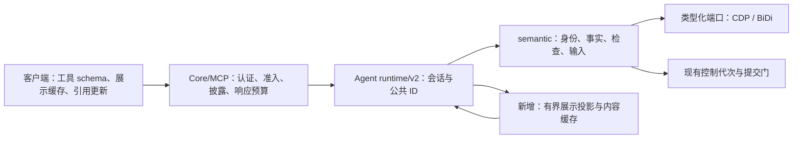

# 浏览器能力后续规划与实现方案

本文面向 Agent、Core、MCP 和客户端的实现者，规定 D4 之后的开发顺序、职责和接口草案。现行行为仍以[capability v2 契约](browser-capability-v2-zhCN.md)、[共同页面语义](browser-semantic-dom-v1-zhCN.md)和[后端规约](browser-backend-contract-zhCN.md)为准。新增字段、工具和预算均是待实施方案；代码、契约测试和真实客户端验收完成前，不得出现在已支持能力声明中。

实施和放行方式见[后续能力验收指南](browser-evolution-acceptance-zhCN.md)。测试次数、耗时和 RSS 的单次结果保存在带产物摘要的验收记录中，不作为本文的长期支持承诺。

## 1. 当前基础与规划顺序

当前 v1 使用兼容页面算法；显式选择的 v2 通过同一个 `semantic_dom_v1` 协调器驱动 CDP 和 BiDi。Linux x86_64 候选已经具备真实 Server/MCP、命名资料、文件、人工交接和回退路径。受限性能、RSS 与本地全链路结果只证明记录中的二进制和环境组合；托管 CI、其他平台/版本和真实 AI 宿主的能力仍须各自验收。

后续扩展继续使用 Rust 单二进制和用户已安装的浏览器，不增加 Node、Puppeteer、独立驱动或自动下载依赖。现有 v1 默认选择、错误文案、资料格式和操作回执保持兼容。

| 阶段 | 交付范围 | 启动依赖与退出条件 |
| --- | --- | --- |
| D4 发布收尾 | 补齐 CDP 事件预算与即时停止路径，固定候选产物、首发矩阵、真实客户端、托管 CI 和回退记录 | 先完成下文 D4-R1，再按原门槛验证要声明的组合；未运行项保留 `not_run`。开发计划不触发部署 |
| D5 只读可操作性诊断 | 公共诊断模型、`browser_inspect` 草案、双后端与 MCP 接入 | 先冻结 schema/预算；证明检查没有输入、滚动、授权消耗或回执变更；旧行为回归通过 |
| D6 按能力提供指引 | `browser_guidance` 草案、版本化示例及契约校验 | 复用 D5 的扩展发现规则；旧设备得到现有能力的正确指引，示例能在匹配的真实组合执行 |
| D7 可选增量观察 | 有界内容缓存、差分格式、引用更新表、可验证的客户端重建 | 先完成内容与引用分离；接收端能确定性重建；正确性、输出收益和原性能/RSS门槛全部通过 |
| D8 可选检查扩展 | 原生 AX、控制台/网络诊断、trace 的独立设计与原型 | 每项先交付权限、原生所有权、事件/字节预算和后端差异证据，再决定是否实施与公开 |

D5–D7 可以在固定的 D4 候选之后建立独立开发分支；D4 尚未放行时，不把这些变化混入正在验收的候选。跨平台扩展另按 OS/CPU/浏览器组合推进：先证明进程、资料、端点隔离和输入语义，再接入 v2。交叉编译成功不能替代原生运行，Linux 的 namespace 方案不能直接视作 macOS 或 Windows 的隔离方案。

## 2. 保持现有状态所有者

新增能力沿既有调用链进入。Core 处理认证、准入、计量、披露和 MCP 封装；Agent 处理会话、文档身份、引用、页面事实及原生资源。客户端只保留明确收到的展示结果和版本，不取得额外的动作权限。



图中的展示缓存只保存已脱敏的序列化内容，不持有原生节点、脚本对象、文件流或输入许可。Core 不建立第二套页面身份表，也不从服务端缓存重建 Agent 已拒绝披露的内容。

| 责任 | 现有源码落点 | 后续改动 |
| --- | --- | --- |
| 能力候选及三字段选择 | `src/browser/selection.rs` | 增加独立的扩展声明；保持 `Selection` 的三个字段和严格拒绝规则 |
| 会话实际能力、公共 ref/frame 映射、最终控制检查 | `src/browser/runtime/v2.rs`、`runtime/v2/` | 接入只读检查、展示投影和缓存失效；复用现有会话锁及控制门 |
| 共同事实与动作前检查 | `src/browser/semantic/page.rs`、`types.rs`、`program.rs` | 提取可复用的纯判定，增加只读采集路径；动作仍在提交前重新校验 |
| 原生协议差异 | `src/browser/engine/cdp/semantic.rs`、`engine/bidi/page.rs` | 补齐类型化事实，不在公共层按协议名称分派 |
| Agent 操作发现及调度 | `src/browser/mod.rs`、`src/rpc.rs` | 登记新增只读操作，使用普通浏览器工作配额；不占用人工控制专用通路 |
| MCP schema、准入、输出及指引 | Server 的 `contracts/mcp/v1/`、`apps/core/src/mcp_tools.rs`、`mcp.rs`、`browser.rs` | 校验扩展能力、封闭参数、受限输出和版本化示例；复用 Auth/Runtime 权限与计量 |

目录调整服从实现需要。无需先建立通用插件总线、跨后端脚本执行接口、独立缓存服务或工作流框架。

### D4-R1：补齐 CDP 事件接纳边界

当前 [CDP wire](../src/browser/engine/cdp/wire.rs) 使用 256 条 `broadcast<Value>`，入站消息上限为 2 MiB；[消费端](../src/browser/engine/cdp/session.rs)在发现 Lagged/关闭后停止连接。发送端忽略广播发送结果，没有独立的聚合事件字节账本，也没有把关键事件丢失判定与新命令准入放在同一临界区。[BiDi wire](../src/browser/engine/bidi/wire.rs)已有 256 条、1 MiB 聚合、64 KiB 单事件限制，并在关键事件入队失败时同步停止。两者的原始上限不同，不能直接把 BiDi 结果记作 CDP 的 BC-27/36 证据。

先清点 v1/v2 的事件消费者和启动订阅顺序，再实现持有到最后消费者释放的条数/字节许可。保留 CDP 现有 2 MiB 入站上限和 256 条限制，聚合已编码事件字节的初始设计预算为 8 MiB；在编码前以现有导航、弹窗、附件和大响应头语料确认适用范围并固定预算。队列和消费者持有阶段都计入占用，避免每个消费者无约束地克隆 `Value`，另测解码结构和实际内存峰值。

关键消费者应在启用对应事件或开放导航之前就绪。容量超限、关键消费者缺失或序列缺口必须在读取/入队侧关闭普通准入，再由既有路径处理在途 unknown 和原生清理；不能等到一个被阻塞的消费者再次 recv 才禁止后续输入。未使用的事件仍按封闭分类处理，意外原生对象的拒绝与租约回收不因过滤而跳过。

此项单独提交和验收，覆盖消费者停止读取、条数/字节恰好上限及超一项、多个消费者、消费者退出、迟到响应和关闭。原来的功能通过数不证明该边界已满足；完成后重验 v1、双后端公开链路、事件压力、fence 与受影响性能。D5–D8 不先增加新的事件订阅。

## 3. 扩展发现与兼容规则

`capabilities.browser.version` 继续为 `1`，v2 的 `selection` 继续仅包含 `version`、`observation_profile`、`backend`。扩展通过独立字段声明，不向 `selection` 添加诊断、缓存或自动回退开关。

建议在候选后端和打开后的会话 `capabilities` 中分别增加 `extensions`。下列为结构草案，当前实现不提供这些字段：

```json
{
  "extensions": {
    "actionability": {"version": 1, "available": true},
    "observation_delta": {"version": 1, "available": false, "reason": "disabled_by_local_policy"}
  }
}
```

Core 判断自身工具 schema 与在线 Agent 候选是否支持请求；Agent 再根据会话固定的后端、profile、扩展版本和本地策略验证。打开结果仅声明本次已启用的扩展，候选可用不能替代握手。新的内容读取仍在完成后检查披露权限和控制代次。

兼容处理固定如下：

- 不带新增参数的请求保持原结果格式；v1 不接受新增的 v2 展示参数。
- 缺扩展、未知扩展版本或不匹配的 profile 在采集页面、创建资源和输入之前拒绝，沿用适用的 `browser_feature_unsupported` 或参数错误；不猜测替代后端。
- 新客户端先读 MCP 工具 schema，再读设备与会话能力。旧 Core 不认识新工具或参数时，客户端继续使用原来的完整观察；不得把未发送的新请求改成一次隐式动作重试。
- `not_sent`、`unknown`、原错误码和错误文案继续按现有执行进展生成。新诊断正文不写入变更操作回执，不扩展数据库摘要白名单。
- 新只读操作复用现有设备权限、普通准入和计量，不因命名为“诊断”而加入免配额的后续操作列表。若需要改变计费分类，必须单独设计和验收。

## 4. D5：先提供只读检查

### 4.1 接口与结果

现有 `Failure` 只有错误码和执行状态，Core 再映射固定文案。首版采用独立的 `browser_inspect`，不让诊断正文穿过所有错误和回执路径。工具检查一个现有 ref 对指定动作种类的当前前置条件，不接收脚本、选择器、坐标、文件路径或实际输入文本。

以下为拟议请求，不能发送给当前版本：

```json
{
  "device_id": "test",
  "session_id": "session-from-open",
  "control_epoch": 1,
  "ref": "ref-from-latest-observation",
  "action_kind": "click"
}
```

结果包含 `diagnostic_version`、当前会话/控制代次、`status`、有界 `reasons` 和 `content_trust`。首版 `action_kind` 限定为现有的 click、press、fill、check、select、attach_file；对输入值、按键参数和上传授权的检查仍在真实动作执行时完成。

首版只检查当前仍有效的动作 ref，不为所有观察行另建诊断引用表。现有 `Facts::eligible` 不给禁用或隐藏目标签发 ref；这类状态由完整观察中的已有事实说明。目标在观察后变为禁用、隐藏或记录已变化时，检查继续返回既有 stale 错误，不能为了给出详细原因而放宽指纹校验。没有 ref 的节点不能通过名称、索引或选择器送入此工具。

| status | 含义 |
| --- | --- |
| `ready_now` | 采样时满足所检查的前置条件；不保证稍后的输入可执行或业务成功 |
| `needs_scroll` | 目标在当前视口外；真实动作可能按现有流程滚动，诊断本身不滚动 |
| `blocked` | 有效引用下已确定只读、遮挡、敏感输入限制或动作类型不适用 |
| `indeterminate` | 无法在期限或现有几何保证内完成判断；不能当作可操作 |

原因采用封闭枚举，例如 `read_only`、`covered`、`outside_viewport`、`unstable_geometry`、`unsupported_geometry`、`sensitive_target`、`unsupported_action`。首版只返回原因与类型化布尔事实，不返回遮挡元素的页面文本、DOM 路径或原生 ID。过期引用、文档变化、错误主体和控制权变化仍走现有错误路径，不能借诊断重新匹配目标。

### 4.2 公共实现与副作用边界

把 `semantic/page.rs` 中可操作性判定提取成接受 `Facts`、`Geometry` 和动作种类的纯函数。动作与诊断复用判定规则，但保留各自采集流程：动作可以在授权后滚动并再次检查；诊断只执行身份刷新、固定 Inspect、只读几何/命中检查和必要的二次稳定性采样。

诊断不得调用 `perform` 的完整流程，不执行 Scroll、Focus、输入、表单设置或上传授权消耗。检查不续期 ref/cursor，不签发新 ref，不把 `ready_now` 保存成下一动作的授权令牌。每个真实动作继续独立检查文档、记录、控制代次及提交门。

检查任务受绝对 deadline、既有原生命令与对象预算约束。取消、超时和迟到响应沿现有租约结算；人工接管能立即关闭旧代次准入，不等待诊断持有普通锁。仅靠错误字符串分类不满足此阶段要求。

## 5. D6：按实际能力提供使用指引

保留初始化阶段的简短通用说明。设备相关示例通过拟议的 `browser_guidance` 读取，参数仅包含 `device_id`、可选 `session_id` 和一个封闭的 `topic`，例如 `open`、`observe`、`recover`、`handoff`、`files`。一次返回一个主题。

Core 从已认证设备连接与本次会话能力选择随 Server 构建发布的静态模板，返回指引版本、模板内容摘要、适用的 schema/扩展版本和前置条件。不依据版本号字符串推测能力，不把一个设备的指引放进所有设备共用的初始化说明，不从网页或外部 URL 动态加载操作指令。

示例须经过工具 schema 校验，并在对应 v1、v2/CDP、v2/BiDi 组合实际执行。恢复示例先查询原操作/会话，不自动重放；人工交接示例包含明确披露和重新观察；文件示例使用现有人工授权，不包含设备路径。旧设备得到可执行的 v1 示例，未知扩展不能出现在示例中。

指引读取不采集页面正文、不创建浏览器会话、不改变默认后端。若 Agent 重连、会话关闭或能力改变，先前的指引只作为说明，下一请求仍按当前能力独立校验。

## 6. D7：内容差分与动作引用分离

### 6.1 为什么不能直接比较现有 JSON

当前 `runtime/v2.rs::observe` 每次都会清空并重建公开 `ref`、`frame_id` 和游标映射。页面内容相同，新的结果也会包含不同的不透明标识。直接缓存整个结果会产生大量无意义差分；为了得到 `unchanged` 而保留旧 ref，又会改变已冻结的引用寿命。

首版增量观察作为 `browser_observe` 的显式展示方式。省略 `presentation` 时，参数和结果完全沿用当前格式。拟议参数为：

```json
{
  "presentation": {
    "version": 1,
    "mode": "delta",
    "base_revision": "opaque-revision-from-last-received-result"
  }
}
```

首次请求可以省略 `base_revision`，得到该展示方式的 `full` 结果。`presentation` 与 `cursor` 不能同时提供；需要续页时沿用普通完整观察。此参数需要 Core 工具 schema、Agent 扩展和接收端重建能力同时就绪。

### 6.2 投影格式与引用更新

每次调用仍执行真实观察、身份校验和现有引用替换。结果分成三部分：

1. 内容投影：有序节点及完整 canonical 字段、记录材料、页面内容和覆盖信息。移除动作 ref、公开 frame_id、游标及其他每次签发的标识；用展示用 frame 槽关联节点。
2. 当前绑定：本次所有可执行节点的 `node_index → ref`、展示 frame 槽到本次 `frame_id` 的完整映射，以及当前会话、tab 和控制代次。绑定每次全部更新；无 ref 的节点明确为空。
3. 版本封装：`kind: full | delta | unchanged`、不透明 `revision`、需要时的 `base_revision`、本会话单调递增的观察序号、结果节点数和固定的 `content_trust: untrusted_page`。观察序号按最多 20 位十进制字符串传输，溢出明确拒绝，不环绕复用。

`unchanged` 仅表示内容投影相同，仍返回新的完整绑定。展示索引和 frame 槽不能传给 `browser_act` 或当作 `within`；客户端必须使用当前绑定中的新 ID。不得按 role/name、文本或位置重新激活旧 ref。

首版采用有界数组 splice：以共同前缀和后缀确定一段替换区，逐行保留所有 canonical 字段。页面元数据变化完整替换对应小对象。节点插入、删除、排序、文本、checked/value、记录结构及名称质量变化都必须能精确重建。无需实现通用 JSON Patch 解释器或不受限的最短编辑距离算法。

### 6.3 缓存、失效与拒绝

缓存归 Agent 会话所有，键包含认证主体、Agent 实例/会话、后端、profile、tab、完整 frame/document/realm 身份集合、控制代次、查询条件以及节点/字符预算。`within` 使用验证后的内部 Context 作为查询范围，不把每次重新签发的公开 frame_id 当成稳定键。身份使用内部已验证类型，不接受调用者提供的原生 ID。URL 相同不能证明文档相同。

仅当扫描完成、没有续页、没有读取中变化及资源截断时建立基线。profile 固定声明的 closed shadow、canvas 和浏览器 UI 范围限制继续随结果保留；它们不等于支持完整浏览器内容。分页、动态页面或受限观察返回新鲜 `full`，不偷偷继续扫描到完整，也不以删掉 coverage 获得可缓存结果。

新文档、同 URL reload、BFCache、realm/frame 替换、控制权换代、人工接管、关闭、失联、重启、策略改变、查询改变和 TTL 到期均使基线失效。控制门同步使缓存不可访问；有界回收不阻塞人工 fence。展示缓存不延长任何原生租约。

缺基线、版本不匹配、被淘汰或差分无收益时，允许在同一次已授权观察中返回 `full`。权限失败、暂停、失联和身份无法证明时返回原错误，不能以“回退到 full”绕过拒绝。未知 revision 在当前会话内按未命中处理，不查询其他主体缓存，不透露命中关系。

响应丢失不等于客户端接受了 revision。客户端每次携带自己最后成功应用的版本；服务端不假定交付成功。并发调用、乱序响应和过期 epoch 必须由接收端拒绝原子替换，必要时重新请求完整结果。缓存只能在本次最终披露检查成功后成为可用版本，迟到结果不能重新插入已失效代次。

### 6.4 接收端与收益条件

增量输出默认关闭。普通 MCP 客户端继续接收完整观察；先实现一个可验证的接收端 reducer，按 base/revision、会话/控制代次和观察序号校验，检查 splice 范围及结果节点数，再原子替换全部引用和 frame 绑定。模型对历史文本的记忆不能代替这一步。首版不增加跨语言 canonical JSON 散列协议；以同一次采集生成的完整结果作为测试 oracle，逐字段比较重建结果。实际 AI 宿主或受控适配器无法保留并验证基线时，该客户端不启用 delta。

比较收益时计入完整 MCP 响应，包括绑定、元数据和可能同时存在的文本/结构化内容。只比较删掉 ref 后的页面文本会夸大收益。原生观察和身份检查仍执行，因此输出字节减少不代表原生命令或观察时延减少。

## 7. 新增预算草案

以下是新增能力的初始设计预算，须在实现前的契约提交中固定。它们不替换既有消息、引用、命令、句柄、性能及 RSS 门槛；实现同时满足两组限制。未达到收益目标时不公开优化能力，不在看到结果后放宽目标。

| 对象 | 草案预算 | 超限处理 |
| --- | --- | --- |
| 单次诊断 | 一个 ref；最多 8 个原因；Agent 诊断正文 UTF-8 JSON ≤ 4 KiB；总期限不超过调用剩余期限与 1 秒的较小值 | 不循环等待；检查不足返回 indeterminate 或现有期限错误，不输入 |
| 单次指引 | 一个主题；正文 UTF-8 JSON ≤ 16 KiB | 返回受限主题或明确拒绝；不隐式拉取后续内容 |
| 单个内容基线 | 序列化投影 ≤ 256 KiB，节点/字符上限仍为现值 | 不建立基线，返回允许的完整观察；完整输出仍受现有 RPC/MCP 上限约束 |
| 缓存总量 | 每会话最多 2 个 revision；每 Agent 已存投影合计 ≤ 1 MiB；单会话新增构造暂存 ≤ 512 KiB；全 Agent 缓存节点索引 ≤ 4,000 项、frame 索引 ≤ 128 项 | 有界淘汰旧版本，缺失时 full；使用序列化字节和边界索引，不长期保留另一份解码对象树；同时核对实际分配与 RSS |
| 缓存寿命 | 最长 60 秒，且不超过已有 ref/cursor 和会话寿命；不因命中无限续期 | 到期失效；缓存不落盘、不写日志或回执 |
| 差分计算 | 单次 O(N) 前后缀比较，N 受当前 1,000 项上限约束；最多一段节点 splice | 不引入无界任务、递归 patch 或逐节点原生查询 |
| 输出选择 | 含新绑定的 delta/unchanged 完整响应必须 ≤ 同次 full 响应的 70% | 返回 full；完全相同内容也可能因绑定较大而不适合增量 |

## 8. D8 的进入条件

原生 AX 采用独立输出 profile 或能力，不覆盖 `semantic_dom_v1` 的名称、角色和引用资格，首版不从 AX 节点签发动作引用。控制台、网络和 trace 各自定义读取权限、脱敏、保留时长、事件数量、事件字节、完整消息大小及停止流程。

| 分段 | 实现方式草案 | 首版交付边界 |
| --- | --- | --- |
| D8.1 原生 AX 检查 | 在 adapter 增加封闭的只读 AX 端口，公共层输出独立的版本化检查结果；不复用 canonical ref | 仅提供目标浏览器已证明支持的字段，节点数/深度/字节均有界；不能声明两个引擎的原生 AX 完全等价 |
| D8.2 控制台与网络摘要 | 会话内显式开始/停止的诊断订阅；关键生命周期事件和可丢失诊断记录分开限额 | 默认只输出有界级别/计数、来源 origin、状态与时序，不输出请求/响应正文、凭据、URL 查询串或任意对象展开；丢失以 gap/dropped_count 明示 |
| D8.3 性能 trace | 有界采集任务与受限原生流，停止后生成私有诊断制品 | 不把完整 trace 内联给模型；人工交付、保留及显式删除单独定义。现有附件目录只接收受约束 HTTP attachment，新增诊断制品需要独立类型及旧版读取/回退规则 |

这些分段先提交具体 schema、单次/总量/时间预算和原生能力证据，再实现 adapter 和公开入口。诊断队列溢出可以在契约允许时丢记录并报告缺口；关键身份、导航或控制事件丢失仍必须停止，不能用同一“允许丢失”策略处理。网络观察不能改变已有导航拦截/附件流的决定，也不能为了读取正文重发请求。React 等特定应用检查按实际需求另行设计，不纳入基础后端保证。

当前 CDP 不订阅未使用的 Runtime console/exception/inspect 事件，并拒绝意外对象所有权。增加订阅会直接改变这一资源边界：必须证明事件携带的对象如何纳入现有租约上限、如何有界释放，以及容量不足时如何停止。不能直接增加无界事件 tap、丢弃对象或在超时后提前扣减占用。无法在既定预算内完成的订阅保持不可用。

扩展仍只提供经过设计的操作，不开放任意脚本、CDP/BiDi 方法或调试端点。网络正文、Cookie、Authorization、trace 和堆快照的内容范围须独立评审；它们不能因页面可被观察就自动取得披露权限。

## 9. 提交分段与回退

| 提交段 | 可审查交付物 | 主要验收 |
| --- | --- | --- |
| D4-R1 | CDP 事件消费者清单、冻结预算、共享事件占用与源头停止路径 | EX-00、BC-24～29/36、v1 和公开 MCP 回归；不改已提交输入的结算含义 |
| D5.1 | 扩展声明、诊断 DTO/纯判定、schema 和预算 | 契约、Fake、旧错误快照；功能默认关闭 |
| D5.2 | CDP/BiDi 只读采集和 Agent 路由 | 两端同一诊断语料、零副作用、取消与租约 |
| D5.3 | Core/MCP 接入、示例和公开拒绝路径 | 真实 MCP、权限/计量、v1/v2 兼容与人工 fence |
| D6.1 | 指引模板、能力选择、schema 校验 | 新旧设备及重连场景；示例在声明组合执行 |
| D7.1 | 内容投影、绑定分离、缓存与失效；仅内部使用 | 精确重建、身份/控制失效、预算边界；原观察输出不变 |
| D7.2 | opt-in 展示参数、MCP 输出、客户端 reducer | 丢响应、乱序、缓存缺失、完整绑定替换与真实宿主 |
| D7.3 | 固定语料的输出收益及完整回归 | 新增收益门槛与原性能/RSS门槛同时通过，才允许公开声明 |

每段保留独立提交与原始失败记录。D5–D7 的缓存和诊断不改变磁盘资料格式，也不扩展变更回执摘要。关闭扩展后，客户端重新获取能力并恢复普通观察；进行中的已提交动作仍按原回执和清理流程结算，不因关闭扩展而重放。涉及 Core 函数契约的其他变化仍执行现有程序/数据库配套回退，不能把内存缓存回退等同于整套服务回退。

## 10. 调研依据与采用范围

参考 `vercel-labs/agent-browser` 固定提交 `b06e2533ba9b3823b8a96c859d455cb55f4d7893` 的静态源码。此次参考用于确定设计候选，没有引入该项目依赖，也没有用其宣称替代本项目的性能或兼容证据。

| 上游机制 | 本方案采用的部分 | 源码 |
| --- | --- | --- |
| full/delta/unchanged、版本与树内容替换 | 可选输出方式和按完整大小选择 full；RDH 另行定义身份范围及全量新绑定 | [actions.rs](https://github.com/vercel-labs/agent-browser/blob/b06e2533ba9b3823b8a96c859d455cb55f4d7893/cli/src/native/actions.rs#L6700-L6865) |
| 可操作性原因 | 有界类型化诊断；RDH 采用独立只读入口 | [element.rs](https://github.com/vercel-labs/agent-browser/blob/b06e2533ba9b3823b8a96c859d455cb55f4d7893/cli/src/native/element.rs#L1098-L1179) |
| 发现入口与运行时指引分离 | 随构建发布并按实际能力选择示例 | [skills.rs](https://github.com/vercel-labs/agent-browser/blob/b06e2533ba9b3823b8a96c859d455cb55f4d7893/cli/src/skills.rs#L20-L45) |
| 页面内容标界 | 所有新增投影、摘要和差分保留页面内容来源；分隔符不承担授权作用 | [output.rs](https://github.com/vercel-labs/agent-browser/blob/b06e2533ba9b3823b8a96c859d455cb55f4d7893/cli/src/output.rs#L1-L75) |

上游的[过期引用重匹配](https://github.com/vercel-labs/agent-browser/blob/b06e2533ba9b3823b8a96c859d455cb55f4d7893/cli/src/native/element.rs#L443-L477)、[点击后的补发路径](https://github.com/vercel-labs/agent-browser/blob/b06e2533ba9b3823b8a96c859d455cb55f4d7893/cli/src/native/interaction.rs#L630-L735)及[传输事件/等待者处理](https://github.com/vercel-labs/agent-browser/blob/b06e2533ba9b3823b8a96c859d455cb55f4d7893/cli/src/native/cdp/client.rs#L768-L841)不直接采用。本项目继续以文档身份、动作前复核、在途所有权和未知结果不重放为边界。
