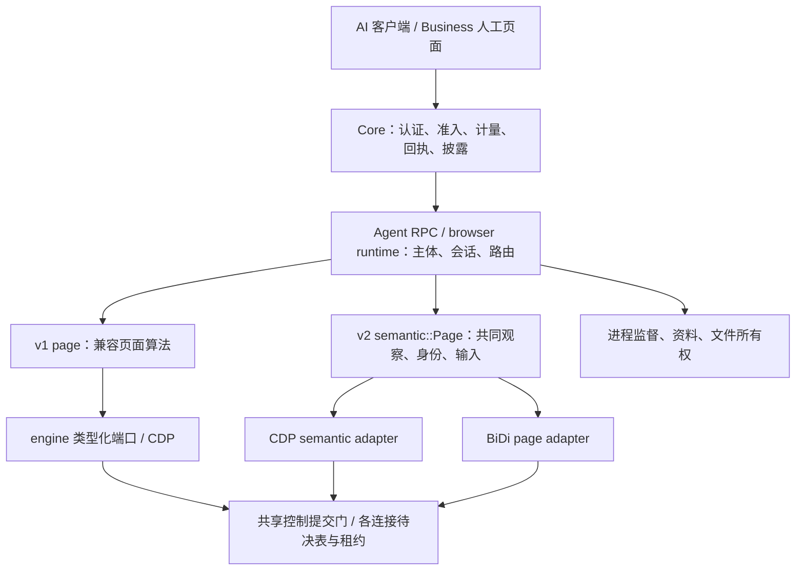

# 浏览器能力实现现状

本文描述当前代码中的浏览器能力、调用关系、数据与资源所有权、公开接口和已知限制。实现事实以本仓库源码及配套 Server 契约为依据；代码具备某条路径，不等于所有平台、浏览器版本和 AI 客户端均已验收或发布。待实现的变化及持续适用的验收要求集中在[设计与验收](browser-design-zhCN.md)。用户操作另见[使用手册](browser-zhCN.md)。

浏览器架构只维护本仓库受 Git 跟踪的 `docs/browser-implementation-zhCN.md` 和 `docs/browser-design-zhCN.md` 两份文档；引用、修改和评审以仓库文件为准，工作区外的临时副本不作为维护入口。每轮行为、接口、默认值、预算或支持条件变化，都在同一实现提交或配套提交中核对并更新这两份文档；未受影响的部分不机械改写。完成的设计从待办中移除，将实际行为写入本文，将持续需要的断言留在验收章节。单次测试结果写入提交说明，原始日志和产物放在忽略目录或外部存储；不新增按日期、阶段、对话或“完成情况”命名的架构、规划和历史记录文档，不设旧文档归档副本。

## 1. 当前能力与启用条件

Agent 使用 Rust 单二进制和设备上已安装的浏览器。运行时不要求 Node、Puppeteer、ChromeDriver、GeckoDriver、浏览器扩展或独立代理，也不自动下载浏览器。测试和构建工具不属于用户运行时依赖。

| 路径 | 当前代码行为 | 启用与范围 |
| --- | --- | --- |
| v1 | `runtime.rs` / `page.rs` 保留既有 Chromium/CDP 页面算法和公开格式 | 浏览器能力默认关闭；开启后，无 `selection` 的请求使用此路径。平台条件由现有进程与私有存储实现检查 |
| v2/CDP | `semantic::Page<P>` 驱动 CDP adapter，提供 `semantic_dom_v1` | 编译 `experimental-browser-bidi`，Linux x86_64，本地开启 `browser.enabled` 与 `browser.capability_v2`，请求显式选择 |
| v2/BiDi | 同一共同页面算法驱动 Firefox/BiDi；Linux namespace 内启动和连接 | 与 v2/CDP 相同的编译/策略门槛，另需配置 Firefox 绝对路径及可用的 namespace/pidfd 能力 |
| 命名资料、上传、下载 | v1 与两个 v2 后端均有实现，各自按策略声明 | `persistent_profiles`、`uploads`、`downloads` 默认分别关闭；实际可用性随设备和会话返回 |
| 只读可操作性诊断 | `browser_inspect` 检查一个当前 ref 的动作前置条件 | 仅显式 v2 / `semantic_dom_v1`，要求候选与打开结果均声明 `actionability` 扩展版本 1 |
| 能力指引 | Core `browser_guidance` 返回当前设备或会话适用的一个主题 | 根据明确能力选择静态模板；只读取会话元数据，按普通请求计量 |
| 独立文件批准 | 用户在独立页面批准一次文件选择，AI 保留浏览器控制 | v1 与两个 v2 后端；要求 `uploads` 策略及 `file_authorization` 扩展版本 1，原租约上传继续可用 |
| 可选增量观察 | 完整观察后将内容与当前引用绑定分开，受控 reducer 重建普通结果 | 仅 v2，显式 `presentation` 与每次 MCP 调用的 reducer 元数据；默认完整观察 |
| DOM 与布局证据 | `browser_evidence` 查找非交互节点并读取事实和局部布局，不改变动作 ref 或增量基线 | 仅显式 v2 / `semantic_dom_v1`，要求候选和实际会话声明 `dom_evidence` 扩展版本 1 |
| 独立原生 AX/DevTools 扩展 | 尚未实现为公开能力 | 不出现在当前支持声明中；接口草案仅见设计与验收 |

v2 的编译、策略及后端门槛见[选择解析与能力声明](../src/browser/selection.rs)和[会话实际能力](../src/browser/runtime/v2.rs)。`candidate` 仅表示允许尝试；成功打开并返回 `session_ready` 才表示本次启动、文档身份和截图检查完成。最低浏览器版本、Firefox ESR、其他 Chromium 品牌及其他 OS/CPU 的支持需要独立证据，不能由协议名称或交叉构建推导。

## 2. 调用关系与源码职责



| 源码 | 当前职责 |
| --- | --- |
| [browser/mod.rs](../src/browser/mod.rs)、[rpc.rs](../src/rpc.rs) | 配置、操作目录及 RPC 调度；主体由认证链路提供，不由模型参数指定 |
| [runtime.rs](../src/browser/runtime.rs)、[runtime/v2.rs](../src/browser/runtime/v2.rs) | 会话与公开 ID、v1/v2 路由、最终控制/披露检查；v2 会话选择固定 |
| [control.rs](../src/browser/control.rs) | `Control` 与 `Submission`：控制代次、最后授权检查、同步入队及单调副作用标记 |
| [page.rs](../src/browser/page.rs)、[engine.rs](../src/browser/engine.rs) | v1 算法及 `PageReadPort`、`PageActionPort`、`SessionPort`、`TransferPort`；`Engine` 仍封装 CDP adapter |
| [semantic.rs](../src/browser/semantic.rs)、[semantic/page.rs](../src/browser/semantic/page.rs) | `Port` 与 `Page<P>`：v2 共同事实、记录、引用、动作及输入任务；不按后端改变 canonical 规则 |
| [semantic/actionability.rs](../src/browser/semantic/actionability.rs) | 动作和只读诊断共用的类型与几何判定；诊断输出不含页面值、文本或原生身份 |
| [semantic/program.rs](../src/browser/semantic/program.rs)、[program.js](../src/browser/semantic/program.js)、[types.rs](../src/browser/semantic/types.rs) | 随二进制交付的固定程序、严格解码、身份和记录材料；不接受调用者脚本 |
| [semantic/evidence.rs](../src/browser/semantic/evidence.rs)、[evidence.js](../src/browser/semantic/evidence.js)、[runtime/v2/evidence.rs](../src/browser/runtime/v2/evidence.rs) | 有界 DOM/布局采集、独立弱引用和会话诊断 ID；不修改 canonical 观察材料 |
| [engine/cdp](../src/browser/engine/cdp)、[engine/bidi](../src/browser/engine/bidi) | 封闭命令、原生 ID、事件、realm、输入和连接待决表；协议差异留在 adapter |
| [process.rs](../src/browser/process.rs)、[process](../src/browser/process)、[profiles.rs](../src/browser/profiles.rs) | 进程树与启动身份、独占资料租约、恢复和关闭；通道断开不作为进程退出证明 |
| [files.rs](../src/browser/files.rs)、[files](../src/browser/files) | 人工上传授权、私有暂存、配额、原始附件响应及交付 |

Server 对应源码为 `apps/core/src/browser.rs`、`browser/guidance.rs`、`browser/evidence.rs`、`mcp_tools.rs`、`mcp.rs`，MCP schema 和错误目录位于 `contracts/mcp/v1/`。Core 处理认证、准入、计量、封装及披露，Agent 持有页面身份与原生资源。Runtime Rust 与 PostgreSQL 结算函数共同约束恢复摘要。Server 的协议/维护文档只提供入口，不复制这两份浏览器文档。

## 3. 能力发现、选择与公开会话

本地策略配置示例；将两个可执行文件路径替换为设备上的实际安装位置。此开关不安装浏览器，也不更改宿主的隔离策略。Firefox 需要允许其 helper 使用所需的非特权 user、mount、PID 和 network namespace。

```json
{
  "version": 1,
  "browser": {
    "enabled": true,
    "capability_v2": true,
    "executable": "/opt/google/chrome/chrome",
    "firefox_executable": "/opt/firefox/firefox"
  }
}
```

`device_info.capabilities.browser.version` 为 `1`。`capabilities.browser.v2` 是独立声明，包含 `version: 2`、`available`、`reason`、`observation_profiles` 和 `backends`。每个后端条目包含 `id`、`browser_family`、`available`、`reason` 和 `stage: "candidate"`。候选可用表示配置、平台、文件与策略允许尝试；不表示已经完成协议握手。

`browser_open` 接受可选对象 `selection`：

```json
{
  "device_id": "test",
  "selection": {
    "version": 2,
    "observation_profile": "semantic_dom_v1",
    "backend": "bidi"
  },
  "url": "https://example.com/"
}
```

`selection` 必须且只能包含这三个字段；后端只能是 `cdp` 或 `bidi`。CDP 使用 `browser.executable`，BiDi 使用绝对路径配置 `browser.firefox_executable`。未提供 `selection` 的请求按 v1 执行；`null`、不完整选择、未知字段、未知版本/profile/后端均拒绝。没有自动选择或失败后换用其他后端。

Server 先验证选择结构，再检查设备的 v2 声明和目标后端，满足后才分配或执行变更操作。旧 Agent 缺少 v2 时返回 `browser_capability_unsupported`。Agent 独立重复验证。未知选择返回 `browser_selection_invalid`，后端候选不可用返回 `browser_backend_unavailable`。严格策略在能力声明中以 `reason: browser_policy_unsupported` 标为不可用，公开打开因此被拒绝；内部共同语义入口也保留策略校验。这些公开拒绝发生在进程、临时资料和页面副作用之前。

`capabilities.browser.v2.backends[].extensions.actionability`、`extensions.observation_delta` 和 `extensions.dom_evidence` 分别声明 `version: 1`、布尔值 `available` 和可空 `reason`；可用性沿用对应后端的构建、平台、本地策略和浏览器检查。成功打开后的 `capabilities.extensions` 声明本次实际启用的对应扩展。扩展不增加 `selection` 字段，也不新增本地开关。

打开成功返回原有 `session_id`、`tab_id`、`control_epoch`、`state`，并增加实际 `selection`、`capabilities` 和 `stage: "session_ready"`。`browser_sessions` 的 v2 条目也包含与打开结果相同的 `capabilities`；v1 条目的格式保持原样。选择在会话内固定；后续会话请求通过会话 ID 路由，不再接受选择参数；资料列举和删除单独接受 `selection`。核心能力在运行中丢失时暂停或关闭，不降级成 v1，也不更换后端。

v2 复用 `browser_sessions`、`browser_tabs`、`browser_observe`、`browser_act`、`browser_wait`、`browser_screenshot` 和 `browser_control`，继续使用经过认证的 `browser_principal`、操作回执和控制 epoch。人工接口继续由 Server 绑定用户主体，并用 view、lease、epoch、sequence 和截图 frame 约束输入。人工输入内容不进入操作回执。

观察结果中的 `observation_profile` 为 `semantic_dom_v1`。`nodes` 包含 canonical `role`、`name`、`name_source`、`name_quality`、可选 `value` 和可选 `ref`，并保留控件的 `kind`、`tag`、`input_type`、敏感标记和有界 `record` 材料；记录条目不包含内部节点编号。`coverage` 明确遍历完成状态、变化和遗漏原因。`ref`、`next_cursor`、tab/frame 标识都是 Agent 分配的不透明标识，不接受原生协议 ID、脚本、选择器或坐标作为 AI 引用。输入回执的 `input_acknowledged` 只代表协议确认，`business_result_verified` 保持 `false`。

`fill` 使用原生文本编辑；原生日期、时间、颜色及范围控件使用 `select` 的固定表单设值路径。`scroll` 只滚动主文档，人工视口滚轮则按命中位置路由。

会话核心能力包括生命周期、文档身份、共同观察与输入、截图、JavaScript 弹窗、人工交接、导航策略和保守恢复。公开会话限制、支持动作和可选功能随打开结果返回。命名资料、上传和下载分别遵循 `browser.persistent_profiles`、`browser.uploads`、`browser.downloads` 三个本地开关，默认均关闭；`device_info` 和打开结果声明这些可选能力。命名资料被本地策略关闭时返回 `browser_profile_disabled`。原生 AX、匹配 CSS 规则、console/网络记录和 trace 扩展仍不可用。关闭及崩溃恢复必须证明所属进程已结束，才能释放命名资料租约。

v1 与 v2 共用每设备 2 个会话的上限，每个 v2 会话最多 8 个标签页和 32 个 frame。截图为有界 viewport JPEG。人工视图租约为 120 秒；刷新截图或完成输入可续期，过期视图不能继续输入，返回 AI 必须显式确认披露页面。敏感输入只经已认证的人工接口传输，观察和回执不返回密码值。

人工文本输入核对所选标签页内的 DOM 焦点及逐层 frame 所有者，不依赖 headless 浏览器的窗口级 `document.hasFocus()`。BiDi 的截图坐标先按原生 frame 所有者和内容区几何换算，再在对应 context 发送原生输入；跨 frame 只接受可证明的正向、轴对齐映射，旋转和透视等几何在输入前拒绝。

弹窗可能使触发它的原生输入返回 `unknown`，会话随之暂停，原生命令仍由通道持有。客户端从 `browser_tabs` 获取当前 epoch 和 `dialog_id`，明确处理弹窗，再在待决输入结算后恢复并重新观察；不能重放触发弹窗的点击。输入执行前拒绝与已提交但结果不明分别保持 `not_sent` 和 `unknown`。

回执仅保存已有的有界会话标识及严格的三字段 `selection`。Agent、Server Rust 和 PostgreSQL 结算函数执行同一白名单；URL、标题、页面内容、输入文本和未知选择字段不进入恢复摘要。Server 的数据库函数契约须与服务二进制一起更新，启动时的契约哈希检查会拒绝不一致的组合。

### 3.1 按能力提供操作指引

`browser_guidance` 是 Core 工具，输入为必填 `device_id`、必填 `topic` 和可选 `session_id`。主题只接受 `open`、`observe`、`recover`、`handoff`、`files`；未知字段拒绝，不接受外部模板、脚本、路径或版本选择参数。工具沿用设备权限、浏览器功能开关、普通准入与计量，不创建变更回执。

Core 绑定已认证的连接 ID 和 Agent 实例，向该连接发送带原认证主体的 `browser_sessions`，只读取元数据。计量、指纹和调用记录的操作名仍是 `browser_guidance`。构造结果前核对连接；完成记录和授权检查后，再核对连接仍有效，避免数据库等待期间断开的连接继续披露旧指引。Core 不请求页面观察、会话创建、文件操作或原生输入。Agent 仍执行 `browser_sessions` 原有的存储准备与过期回收；指引不建立跨请求缓存。

设备级结果最多包含 v1、v2/CDP、v2/BiDi 三个明确可用的候选。提供 `session_id` 时，列表必须有唯一的本主体会话；v2 模板取连接声明与该会话实际能力的交集。旧 v1 保持可用；旧 v2 列表缺少实际能力或选择未知时返回 `browser_feature_unsupported`。缺失或未知 actionability 版本时不出现 `browser_inspect` 示例，不按 Agent 版本字符串猜测功能。

结果固定为 `guidance_version: 1`、`schema_version: "mcp/v1"` 和 `content_trust: "server_template"`。`context` 仅包含设备/实例 ID、范围，以及请求会话时的会话 ID、封闭状态、控制者和代次。`variants` 给出选择、已知扩展和文件/人工控制条件，以及版本化 `template_id`、固定模板和模板 UTF-8 JSON 的 SHA-256。名称、URL、页面正文和任意 Agent 字符串不进入模板。

每个模板最多包含三个示例，每个示例包含工具名、通过当前 schema 的参数占位值、字段来源 `bindings` 和执行前提 `when`。调用者须用当前认证结果替换占位值；指引不冻结能力，也不授权后续动作。返回的候选不能证明会话一定打开成功，诊断不能证明页面业务操作成功。

| 主题 | 示例及执行前提 |
| --- | --- |
| `open` | 明确选择 v1 或已声明可用的 v2 后端；丢失打开响应时先恢复原操作，不重复创建 |
| `observe` | 从当前会话取得 tab 与代次，再观察；诊断示例还要求实际 actionability 扩展版本 1 |
| `recover` | 查询原 `operation_id`、会话及 tab；普通暂停在连接可用、输入与必要清理已结算且没有人工控制/披露阻塞时，用当前 epoch 恢复，再按 observe 模板取得新 tab/epoch 和观察；pending/running/unknown 不授权重放 |
| `handoff` | 仅敏感信息输入或必须由本人完成的验证需要人工接管；暂停后提供认证 `human_url`，用户明确交回并允许披露，再取新代次并重新观察 |
| `files` | 只给启用能力的示例；独立批准扩展及人工接口明确可用时，引导用户通过 `files_url` 选择会话批准文件，AI 不暂停或接管浏览器；上传示例使用当前会话/tab/origin 的一次性授权 |

`recover` 的能力准入要求 `browser_sessions`、`browser_tabs`、`browser_control` 和 `browser_observe`，不依赖人工接管能力；原操作回执仍使用 `get_operation_status`，状态字段为 `execution_state`。模板把普通页面、脚本、网络和性能故障交给 AI 取证和恢复，能力不足、连接不可用或检查被拒绝时明确说明缺失证据及待决工作，不自动转为人工排障。`succeeded` 只代表 Agent 结果，业务成功须另外核对。指引不自动执行这些步骤，Agent 继续独立检查恢复条件；人工接口没有用途参数，当前用途限制由模板前提表达。

包含 `support_id` 和适用时 `human_url` 的 Core 结果正文最多 16 KiB，完整 MCP 封装继续受原有上限约束。实例变化、关闭或能力变化后，旧指引只能作为说明；下一次工具调用重新校验当前状态。旧 Core 未提供该工具时，客户端继续按已有 schema 使用原工具。

## 4. 提交、控制权与错误进展

`Submission::enqueue` 在与控制换代相同的临界区内核对 epoch、同步尝试入队并标记副作用。提交点是经授权的子命令进入可发送队列，不表示浏览器已经执行；入队失败不产生已提交标记。临界区不等待 I/O、响应或队列容量。

各连接待决表持有命令容量、输入交接屏障及原始回执；调用者超时或取消不提前释放这些占用。多子命令动作一旦提交过副作用，后续错误不将它改回 `not_sent`。`Failure` 只含错误码及执行状态，Core 继续映射原有固定文案；结构化可操作性诊断通过独立的 `browser_inspect` 成功结果返回，不穿过错误和变更回执路径。

暂停先换代并阻止旧代次的新提交；已提交工作继续结算。读取也占用传输容量，但不全部计入输入交接屏障。人工或 AI 恢复输入前检查相关输入与必要清理是否完成；断线后 pending 归零不表示可继续输入。命令共享上层绝对 deadline，资源清理有独立上限。恢复查询原回执与会话，不自动重放不明结果。

页面读取、截图和文件交付仍在结果返回前核对控制及披露权限。`input_acknowledged` 只证明协议确认，`business_result_verified` 为 `false`。最后一次目标检查与网页收到输入之间存在非原子窗口；实现不提供网页事务或业务成功保证。

## 5. semantic_dom_v1 的实际语义

### 5.1 观察范围与名称

范围为各已枚举文档的 DOM 与 open shadow tree。遍历不跨文档猜测关联；每个 frame 单独采集。closed shadow 的内容、canvas 像素和浏览器 UI 不在范围内，coverage 固定列出这些限制，不能声称知道未开放内容的数量。最多 32 个 frame；超过上限拒绝，不返回伪完整结果。

候选包括原生控件、受支持的显式 ARIA 控件、标题和文本。显式控件 role 支持 button、link、textbox、searchbox、combobox、checkbox、radio、spinbutton、slider、switch、menuitem、tab、option；heading 为只读记录。原生映射包括 button、有效 href 的 a、input 的非隐藏类型、textarea、select、summary、img、h1–h6 与 contenteditable。其他 tabindex、onclick 或 pointer 元素可标为 inferred，只允许 click/press。generic、none、presentation、caption、code、deletion、emphasis、insertion、paragraph、strong、subscript、superscript 禁止命名，也不因此取得输入资格。未知 role 保留限制，不伪造原生质量。

命名依次采用有效 aria-labelledby 的文本、非空 aria-label、适用控件的关联 label、img/input-image 的 alt、允许内容命名的角色或控件文本、title。input-button/submit/reset 使用显式 value；没有显式 value 的本地化默认文本不推测。textbox 等不采用自身文本作为名称。多 label 按文档顺序；多引用按声明顺序。仅折叠 ASCII 空白 U+0009/U+000A/U+000C/U+000D/U+0020；保留大小写、NBSP 和其他 Unicode。

关联只能在当前 tree root 内解析。隐藏的显式引用可以提供文本。缺失 ID、重复 ID、循环引用、空关联、跨 shadow 关联以及预算不足均给出明确质量限制；有效的部分名称可显示，但不获得可执行引用。最多处理 32 个关联、递归 16 层、256 个命名节点，名称最多 512 个 Unicode 标量。名称规则是有界产品语义，不宣称完整 AccName 或原生 AX 树兼容。

固定语料在[共同语义 oracle](../tests/fixtures/semantic-dom-v1/oracle.json)，两个 adapter 使用同一公共字段断言。当前 v2 的 canonical 名称由共同程序计算，不使用原生 AX 结果覆盖。

### 5.2 记录、分页和引用

记录边界为最近的 `data-rdh-record`、tr、li、article 或 role=row/listitem 容器；无此祖先时为控件自身。材料包括该范围内受支持的文本、结构、控件类型、命名依据、目标 URL、表单状态和选项。密码及敏感输入值不进入材料、观察或日志。公共 Rust 层校验材料并散列；不接受后端提供的任意 signature 字符串。

每条记录最多 256 个节点、4,096 个 Unicode 标量，预算不足时返回限制且不签发可执行 ref。邻接记录变化不使未变化记录的 ref 失效；同一记录变化、控件替换、脱离文档或类型变化会使动作拒绝。身份来自已保留节点，不按名称、选择器或位置重新匹配旧引用。

每页最多 1,000 项、64,000 字符；默认 200/20,000。每段扫描最多访问 5,000 个节点，find/interactive/viewport 不通过无限重启取得完整。查询与 frame 范围在首次扫描固定。续页替换上一页引用；新观察、控制权换代、300 秒空闲过期或扫描释放使旧 cursor/ref 失效。变更中读取返回 changed_during_read，发生语义变化的记录不取得 ref；未扫描部分不标 complete。

会话、上下文、文档与 realm 身份分开。新文档、同 URL reload、BFCache 恢复及无法证明连续性时换文档代次；hash/history 更新地址而不据 URL 猜测新文档。realm 重建释放扫描与脚本资源，旧 AI ref 不复活。节点仅在仍能证明同一文档与原生节点时重新解析。动作和诊断前再次查询身份与材料，不仅依赖事件缓存。公开 ref 映射同时绑定签发它的 tab；向另一 tab 提交同一 ref 返回 `browser_stale_reference`，不能把引用转移到该 tab。

### 5.3 输入与控制

公共动作依次校验 ref、文档、记录、参数、敏感性、可操作性，必要时滚动，再检查并提交输入。坐标使用 CSS 像素，跨 frame 路由与映射由 adapter 负责。已观察到的遮挡、错误目标、禁用、只读或嵌套真实控件拒绝输入。最后检查与事件派发之间的网页变化不具有原子保证，单独验证和报告。

普通 fill 使用原生编辑/按键路径，并检查最终 Unicode 值；没有 DOM value 赋值、剪贴板或桌面输入替代路径。两个浏览器的按键事件数量和 inputType 可以不同。选择、日期、颜色、范围使用独立的固定表单程序，报告合成 input/change；已满足状态返回 changed=false 且不产生新输入。inferred 仅接受 click/press；敏感字段拒绝 AI fill。

contenteditable 的编辑值采用显示文本并将 CRLF 规范为 LF；没有子节点或仅有一个 BR 占位节点的空编辑区表示空字符串。焦点操作可把选择区折叠到已保留编辑节点内部，随后仍由原生按键或编辑命令替换内容；不以设置 DOM 内容模拟编辑。

每个副作用子命令复用公共提交门与绝对 deadline。输入任务由会话拥有，调用 future 被取消不取消原生工作或其清理。输入租约仅释放本次可能按下的键与指针；清理不确定时暂停，不能向下一操作者发放输入许可。旧代次不能继续下一输入子命令；已提交但结果不明的动作保留 unknown，不因后续错误降为 not_sent，也不重放。人工交接要求所有输入与清理结算，交回后重新观察和确认披露。

### 5.4 导航与能力

复用 `browser/sites.rs` 的站点与解析规则。CDP 在新目标恢复前安装拦截，BiDi 在开放导航前安装全局拦截；目标初始化和请求决定分别由有界任务处理，避免初始化等待自身首请求。决定是绑定连接、上下文、请求和 hop 的一次性 token；期限 2 秒，无法归属或超时拒绝。最多 32 个并发决定、4,096 个去重项，超限或决定无法完成时停止所属通道。传输事件缺口处理的后端差异见第 6 节。

首跳拒绝与前序重定向请求已经发出分开报告。导航响应仅表示该协议阶段，不等于 load 或业务完成。等待采用明确文档状态，不使用通用 network-idle。

能力区分导航拦截、DNS 解析检查、实际连接地址证据。DNS 不能替代实际连接证据；连接后证据也不能证明此前没有连接私网。当前两个 v2 adapter 均不提供实际连接地址证据，要求严格连接检查的策略在创建浏览器前拒绝。

公开 v2 每次观察会重新签发 `ref` 和 `frame_id`，续页同样替换引用映射。页面内容相同不会延长旧 ID 的寿命；当前没有展示内容缓存、revision 协议或增量输出。

### 5.5 只读可操作性诊断

`browser_inspect` 只接受 `device_id`、`session_id`、`control_epoch`、`ref`、`action_kind` 和可选 `tab_id`；前五项必填，省略 `tab_id` 时使用当前活动 tab。`ref` 沿用不透明 ID 的 ASCII 字母、数字、下划线和连字符格式，长度为 1～128 字节。未知字段拒绝，不接受脚本、选择器、坐标、实际输入值或文件授权。

先读取设备与打开结果中的诊断扩展，再从最新观察取得 ref。下面是调用参数的形状；会话、代次和引用需替换为本次真实结果：

```json
{
  "device_id": "test",
  "session_id": "session-from-open",
  "control_epoch": 1,
  "ref": "ref-from-latest-observation",
  "action_kind": "click"
}
```

`action_kind` 只接受 `click`、`press`、`fill`、`check`、`select`、`attach_file`。缺少设备扩展、未知扩展版本或不匹配的 profile，Core 在普通准入和计量前返回 `browser_feature_unsupported`；不支持诊断的 v1 会话由 Agent 拒绝。有效诊断按普通读取准入和计量，不属于免配额的后续操作，也不生成变更回执。Gate 和 Core 都编译 MCP 工具目录，新增工具需要配套构建；本扩展不修改数据库函数或恢复摘要白名单。

结果包含 `diagnostic_version: 1`、请求的 `action_kind`、`status`、去重的 `reasons`、`conditions`、`session_id`、`tab_id`、`control_epoch`、原三字段 `selection` 和 `content_trust: untrusted_page`。Core 沿用 `support_id` 和适用时的 `human_url` 封装。

| status | 当前含义 |
| --- | --- |
| `ready_now` | 两次身份与几何采样都满足已检查的前置条件；不保证稍后输入或业务结果 |
| `needs_scroll` | 当前视口外；检查不滚动，实际动作仍按自己的滚动和复核流程执行 |
| `blocked` | 有效引用下已确定只读、遮挡、敏感输入限制或动作种类不适用 |
| `indeterminate` | 现有几何保证无法证明，或两次位置采样不稳定；不能当作可操作 |

原因只取 `read_only`、`covered`、`outside_viewport`、`unstable_geometry`、`unsupported_geometry`、`sensitive_target`、`unsupported_action`，最多 8 项。条件对象包含布尔值 `read_only`、`sensitive`、`editable`，以及可空的 `in_view`、`hit`、`stable`；未取得证据时为 `null`。有两次采样时，位置与命中条件取最后一次，`stable` 比较两次坐标。结果不返回页面文本、值、DOM 路径、坐标或原生 ID。

诊断复用动作的纯类型与几何规则，采集只执行身份刷新、固定 Inspect 和只读几何/命中检查。只读文本框可以接受 click；fill 才按只读条件拒绝。禁用、隐藏或其他无资格节点不签发 ref，观察后失去资格或记录变化仍返回 `browser_stale_reference`。隐藏祖先 frame 或旋转、透视导致无法证明屏幕几何时返回 `indeterminate`，不会按名称重新匹配目标。`attach_file` 检查本地上传开关、主文档与原生文件控件条件；开关关闭返回 `browser_upload_disabled`，检查本身不读取或消耗一次性文件授权。

诊断不调用 Scroll、Focus、表单设值或输入，不续期 ref/cursor、不签发替代引用、不创建节点表或缓存。真实动作仍独立检查身份、参数值、控制代次和上传授权；诊断结果不能作为后续输入许可。

单次调用在 Agent 接纳时固定绝对 deadline，为调用剩余期限与 1 秒的较小值，包含普通锁等待、原生命令及两次稳定性采样间的 50 ms 间隔。已知阻止条件可以提前返回；`ready_now` 必须经过第二次身份和几何校验。期限不足沿用既有错误，不循环等待。包括会话标识和 selection 的 Agent 诊断正文 UTF-8 JSON 最多 4 KiB，不包含 Core/MCP 封装。

普通诊断锁不参与同步控制 fence。人工接管可立即换代，旧代次结果不能披露；纯读取不占用输入交接屏障。已提交读取在调用取消或超时后仍由原生通道持有待决槽及适用租约，迟到响应结算后才释放，不能由调用 future 的销毁伪造归零。

### 5.6 可选增量观察

**显式请求与接收端声明。**

`browser_observe.presentation` 是封闭对象，仅接收 `version: 1`、`mode: delta` 和可选的 `base_revision`。revision 使用既有不透明标识的 1～128 字节 ASCII 语法；Agent 签发 32 位十六进制随机值。它与 `cursor` 互斥。设备候选和实际 v2 会话均通过 `extensions.observation_delta` 声明版本与可用状态；v1、缺失或未知版本在页面工作前明确拒绝。该扩展随现有 v2 构建和本地策略启用，不增加默认开启的客户端行为。

Core 的 MCP 服务按请求鉴权，不依赖初始化握手保存客户端状态。受控适配器必须在每次 `tools/call` 的外层 `params._meta` 中提供 `com.easelian/browser-observation-delta: {"version": 1, "reducer": "rdh-observation-v1"}`。该声明不属于工具 arguments，不授予设备或页面权限；缺失、未知版本或格式错误时，Core 在普通准入和页面读取前返回现有 `browser_feature_unsupported`。工具描述不引导没有 reducer 的模型直接开启 presentation。接收端仍须实际通过重建验收，声明本身不是已验证的客户端证据。

首次请求省略 base_revision 时返回本展示方式的 full。以下仅展示工具 arguments 中的展示参数，外层元数据由适配器设置：

```json
{
  "presentation": {
    "version": 1,
    "mode": "delta",
    "base_revision": "opaque-revision-from-last-received-result"
  }
}
```

**投影、绑定与完整响应选择。**

省略展示参数时保留当前参数和完整结果。显式请求时，`observation_profile`、`page`、`coverage`、`content_trust`、会话、控制代次和 selection 保持原含义；节点和临时绑定放入封闭的 `presentation` 对象。该对象固定返回 `version`、`kind`、`revision`、十进制字符串 `sequence`、`node_count`、`cacheable` 和 `bindings`。full 带 `nodes`；delta 带 `base_revision` 和唯一一段 `splice: {start, delete_count, items}`；unchanged 只带 `base_revision`。`nodes` 与 `items` 保留每个节点的全部 canonical 字段，仅将 `frame_id` 替换为展示用整数 `frame_slot`，移除 ref。

`bindings.references` 是与完整当前节点数组等长的数组，每项为当前 ref 或 null；`bindings.frames` 按槽顺序保存当前 frame_id；受限 full 若产生续页，将原游标放在可选的 `bindings.next_cursor`。序号从 1 开始，单会话单调增加且不超过 u64，溢出明确拒绝。不同响应的 seq 可以不连续；任何 kind 都替换全部绑定。page 与 coverage 每次完整返回，元数据变化也不能冒充 unchanged。

Agent 对每次展示请求仍执行一次正常观察，并只传输一份本次完整节点投影。命中可用基线时，内部附加有界候选描述：已验证的 base_revision、共同前缀/后缀决定的替换范围，以及内容是否完全相同；不另传第二份节点树。Core 完成原有授权、披露及 support_id/human_url 装饰后，使用实际 JSON-RPC ID 和当前 rmcp 编码构造 full 与候选响应，按 UTF-8 JSON 字节精确计算。计算包含 content 中的 JSON 文本、structuredContent、元数据及 JSON-RPC 封装。仅在候选大小的十倍不大于 full 大小的七倍时选择 delta/unchanged，否则返回 full；两种结果使用同一当前 revision。内部候选字段不得进入公开 schema、回执或长期日志。该机制减少 MCP 输出，首版不承诺减少 Agent 到 Core 的完整观察字节。

无论最终选哪一种 kind，现有 RPC/MCP 大小拒绝仍生效。Core 不建立内容基线或第二套页面身份；它只从本次经过授权的完整投影选取要输出的范围。未知内部版本、超界范围、重复绑定或格式不一致按既有解码错误拒绝，不能返回部分成功。

**基线存储与控制 fence。**

基线只保存已脱敏内容的编码字节、节点字节范围、frame 槽边界、随机 revision、创建时刻和固定大小的内部键摘要。摘要由已验证的内部 frame/document/realm 集合、tab、查询、实际节点/字符预算及控制代次编码计算；主体、Agent 实例、后端和 profile 由所属会话固定。frame 槽按内部 Context 的稳定顺序建立；公开 frame_id 不进入键。序列化采用计数后一次有界分配，长期不保留解码 JSON 树。

存储投影每份至多 256 KiB，每会话两份、Agent 两个会话合计至多 1 MiB；节点索引和 frame 索引仍分别限制为 4,000 和 128 项。新增构造暂存至多 512 KiB，包含编码缓冲、范围索引和新绑定，不能把构造副本藏在“缓存以外”。新版本在纳入已存总量前淘汰所需旧版本。TTL 为创建后 60 秒且不续期；获取 ref 的既有 300 秒上限不因缓存改变。过期版本只可被有界回收，不得命中。

普通输入仍使旧动作引用失效；内容基线不授予任何动作权限，可以在同一控制代次保留到下一次真实观察重新验证全部身份。导航、同 URL reload、BFCache、realm/frame、查询或预算变化使键失配、清空原基线并返回新鲜 full。暂停、人工接管、关闭、失联或策略更新使旧代次立即不可访问；回收不要求人工 fence 等待异步 session 锁。省略 presentation 的普通观察清空展示基线，避免跨展示方式保留隐式客户端状态。

Agent 仅在本次最终控制代次检查与同步发布共用的控制锁内将准备好的基线置为可用；发布后再推进的控制代次使其不可访问。被取消的采集不发布，迟到任务不能重新插入旧代次。Core 随后的权限或完成检查仍可拒绝披露；这时 Agent 的未获客户端确认版本不等于成功交付，客户端只能在下一请求中明确携带自己成功应用的 revision。未知 revision 始终只在当前会话检索。

只有完整扫描、无续页、无读取中变化、无记录资源限制且在缓存预算内的投影可以作为基线。既有 closed shadow、canvas 和浏览器 UI 的 profile 范围说明继续保留。受限观察返回新鲜 full，清空旧展示基线，不为了缓存继续扫描；大小上限仍不足以交付时按现有错误拒绝。控制或披露失败不回退为 full。

**受控接收端。**

Server `clients/browser-observation-delta.mjs` 提供无需浏览器自动化依赖的 JavaScript reducer，公开格式由 `contracts/browser/observation-v1.json` 固定。调用方绑定预期设备、会话、tab 和控制代次；断线或新连接重置基线。reducer 校验版本、序号、base、splice 范围、节点数与完整绑定；在临时值中重建普通观察，逐节点恢复 ref/frame_id 和原 next_cursor，通过后才原子替换状态。失败保持原状态并要求新鲜 full。展示索引不成为工具参数，旧序号或旧代次响应不能覆盖新状态。普通 AI 宿主若没有运行该 reducer 的受控能力，保持完整观察。

reducer 使用同次采集生成的 full 作为 oracle，逐字段比较重建后的普通观察；不依赖模型对历史文本的记忆，也不新增跨语言 canonical JSON 摘要协议。共享语料位于 Agent `tests/fixtures/observation-delta-v1/`，适配器测试为 Server `clients/browser-observation-delta.test.mjs`。客户端断线后丢弃基线，重新发现能力并从 full 开始。

Agent 的[展示投影与缓存](../src/browser/runtime/v2/presentation.rs)在真实观察之后准备基线，Server `apps/core/src/browser/presentation.rs` 选择完整 MCP 输出。二者不修改页面算法、动作回执或数据库函数契约。当前仅受控适配器实现自动重建；未集成 reducer 的 AI 宿主继续请求普通完整观察。

### 5.7 DOM 与布局证据

`browser_evidence` 提供 DOM 查找、单节点读取和局部布局读取。原生 AX、匹配 CSS 规则、console、网络和 trace 不在此扩展的支持范围。设备候选及实际 v2 会话用 `extensions.dom_evidence: {version: 1, available, reason}` 声明；默认构建、v1、缺失声明及未知版本在页面读取前拒绝。两个后端均使用固定的隔离 realm 程序，返回 `source: dom`，不称为原生无障碍树。

公开请求是封闭对象，必填 `device_id`、`session_id`、`tab_id`、`control_epoch`、`version: 1` 和 `query`。Agent 从现有认证上下文取得主体，不接受调用者指定主体、原生 ID、脚本或协议方法。`query` 是以下互斥的封闭对象：

| `query.kind` | 其余字段 | 含义 |
| --- | --- | --- |
| `find_nodes` | 至少一个 `tag`、`role` 或 `text`；可选 `scope`、`limit` | tag/role 为 1～64 字节的小写 ASCII 标识，精确匹配；text 为 1～128 个 Unicode 标量，按大小写敏感的字面子串匹配有界名称或直接文本；各条件取交集。scope 为 `main_document`（默认）或 `all_frames`；limit 默认 16、最大 64 |
| `read_node` | `node_id` | 读取同一节点的有界 DOM 事实及文本片段，不重新按名称、选择器或路径定位 |
| `read_layout` | `node_id` | 读取同一节点的 frame viewport 几何、固定计算样式字段及局部中心点命中事实，不滚动、不聚焦、不输入 |

这里的 `role` 是 DOM 诊断事实：有 `role` 属性时取第一个符合小写 ASCII 标识语法的令牌；无有效令牌时，仅推导 button/summary、带 href 的 a、input、textarea、select、img 和 h1～h6 的基础角色，其余为空字符串。不按鼠标样式或事件处理器推断交互性，也不将该字段称为浏览器原生 AX 角色。名称按 `aria-labelledby`、`aria-label`、关联 label、直接文本的顺序选择；`name_source` 只取 aria_labelledby/aria_label/label/direct_text/none。名称解析最多 32 个关联和 16 层，访问仍计入本次统一遍历预算；无法解析或被限制的名称在 coverage 中标明，不借用 canonical 名称质量或动作资格。

查找采用有界 DOM 遍历，包含可访问的 open shadow；跨源 frame 由原 adapter 在已接纳的文档内分别读取，不能经页面脚本绕过同源限制。总访问最多 5,000 个元素、10,000 个文本节点和 5,000 个其他节点，深度 64；注释等非文本游标节点同样受预算约束；文本与命名遍历同样计入本次预算，不能对每个匹配节点重新展开整棵子树。读文本使用有界片段，不序列化 `outerHTML`，不先构造无界 `textContent` 再截断。达到限制时返回已收集结果、计数和 `limits`，不自动追加扫描、分页或扩大预算。查找顺序由固定的 frame 拓扑顺序及各 frame 的 DOM 深度优先顺序确定；同一次请求前后 frame/document/realm 变化时拒绝结果，不能拼接不同文档。

查找结果的每个节点只含 `node_id`、`tag`、`role`、`name`、`name_source`、`sensitive` 和本次采集内的 `frame_index`/`main_frame`。名称最多 256 个 Unicode 标量；支持的来源为有界 ARIA 名称、关联 label 或直接文本，无法完整解析的名称明确列入 coverage。`read_node` 在这些字段上增加 `text_excerpt`（最多 1,024 个 Unicode 标量）、`states` 和封闭的 `attributes`。states 仅包含 connected/disabled/readonly/editable；attributes 仅包含 `type`、`aria-hidden`、`aria-disabled`、`aria-expanded`、`aria-selected`、`hidden`、`inert`、`disabled` 和 `readonly`，单值最多 64 个 Unicode 标量。任何模式都不返回表单 value、文件名、任意属性集合或 HTML。敏感控件沿用当前判定并禁止其值和编辑文本进入结果；祖先文本不能通过拼接敏感子树绕过此边界。

`read_layout` 返回有限数值的 `box: {x, y, width, height}`、`viewport: {width, height}`、`coordinate_space: frame_viewport`、`computed` 和 `hit`。computed 固定包含 display、visibility、opacity、pointer-events、position、z-index、overflow-x、overflow-y、width、height、transform、font-size、line-height、color、background-color；每个值最多 128 个 Unicode 标量，不读取 content、自定义属性或 URL 类值。hit.kind 为 target/descendant/other/outside_viewport/indeterminate；命中 other 时可签发同类型的只读 node_id 供后续查询。命中或祖先遍历达到深度/节点预算时返回 `indeterminate` 并标明限制，不将未完成的判断当作 other。该命中只说明当前 frame 的中心点，不证明嵌入 frame 未被外层遮挡，也不产生 ready_now 或动作许可；跨 frame 的动作判定继续由 `browser_inspect` 和实际动作校验负责。

结果固定包含 `version: 1`、`kind`、`session_id`、`tab_id`、`control_epoch`、`selection`、`source: dom`、`captured: {started_at_ms, finished_at_ms}`、`coverage` 和 `content_trust: untrusted_page`，并按 kind 返回 nodes/node/layout 中的一项。时间是 Agent 的 Unix 毫秒时间，表示本次读取窗口，不用其推断因果。coverage 包含 scope、frames_read、visited_elements、visited_text_nodes、visited_other_nodes、truncated、limits 和 omitted；数量为实际已执行工作，limits 使用封闭原因枚举 element_limit/text_node_limit/other_node_limit/depth_limit/result_limit/name_limit/excerpt_limit/attribute_limit/style_limit/byte_limit。omitted 使用 closed_shadow_roots/canvas_content/browser_ui/ancestor_frame_hit_testing/form_values/editable_text/unresolved_name_reference 表示未取得的范围。超过文本、属性或样式单值上限时只返回有界前缀并记录相应 limit；命名引用不存在、重复、循环或不能在预算内解析时记录 unresolved_name_reference。truncated 为 false 只表示声明范围未触及采集预算，不能据此声称完整理解整个网页。Agent 正文上限 16 KiB；Core 从同一结构生成文本和 structuredContent，装饰后按实际编码检查完整 MCP JSON-RPC 响应的 64 KiB 上限，仍保持原有授权和总消息限制。超出公开响应预算使用既有 result_too_large，不返回不完整 JSON。

node_id 使用 `den_` 加 32 位随机十六进制，只有当前主体的所属会话可解析；与动作 ref、frame_id、cursor、展示 revision 完全分离。Agent 每会话最多保存 128 项纯身份绑定，记录 tab 摘要、内部 context/document/realm/祖先关系摘要、控制代次、节点序号和创建时刻，不保存 URL、节点正文、原生 RemoteObject 或动作许可。每项创建后 60 秒失效，读取不续期；到期后清理，容量不足时淘汰最旧项。受控表自身的分配预算为每会话 32 KiB，两个会话合计 64 KiB。隔离 realm 内使用独立的 WeakRef 注册表，每 realm 最多 128 项；不得复用或清空 canonical `state.nodes`、扫描游标和动作引用。记录淘汰或节点被回收后只返回既有 stale 错误，不能按原名称重新匹配。

读取前后均从 adapter 刷新实际 frame 身份并核对原绑定和控制代次；节点断开、替换、同 URL reload、BFCache 恢复、祖先文档或 realm 变化、切换 tab、暂停、人工接管、关闭、失联及策略更新使旧 ID 不可用。普通观察与增量观察不续期或重建诊断 ID；诊断也不替换原观察 ref 或展示基线。最终发布新 ID 与正文使用现有同步控制 fence，被取消或迟到的读取不能重新发布旧代次。WebSocket/pipe 的迟到响应继续由原命令账本结算，不能因只读或超时提前释放原生占用。

每次调用的绝对期限上限为 2 秒，覆盖准入等待、frame 读取、DOM 程序、结果编码和最终控制检查；控制 fence 不等待这次读取完成。单次调用与现有同会话任务串行化，不先引入另一套调度器。接口复用普通设备权限、准入和计量，正文不进入操作回执或持久缓存；人工持有控制或待披露确认期间仍禁止 AI 读取。向动作传入 den_ ID、向证据接口传入 ref 或其他会话 ID，都必须在原生输入之前拒绝。

实现入口为 [semantic/evidence.rs](../src/browser/semantic/evidence.rs)、[固定 DOM 程序](../src/browser/semantic/evidence.js)和 [runtime/v2/evidence.rs](../src/browser/runtime/v2/evidence.rs)。Core 的 `apps/core/src/browser/evidence.rs` 验证封闭结果、请求身份和字节预算；在完成记录及授权检查之后再次核对当前连接，数据库等待期间撤权或断开不会披露旧结果。

## 6. 原生连接、进程和资源所有权

### 6.1 CDP

Chromium 通过受管启动器、私有 remote-debugging pipe 和独立资料启动。无头会话禁用带后台页或 worker 的内置组件扩展，以及 WebUI 地址栏弹出界面，避免为这些非任务界面启动额外 renderer；保留 `--site-per-process`、页面 worker 和浏览器沙箱。Linux 为每个会话启动同一 Agent 二进制的独立 subreaper；macOS 保留进程组监督，Windows 使用 Job 与独立 supervisor。关闭及恢复核对平台所有权证据，无法确认时保留记录。原生生命周期的公共规则另见[生命周期说明](native-lifecycle-zhCN.md)。

Linux supervisor 通过匿名 Unix socket 接收最多 32 KiB 的启动配置，Agent 持久化所有者身份后才发送配置。浏览器保持原有 CDP 管道及网络环境，不增加 namespace 前置条件。浏览器退出、Agent 退出、父端关闭 lifeline 或 supervisor 收到 `SIGTERM`/`SIGINT`/`SIGHUP` 后，supervisor 逐层终止并回收自己的直接子进程；脱离进程组的 Crashpad 等后代在父进程退出后由该 subreaper 收养。发送信号前用 `waitid(WNOWAIT)` 核对其仍为未回收的直接子进程，不能按名称或过期 PID 批量终止进程。[Linux subreaper 语义](https://man7.org/linux/man-pages/man2/PR_SET_CHILD_SUBREAPER.2const.html)。

supervisor 只有在 `waitpid` 返回 `ECHILD` 后才写入完成凭据，凭据绑定其 PID、启动身份和随机 nonce。正常关闭必须验证凭据并回收 supervisor；恢复必须同时验证凭据和原 supervisor 已停止。supervisor 被强制杀死、凭据缺失或不匹配时保持 `browser_cleanup_pending`；通道断开、浏览器主进程退出或原进程组为空都不能代替整棵进程树的完成证明。配置与原生主进程身份写入失败时，同样不能提前释放目录或命名资料租约。

Linux CDP 临时运行目录位于 `chromium-supervised-v1/<session>`；关闭最后一个会话或成功恢复后移除空的格式目录。旧 Agent 会拒绝尚存的未知目录，不能误用新所有权记录；回退须先完成新会话的清理。没有整树完成凭据的旧 Linux 进程组记录保留为 `browser_cleanup_pending`，不通过迁移伪造退出证明。公开 v1 请求与响应格式不变。

CDP 命令为封闭枚举，类型元数据显式区分页面副作用、读取及弹窗行为。Runtime 求值异常按失败解码，不能成为成功的空观察。固定程序可在内部执行 JavaScript，但没有向调用者开放 evaluate、任意方法名、原生对象 ID 或调试端点。

[CDP 事件通道](../src/browser/engine/cdp/wire/events.rs)最多保留 256 条、8 MiB 已编码事件字节，完整入站消息仍受 2 MiB 限制。事件载荷通过 `Arc` 共享；条数和字节许可随事件传到解码结果、导航决定、目标初始化及附件任务，直到队列和最后一个消费者都释放后才归还。字节账本计量接收帧中的 UTF-8 JSON，包括空白，不等同于 Rust 解码结构和进程 RSS。

启用事件域前必须注册关键消费者，每个连接最多两个，任一已注册消费者退出都会触发停止。读取侧仅向业务消费者投递目标附着、目标移除、目标信息变化、暂停请求、响应附加信息和弹窗开闭这七类事件；过滤之前仍校验原生对象所有权。条数/字节超限、消费者缺失、发送失败或消费序列缺口与普通命令准入共用待决表锁，判定后立即禁止新命令，不等待消费者恢复读取。

事件停止把在途调用通知为 `unknown`，但保留已接纳命令的待决项、槽位和原生租约预留；已提交输入不重放。连接在最长 3 秒内继续处理迟到响应及相应原生回收，再结束传输；原生所有者关闭、EOF 或传输失败可提前结束。传输结束仍不能代替所属进程和磁盘目录的清理证明。

[原生 session 注册表](../src/browser/engine/cdp/wire/sessions.rs)由 reader 在发布附着和退出事件前更新，与命令准入共用待决表锁。表内只保存当前 attachment 及其父 session，最多 128 项；每个 ID 最多 256 个 UTF-8 字节，ID 与父 ID 合计最多 32 KiB。复制前检查计数、字节和父关联。空值、畸形或重复附着、未知父 session、超限、与未结算旧命令重用 ID 都关闭连接准入。父 session 退出递归撤销后代；同一 target 的独立 attachment 保持自己的准入。重复退出不累计历史集合。

session 退出后，新普通命令在入队和设置 effect 前返回 `browser_stale_frame/not_sent`。已接纳命令，包括仍在 writer 队列中的命令，继续由原通道结算；等待者立即收到 `browser_lost/unknown`，槽位、创建预留和已提交输入屏障保留。其他 session 可以使用剩余额度。退出 3 秒后仍有未结算命令时，关闭整个连接的新准入并进入上述有界清理；这一恢复会影响同连接的其他 session。退出不是 JavaScript 取消或页面副作用撤销。

RemoteObject 随所属调试 session 退出失效，迟到响应不能恢复其可用性；仅针对失效对象或对象组的释放可以不发送原生命令。`IO.close` 和 keyUp 不适用该处理：已登记流无法通过退出的 session 清理时，保留占用并进入所属浏览器恢复，不改发到根通道或另一个 session；已提交按下操作也不能因释放未发送而变为 `not_sent`。

并发下载完成时，各传输任务在调用者原有 deadline 内等待四个保留清理槽。`IO.close` 仅在返回 `browser_busy/not_sent`、尚未进入原生命令队列时重新尝试准入；已提交调用超时后保持 `unknown`，继续由原命令 ID 结算，不重复发送。期限到达但仍未提交时保留流租约；调用者结束不代表浏览器已经关闭流。

### 6.2 Firefox/BiDi

`process/firefox.rs` 启动同一 Agent 二进制的内部监督入口。入口在 Tokio 初始化前运行，通过继承的匿名 Unix `SOCK_SEQPACKET` 接收配置，并在独立的 user、network、PID 和 mount namespace 中启动 Firefox。该路径不分配 CDP 管道描述符。

监督链包含外层 anchor 和 namespace 的 PID 1。anchor 绑定 Agent 的父进程死亡信号；PID 1 绑定 anchor，并通过 pidfd 检查设置死亡信号之前父进程已经退出的窗口。PID 1 的启动身份持久化成功后，才允许它启动 Firefox。Agent 退出、anchor 退出或 PID 1 退出都会触发该命名空间的终止路径；PID 1 的退出由 Linux 内核终止其中其余进程，包括改变进程组的后代。原生退出证明仍须经过监督记录与回收检查，不能由 WebSocket 断开推断。[Linux PID namespace 语义](https://man7.org/linux/man-pages/man7/pid_namespaces.7.html)、[父进程死亡信号语义](https://man7.org/linux/man-pages/man2/PR_SET_PDEATHSIG.2const.html)。

Firefox 的 BiDi 监听器只存在于私有网络 namespace 的回环接口。监督进程在该 namespace 内连接端点，再通过 `SCM_RIGHTS` 把已连接 socket 交给 Agent。主机网络 namespace 不增加调试或代理监听端口；控制连接不使用主机 DNS、HTTP 重定向或环境代理。端点声明中的精确 `localhost` 被转换为数值 `127.0.0.1`，其他主机、凭据、查询参数和冲突端点均被拒绝。

这一边界针对其他 OS 用户和受限 Agent shell。root、具有相应管理能力的进程以及不受限制的同 UID 进程不在保证范围内。mount namespace 用于隔离挂载传播并为 PID namespace 挂载 `/proc`，不提供完整的文件系统容器；浏览器资料仍依赖既有私有存储规则。需要的 namespace、pidfd 或挂载能力不可用时启动失败，不退回主机回环监听。[Linux network namespace 语义](https://man7.org/linux/man-pages/man7/network_namespaces.7.html)。

私有网络 namespace 只启用回环接口，没有 veth 或默认路由。Firefox 使用该 namespace 内的 SOCKS5 监听器；监听器描述符交给 Agent，由 Agent 内部的原生 TCP 服务解析目标并建立出站连接。该服务不需要独立代理程序，TLS 握手和证书校验仍由 Firefox 完成。

出站服务仅接受 SOCKS5 TCP CONNECT，支持数值 IPv4、IPv6 和受限主机名。并发连接上限为 32；额外连接立即关闭。握手和目标解析/连接分别有 3 秒期限，每个方向使用固定 8 KiB 转发缓冲。关闭会话时停止监听并等待所有转发任务结束。Firefox 配置关闭直接连接回退、DoH 和 HTTP/3；当前实现不提供 UDP 出站。

该出站路径提供 namespace 内的网站访问。共同页面层在文档请求发送前实施站点许可及重定向检查，但当前 adapter 不提供实际连接地址证据；要求严格私网连接检查的策略在打开前拒绝。文档请求被拦截不代表没有发生 TCP 预连接，出站连通性本身也不证明策略兼容。

BiDi 使用封闭命令和固定程序，原生 context、document、realm 与 sharedId 由 adapter 持有。启动先订阅所需上下文事件，再取得树快照并按事件边界合并；页面阶段还处理导航、realm、弹窗和下载事件。内部通道就绪与公开 `session_ready` 分别判断。

读取和写入任务独立运行；已订阅关键事件超过条数/字节预算、无法入队或损坏时，在生产侧停止新提交并通知原生所有者。浏览器关闭使用保留信号/命令 ID，普通队列满不会阻断该通路；关闭期间继续结算迟到响应。

`Managed` 在独立任务中持有原生所有者。调用者丢弃会话、启动失败或关键事件缺口都触发关闭。正常关闭保留 2 秒优雅退出窗口；必要时停止监督链，原生关闭总预算为 3 秒。外层会话关闭在 3.5 秒内等待原生完成及两个传输任务退出，无法证明完成时返回 `CleanupPending` 并保留恢复记录。

记录类型 `linux-bidi-namespace-v1` 保存 anchor 与已发布 PID 1 的 PID 和启动身份。恢复先核实这些身份已结束，再使用既有 `retire` 路径回收目录；不能仅因 PID 已复用而判断旧工作仍活动，也不能删除仍由原生进程占用的资料。不启用该功能的构建会明确拒绝恢复此类记录，避免按旧 CDP 规则误删。

### 6.3 原生租约

CDP 每连接的对象和流账本在创建命令入队前按最坏返回类型预留。对象/对象组及流在释放成功后结算；调试 session 退出使其 RemoteObject 失效，但不证明流已经关闭。超时、取消和弹窗提前结束等待不释放预留。迟到且无人接收的对象、流进入有界清理；清理通道耗尽、失败或超过 3 秒停止连接。组释放只处理发出命令时已登记的成员，不误释放随后取得的同组对象。

CDP 不订阅未使用的 Runtime console/exception/inspect 事件，仍拒绝意外携带对象所有权的事件；求值异常对象由命令响应进入账本。BiDi 使用 `resultOwnership: none`，允许的 root handle 为 0，意外 root handle 使传输停止。BiDi `sharedId`、CDP `BackendNodeId` 是节点身份，不是需要 disown/releaseObject 的协议租约；页面内强引用与协议租约分别计数。

## 7. 已实现的资源上限

下表列出代码中的边界，不把拟议预算写成实际行为。上限同时适用，公开 schema 可能在 Agent 前拒绝；接收某个节点数量参数不表示字符预算允许返回同样数量的引用。

| 资源 | 当前上限 | 源码 |
| --- | --- | --- |
| 会话、tab、frame | 每设备 v1/v2 合计 2 个会话；每会话 8 个 tab；v2 32 个 frame | [runtime](../src/browser/runtime.rs)、[v2](../src/browser/runtime/v2.rs)、[types](../src/browser/semantic/types.rs) |
| v1/CDP 拓扑与连接证据 | 页面最多 32 个 frame；会话最多 40 个附着子 target；连接地址证据最多 1,024 项并淘汰最旧记录 | [CDP page](../src/browser/engine/cdp/page.rs)、[session](../src/browser/engine/cdp/session.rs)、[runtime](../src/browser/runtime.rs) |
| 观察 | 默认 200 节点/20,000 字符，最大 1,000/64,000；每段遍历 5,000 节点，待遍历队列 50,000 项 | [page](../src/browser/semantic/page.rs)、[program](../src/browser/semantic/program.js) |
| 扫描与引用 | 每 frame 一个扫描、每扫描最多 1,000 强节点；空闲期 300 秒 | [page](../src/browser/semantic/page.rs)、[program](../src/browser/semantic/program.js) |
| 命名与记录 | 名称 512 Unicode 标量、32 关联、16 层、256 命名节点；记录 256 节点/4,096 标量 | [program](../src/browser/semantic/program.js)、[types](../src/browser/semantic/types.rs) |
| 可操作性诊断 | 一个有效 ref、最多 8 项原因、Agent 正文最多 4 KiB、总期限最多 1 秒；稳定性采样间隔 50 ms | [actionability](../src/browser/semantic/actionability.rs)、[page](../src/browser/semantic/page.rs)、[v2](../src/browser/runtime/v2.rs) |
| 能力指引 | 每次一个封闭主题，最多 3 个 variant、每个最多 3 个示例；含 `support_id`/`human_url` 的 Core 正文最多 16 KiB | Server `apps/core/src/browser/guidance.rs`、`mcp_tools.rs` |
| 独立文件批准 | 创建后 600 秒、不续期、一次选择；64 KiB 数据块；接口期限 20 秒，状态正文 4 KiB；与原文件共用配额 | [file approval](../src/browser/runtime/file_approval.rs)、[upload](../src/browser/files/upload.rs) |
| 增量观察基线 | 每份编码投影 256 KiB；每会话 2 份，Agent 合计 1 MiB；节点索引 4,000 项、frame 索引 128 项；创建后 60 秒、不续期 | [presentation](../src/browser/runtime/v2/presentation.rs) |
| 增量观察构造与选择 | 单会话新增暂存 512 KiB；O(N) 前后缀比较、最多一段 splice；含新绑定与 MCP 双输出的候选不超过同次 full 的 70% 才采用 | [presentation](../src/browser/runtime/v2/presentation.rs)、Server `apps/core/src/browser/presentation.rs` |
| DOM 与布局证据 | 访问 5,000 元素/10,000 文本/5,000 其他节点、深度 64；最多 64 结果；正文 16 KiB、完整 MCP 64 KiB；总期限 2 秒 | [semantic evidence](../src/browser/semantic/evidence.rs)、Server `apps/core/src/browser/evidence.rs` |
| 诊断节点身份 | 每会话 128 项/32 KiB、两会话 64 KiB；创建后 60 秒不续期；每 realm 独立 128 个 WeakRef | [evidence registry](../src/browser/runtime/v2/evidence.rs)、[DOM program](../src/browser/semantic/evidence.js) |
| 人工控制 | 公开视图租约 120 秒；内部共同语义输入许可 300 秒，并受外层视图、epoch 约束 | [v2 human](../src/browser/runtime/v2/human.rs)、[page](../src/browser/semantic/page.rs) |
| 原生完整消息 | 入站 2 MiB；出站完整 JSON 256 KiB；BiDi 单帧与完整消息分别受限 | [CDP wire](../src/browser/engine/cdp/wire.rs)、[BiDi wire](../src/browser/engine/bidi/wire.rs) |
| 待决命令与发送队列 | CDP 普通 32 槽，另有 4 个仅供对象/对象组/流释放的槽，发送队列 36；BiDi 普通 32 | [CDP wire](../src/browser/engine/cdp/wire.rs)、[BiDi wire](../src/browser/engine/bidi/wire.rs) |
| CDP 原生 session | 每连接 128 个 attachment；单 ID 256 字节；ID 与父 ID 合计 32 KiB；退出后未结算工作最多保留 3 秒局部宽限，再关闭连接准入并恢复 | [CDP sessions](../src/browser/engine/cdp/wire/sessions.rs) |
| 协议租约 | CDP 对象 256、流 16，分类不可借用；包括 pending 预留；BiDi root handle 0 | [CDP leases](../src/browser/engine/cdp/wire/leases.rs)、[BiDi wire](../src/browser/engine/bidi/wire.rs) |
| 事件 | CDP 256 条/合计 8 MiB 已编码字节/最多两个关键消费者，单消息受 2 MiB 限制；BiDi 256 条/合计 1 MiB/单事件 64 KiB | [CDP events](../src/browser/engine/cdp/wire/events.rs)、[BiDi wire](../src/browser/engine/bidi/wire.rs) |
| 导航决定 | 32 个并发、4,096 个去重项、2 秒期限 | [policy](../src/browser/semantic/policy.rs) |
| BiDi 启动上下文与写入 | 128 活动项、128 销毁标记、深度 32；写入 3 秒；启动日志 64 KiB | [BiDi](../src/browser/engine/bidi)、[Firefox process](../src/browser/process/firefox.rs) |
| 截图 | viewport JPEG，宽高各不超过 1920 CSS px，base64 最多 512 KiB；完整响应另外受限 | [image](../src/browser/image.rs)、[v2 native](../src/browser/runtime/v2/native.rs) |
| 命名资料与文件 | 每命名空间 16 个资料；文件/暂存合计 16 项/128 MiB，单文件 32 MiB；读取块 64 KiB；完成文件保留 24 小时 | [profiles](../src/browser/profiles.rs)、[files](../src/browser/files.rs) |

截图在原生协议中以完整 base64 结果返回，产品层分块不能补救超大入站消息。清理未确认时保留占用和 `CleanupPending`；通道关闭不等于进程或磁盘清理结束。

## 8. 命名资料、上传与下载

`browser_open` 接受 `profile_name`。v1、v2 Chromium、v2 Firefox 的目录、资料 ID 和独占租约相互隔离；同一名称不能共享 Cookie、站点存储或浏览器数据库。v1 的资料 ID、元数据格式和默认请求保持不变。每个命名空间最多保留 16 个资料，未显式删除时持续保留。资料只属于创建它的认证 AI 主体，同名资料不能同时打开，使用中的资料不能删除。

列举 v2 资料时，向 `browser_profiles` 传入打开时的完整 `selection`；删除时，向 `browser_control` 传入 `action: "delete_profile"`、`profile_name` 和相同 `selection`。省略 `selection` 只访问 v1 资料。其它会话操作不接受 `selection`，以 `session_id` 确定后端。资料列举和删除不消耗任务配额。

### 8.1 独立文件批准

独立文件授权继续使用经认证的 Business → Gate → Core → Agent `browser_human` 链路，但不调用 `claim`、`release`，不创建或续期人工控制租约，也不暂停、恢复、切换标签页或改变控制代次。文件选择和批准是用户动作；AI 只能取得授权元数据并按现有 `attach_file` 使用一次。现有 `upload_*` 接口及租约语义继续服务旧客户端。

设备在 `capabilities.browser.extensions.file_authorization` 显式声明 `version: 1`、`available` 和可空 `reason`；可用性要求原上传策略、存储及浏览器条件成立。独立批准接口先检查此版本。旧 Agent 缺少声明时，新页面明确显示独立文件授权不可用，不隐式接管或退回租约上传。原有 v1 打开和观察格式不增加必填字段；会话上下文接口返回本次会话实际支持情况，不以设备候选替代运行时检查。

以下动作的参数对象封闭，不接受调用者主体或设备路径：

| 动作 | 参数（均另含 `action`） | 行为 |
| --- | --- | --- |
| `file_upload_context` | `session_id`、`view_id` | 读取当前活动 tab、HTTP(S) origin、控制代次及独立授权版本；不改变活动 tab，不读取截图或正文 |
| `file_upload_begin` | 上述字段及 `tab_id`、`source_origin`、`control_epoch`、`name`、`size_bytes`、`sha256`、`approved: true` | 再读实际 tab/origin，批准显示范围与实际范围一致才预留配额，返回新 `file_grant_id` 和仅人工页面可持有的 `approval_token` |
| `file_upload_chunk` | `session_id`、`view_id`、`file_grant_id`、`approval_token`、`control_epoch`、`offset`、`data` | 身份、授权代次和精确 offset 匹配后追加有界数据；不发送网页输入 |
| `file_upload_finish` | `session_id`、`view_id`、`file_grant_id`、`approval_token`、`control_epoch` | 校验完整大小和 SHA-256，再核对当前活动 tab/origin 与授权目标，最后在控制 fence 内发布这一份授权 |
| `file_upload_status` | `session_id`、`view_id`、`file_grant_id`、`approval_token` | 查询原暂存的状态、已收到字节和固定到期时间；不延长授权、不重试追加或发布 |
| `file_upload_cancel` | 与 status 相同 | 撤销尚未使用的同一份暂存/批准；关闭、换页或人工接管后仍可凭原授权清理，不依赖恢复浏览器控制 |

`view_id` 使用页面生成的 32 位十六进制随机值；`approval_token` 由 Agent 生成同等长度的独立随机值，仅返回 begin 响应，私有元数据保存其 SHA-256。授权绑定已认证用户、批准页面的主体和 view、原 AI 主体、Agent 实例内的 session、tab、origin、控制代次及文件元数据。token 不进入 AI 元数据、变更回执、审计内容或 URL。status/cancel 只查询或撤销该身份的原授权，不能用来读取文件内容或继续旧控制代次的上传。

context/begin/chunk/finish 只在 AI 持有控制、没有人工持有或待披露确认、连接可用且相关输入和必要清理已结算时执行；拒绝不会改变这些条件。begin/finish 使用当前元数据读取和最终控制 fence，切换控制后不发布旧结果。上传期间 AI 不被自动暂停；tab、origin 或控制代次变化会使 finish 明确拒绝。成功 finish 只令该文件授权的元数据对原 AI 主体可见，不把会话中其他文件改为可见，也不代表整个页面已获新的披露许可。校验、落盘和载荷准备在最终控制临界区外完成；临界区只核对并发布内存中的可见性。上传不会跨 Agent 实例保留，消费仍在原生提交前持久化。status/finish 返回 `available_to_ai`；已准备但未通过最终发布的文件保持 false，后续整页披露也不能代替这一检查。上传过程的控制代次约束不改变成功发布后原有 session/tab/origin 与一次使用范围。原 `attach_file` 仍验证当前 ref 和 session/tab/origin，并在原生提交前持久化消费状态；unknown 不恢复使用次数。

沿用单文件 32 MiB、总计 128 MiB、16 项、64 KiB 数据块、创建后 600 秒且不续期的预算。新旧上传与下载共用原文件配额和回收任务；请求沿用人工接口的 20 秒上限，状态输出不超过 4 KiB。context 返回 origin 不含路径、查询串或凭据；与旧上传相同，只允许 HTTP(S) 目标。人工页面保留有限本地文件缓冲，不把字节发送给 AI。

独立授权写入 `metadata.version: 2`，记录独立授权类型及上述绑定；旧租约上传保持版本 1。新程序能读取旧格式，新旧上传均不跨 Agent 实例继续使用。新程序重启时按已有归属和私有存储规则清理上传暂存；旧程序遇到版本 2 或未知字段必须拒绝并保留原目录，不能自动转换、忽略授权绑定或删除文件。回退前用支持该格式的程序完成清理，再确认旧程序可用。

Business 提供独立文件批准入口，经现有 `files_url` 和会话列表进入；页面先读取目标，再由用户选择文件并勾选一次授权。界面同时显示目标 origin、文件名/大小、一次使用、选择可能立即上传以及后续提交不在本授权内。加载页面、读取上下文、上传失败和缺少能力都不触发人工接管。结果未知时保留原授权身份，使用 status 查询或明确取消；不自动重新 begin、追加块或 finish。控制变化后清除尚未提交的同意状态；遗失 begin 响应时明确保留未知暂存到原到期时间，不宣称已经撤销。

实现入口为 [file_approval.rs](../src/browser/runtime/file_approval.rs)、[v2/file_approval.rs](../src/browser/runtime/v2/file_approval.rs) 和 [files/upload.rs](../src/browser/files/upload.rs)。Server 的 `apps/business/web/src/BrowserFileApproval.vue` 提供独立页面，`product-path.ts` 与前端 router 同时允许 `/auth/browser/upload`；Business、Gate 和 Core 分别校验参数、认证及能力，不把人工接口暴露为 AI 工具。

### 8.2 一次性选择与原有上传兼容

原有 `upload_begin`、`upload_chunk`、`upload_finish` 和 `upload_cancel` 保持人工控制租约语义，继续校验 view、lease 和控制代次。旧页面仍在人工接管期间暂存文件，用户明确交还并允许披露后，AI 才能使用原授权。新页面不把缺失的独立批准能力解释为可以自动建立租约；当前页面和旧 Agent 的组合明确拒绝独立批准。

批准的文件绑定 AI 主体、用户、会话、标签页、来源站点和一次使用次数。AI 的 `attach_file` 必须提供新观察中的 `ref` 和 `file_grant_id`。Agent 在共同输入租约内重新验证文档、主 frame、原生文件输入框、几何和站点，并在原生派发前持久化授权消耗。CDP 使用 `DOM.setFileInputFiles`，BiDi 使用 `input.setFiles`；调用者不能指定设备路径。结果不明时不恢复授权或自动重试。上传字节不进入模型观察、文件列表或操作回执。

### 8.3 下载与披露

下载只接收 HTTP 200 attachment 响应，必须有唯一的 `Content-Length`，且未使用压缩编码。单文件最多 32 MiB，全部文件及上传暂存共用 128 MiB 和 16 项配额，完成文件保留 24 小时。读取每块最多 64 KiB，并校验完整长度与 SHA-256。文件列表只返回元数据，实际字节通过认证人工文件接口读取。人工接管立即隐藏该会话的文件；显式返回并披露后才重新对 AI 可见。

Chrome 使用已经暂停的原始响应流。Firefox 由原生下载器处理同一响应；不重新请求 URL，因此保留原始 Cookie、POST 请求体和服务器的一次性操作语义。Firefox 的下载目录挂载在所属浏览器的私有 namespace 内，tmpfs 数据容量为 32 MiB，inode 上限为 128；Agent 仅通过继承的目录描述符读取完成文件，并拒绝路径逃逸、符号链接及非普通文件。每个 Firefox 会话同一时间只接收一个附件。

Firefox 下载开始及结束事件必须匹配已接纳的主 frame、navigation、URL 和 download ID。未知下载、无法归属的事件或清理失败会关闭所属会话。Firefox 没有可用的单文件取消路径，因此取消正在接收的附件会关闭该会话；其 `cancellation_scope` 为 `session`，网页在原有删除确认处说明这一影响。Chrome 的取消范围为单文件。取消确认只表示收到请求，客户端应继续核对文件列表；只有确认原生进程结束后，Firefox 才释放失败下载的配额。独立会话不受影响。

## 9. 升级、回退与资料兼容

资料位于原有私有 browser 根目录的 `v2/chromium-temporary-v1` 或 `v2/firefox-temporary-v1`；命名资料保存在各自目录下的独立命名空间。旧程序不认识 `v2` 时返回 `browser_cleanup_pending`，拒绝恢复和打开，不会接管或删除目录。关闭最后一个 v2 会话不会移除这些空目录，直接替换成旧程序仍可能被拒绝。

回退会影响新格式资料和文件的可用性。先清点所有认证主体的 v2 资料与下载；需要保留新资料时继续使用支持它们的版本，并按既有私有数据备份流程处理。以下步骤适用于已明确决定退役相应 v2 资料和文件的设备，不能用来绕过 `browser_cleanup_pending`：

1. 使用支持 v2 的 Agent 关闭会话，并核对原生进程、待决下载及清理状态。清理未确定时停止回退。
2. 按完整 `selection` 列举并显式删除已确认退役的 v2 命名资料；通过原有文件接口删除已确认退役的下载。Firefox 的 `cancellation_scope` 元数据不属于旧文件格式，不能只处理资料目录而留下这些文件。
3. 停止 Agent，确认没有所属浏览器进程或有效所有权记录。从最深层开始，仅用非递归 `rmdir` 移除已核实为空的 v2 目录，最后移除 `v2` 本身。任何文件、符号链接或非空目录都使此步骤停止；不删除所有权记录或递归清空目录。
4. 使用旧版接受的本地配置启动旧 Agent；旧版配置不包含 `capability_v2` 和 `firefox_executable`。重新打开原有 v1 命名资料，验证资料 ID 和合成持久状态；实际业务数据按设备的验收流程核对。

独立批准的私有上传元数据为版本 2，原租约上传仍为版本 1。支持新格式的 Agent 在重启准备文件存储时清理两种上传记录，不恢复旧实例的批准或使用次数。旧程序遇到版本 2 拒绝读取并保留该目录与载荷。回退前应通过当前程序取消未使用的批准，或在已确认结束相关上传任务后由当前程序完成重启清理；确认新格式记录已移除后再启动旧程序，不能直接修改版本号或去掉授权字段。

新增工具的 Gate/Core 目录须保持配套。旧 Gate 会在路由层拒绝未知工具；旧 Core 不认识新工具或参数时，客户端继续使用其已支持的完整观察，不隐式重试输入。

Server 回退是独立步骤：停止并排空受影响的 Core，再用目标版本的迁移器离线安装其 Runtime 函数契约，执行目标 Core 的 `check-storage` 后才恢复服务。旧 Core 不接受新的 `selection` 参数。程序和 SQL 函数来自不同版本时不能继续启动；Agent 的资料清理不会修复 Server 契约不一致。

Core 的离线函数切换入口是目标版本的 `rdh-migrate activate-runtime-transactions ENV CORE_ROLE`；`ENV` 指向维护数据库连接的私有环境变量，`CORE_ROLE` 为已有受限角色。完成后运行目标 Core 的 `check-storage CONFIG.json`。新旧二进制、迁移器和函数契约必须配套；此处描述现有恢复机制，不表示已经执行任何部署或数据退役。

## 10. 当前限制与测试入口

当前 v2 的 `network_isolation` 和 `observed_connection_address` 均为 `false`。要求严格私网连接检查的策略在创建浏览器和资料前拒绝。受支持 DOM 之外的 closed shadow、canvas 和浏览器 UI 不在观察范围；不能证明的输入几何拒绝。已安装浏览器、候选声明、通道就绪、公开会话成功及产品发布分别判断。

v1 的 [select_all](../src/browser/engine/cdp/page.rs) 在 macOS 发送 Command+A（`modifiers: 4`），并在 keyDown 上附带原生编辑命令 `commands: ["selectAll"]`；仅改变修饰键不能在 macOS CDP 中执行全选。其他平台沿用 Ctrl+A（`modifiers: 2`）。公开 v2 目前仍仅在 Linux x86_64 启用，不能从 v1 的平台行为推导 v2 的支持范围。

| 现有测试/工具 | 覆盖范围；存在不等于本轮已执行 |
| --- | --- |
| [browser_session.rs](../tests/browser_session.rs) | v1 真实 Chromium 行为、人工控制、资料、文件及恢复 |
| [semantic/tests](../src/browser/semantic/tests)、[共同语料](../tests/fixtures/semantic-dom-v1) | Fake 与双后端共同语义、身份、输入、导航、资源与性能 |
| [CDP wire](../src/browser/engine/cdp/wire)、[BiDi wire tests](../src/browser/engine/bidi/wire/tests) | 准入、迟到响应、取消、预算、原生租约和控制 fence |
| [Firefox process tests](../src/browser/process/firefox/tests)、[BiDi session tests](../src/browser/engine/bidi/session/tests.rs) | namespace、监督链、端点、出站和原生恢复 |
| [diagnostics.rs](../src/browser/semantic/tests/diagnostics.rs)、Server `tests/core/test_browser_diagnostics.py` | 判定和预算、原生只读采集、人工接管、迟到响应、公开权限/计量和一次性上传授权 |
| Server `apps/core/src/browser/guidance.rs` 单元测试、`tests/core/test_browser_guidance*.py` | 模板/schema/摘要、真实 v1/CDP/BiDi 示例、旧 Agent/默认构建、计量与连接/撤权披露边界 |
| [files/upload.rs](../src/browser/files/upload.rs)、[runtime/file_approval.rs](../src/browser/runtime/file_approval.rs)、Server `tests/core/test_browser_file_approval.py` | 独立批准的身份、控制 fence、一次使用、未知结果、真实 UI、旧 Agent 能力及实际二进制元数据回退/重启 |
| [presentation tests](../src/browser/runtime/v2/presentation_tests.rs)及同目录原生/资源/性能/内存测试，Server `tests/core/test_browser_observation_delta.py`、`test_browser_delta_native_corpus.py`、`clients/browser-observation-delta.test.mjs` | 同次完整 oracle 重建、MCP 实际字节选择、权限与披露、基线失效、满载缓存和独立会话资源/性能对照 |
| [evidence tests](../src/browser/runtime/v2/evidence_tests.rs)、[native evidence tests](../src/browser/runtime/v2/evidence_native_tests.rs)、[DOM 语料](../tests/fixtures/dom-evidence-v1)，Server `tests/core/test_browser_evidence.py` | 有界事实与布局、身份/TTL、保留原 ref/基线、取消和控制切换、撤权/断连、公开计量及 v1 拒绝 |
| Server `tests/core/test_browser_v2*.py`、`tests/runtime/test_single_call_transactions.py` | 公开 MCP、两个后端、文件、版本回退、预算、重复恢复、RSS、回执白名单 |
| Server `scripts/run_browser_acceptance.py`、`scripts/summarize_browser_rss.py` | 严格收集/JUnit 对照、产物摘要及四组 RSS 汇总；不自动构建、重试、部署或启动托管 CI |

测试命令、持续回归断言、性能/RSS 门槛和未完成工作的放行条件统一见[设计与验收](browser-design-zhCN.md)。本文不保存一次性通过数、测量值、日期或提交流水。
