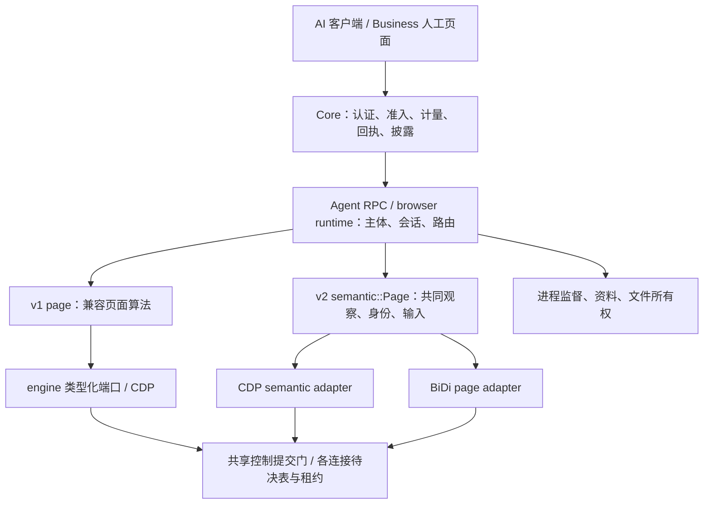

# 浏览器能力实现现状

本文描述当前代码中的浏览器能力、调用关系、数据与资源所有权、公开接口和已知限制。实现事实以本仓库源码及配套 Server 契约为依据；代码具备某条路径，不等于所有平台、浏览器版本和 AI 客户端均已验收或发布。待实现的变化及持续适用的验收要求集中在[设计与验收](browser-design-zhCN.md)。用户操作另见[使用手册](browser-zhCN.md)。

浏览器架构只维护本文和设计与验收两份文档。每轮行为、接口、默认值、预算或支持条件变化，都在同一实现提交或配套提交中核对并更新这两份文档；未受影响的部分不机械改写。完成的设计从待办中移除，将实际行为写入本文，将持续需要的断言留在验收章节。单次测试结果写入提交说明，原始日志和产物放在忽略目录或外部存储；不新增按日期、阶段、对话或“完成情况”命名的架构、规划和历史记录文档，不设旧文档归档副本。

## 1. 当前能力与启用条件

Agent 使用 Rust 单二进制和设备上已安装的浏览器。运行时不要求 Node、Puppeteer、ChromeDriver、GeckoDriver、浏览器扩展或独立代理，也不自动下载浏览器。测试和构建工具不属于用户运行时依赖。

| 路径 | 当前代码行为 | 启用与范围 |
| --- | --- | --- |
| v1 | `runtime.rs` / `page.rs` 保留既有 Chromium/CDP 页面算法和公开格式 | 浏览器能力默认关闭；开启后，无 `selection` 的请求使用此路径。平台条件由现有进程与私有存储实现检查 |
| v2/CDP | `semantic::Page<P>` 驱动 CDP adapter，提供 `semantic_dom_v1` | 编译 `experimental-browser-bidi`，Linux x86_64，本地开启 `browser.enabled` 与 `browser.capability_v2`，请求显式选择 |
| v2/BiDi | 同一共同页面算法驱动 Firefox/BiDi；Linux namespace 内启动和连接 | 与 v2/CDP 相同的编译/策略门槛，另需配置 Firefox 绝对路径及可用的 namespace/pidfd 能力 |
| 命名资料、上传、下载 | v1 与两个 v2 后端均有实现，各自按策略声明 | `persistent_profiles`、`uploads`、`downloads` 默认分别关闭；实际可用性随设备和会话返回 |
| 只读诊断工具、能力指引工具、观察差分、独立原生 AX/DevTools 扩展 | 尚未实现为公开能力 | 不出现在当前支持声明中；接口草案仅见设计与验收 |

v2 的编译、策略及后端门槛见[选择解析与能力声明](../src/browser/selection.rs)和[会话实际能力](../src/browser/runtime/v2.rs)。`candidate` 仅表示允许尝试；成功打开并返回 `session_ready` 才表示本次启动、文档身份和截图检查完成。最低浏览器版本、Firefox ESR、其他 Chromium 品牌及其他 OS/CPU 的支持需要独立证据，不能由协议名称或交叉构建推导。

## 2. 调用关系与源码职责



| 源码 | 当前职责 |
| --- | --- |
| [browser/mod.rs](../src/browser/mod.rs)、[rpc.rs](../src/rpc.rs) | 配置、操作目录及 RPC 调度；主体由认证链路提供，不由模型参数指定 |
| [runtime.rs](../src/browser/runtime.rs)、[runtime/v2.rs](../src/browser/runtime/v2.rs) | 会话与公开 ID、v1/v2 路由、最终控制/披露检查；v2 会话选择固定 |
| [control.rs](../src/browser/control.rs) | `Control` 与 `Submission`：控制代次、最后授权检查、同步入队及单调副作用标记 |
| [page.rs](../src/browser/page.rs)、[engine.rs](../src/browser/engine.rs) | v1 算法及 `PageReadPort`、`PageActionPort`、`SessionPort`、`TransferPort`；`Engine` 仍封装 CDP adapter |
| [semantic.rs](../src/browser/semantic.rs)、[semantic/page.rs](../src/browser/semantic/page.rs) | `Port` 与 `Page<P>`：v2 共同事实、记录、引用、动作及输入任务；不按后端改变 canonical 规则 |
| [semantic/program.rs](../src/browser/semantic/program.rs)、[program.js](../src/browser/semantic/program.js)、[types.rs](../src/browser/semantic/types.rs) | 随二进制交付的固定程序、严格解码、身份和记录材料；不接受调用者脚本 |
| [engine/cdp](../src/browser/engine/cdp)、[engine/bidi](../src/browser/engine/bidi) | 封闭命令、原生 ID、事件、realm、输入和连接待决表；协议差异留在 adapter |
| [process.rs](../src/browser/process.rs)、[process](../src/browser/process)、[profiles.rs](../src/browser/profiles.rs) | 进程树与启动身份、独占资料租约、恢复和关闭；通道断开不作为进程退出证明 |
| [files.rs](../src/browser/files.rs)、[files](../src/browser/files) | 人工上传授权、私有暂存、配额、原始附件响应及交付 |

Server 对应源码为 `apps/core/src/browser.rs`、`mcp_tools.rs`、`mcp.rs`，MCP schema 和错误目录位于 `contracts/mcp/v1/`。Core 处理认证、准入、计量、封装及披露，Agent 持有页面身份与原生资源。Runtime Rust 与 PostgreSQL 结算函数共同约束恢复摘要。Server 的协议/维护文档只提供入口，不复制这两份浏览器文档。

## 3. 能力发现、选择与公开会话

本地策略配置示例；将两个可执行文件路径替换为设备上的实际安装位置。此开关不安装浏览器，也不更改宿主的隔离策略。Firefox 需要允许其 helper 使用所需的非特权 user、mount、PID 和 network namespace。

```json
{
  "version": 1,
  "browser": {
    "enabled": true,
    "capability_v2": true,
    "executable": "/opt/google/chrome/chrome",
    "firefox_executable": "/opt/firefox/firefox"
  }
}
```

`device_info.capabilities.browser.version` 为 `1`。`capabilities.browser.v2` 是独立声明，包含 `version: 2`、`available`、`reason`、`observation_profiles` 和 `backends`。每个后端条目包含 `id`、`browser_family`、`available`、`reason` 和 `stage: "candidate"`。候选可用表示配置、平台、文件与策略允许尝试；不表示已经完成协议握手。

`browser_open` 接受可选对象 `selection`：

```json
{
  "device_id": "test",
  "selection": {
    "version": 2,
    "observation_profile": "semantic_dom_v1",
    "backend": "bidi"
  },
  "url": "https://example.com/"
}
```

`selection` 必须且只能包含这三个字段；后端只能是 `cdp` 或 `bidi`。CDP 使用 `browser.executable`，BiDi 使用绝对路径配置 `browser.firefox_executable`。未提供 `selection` 的请求按 v1 执行；`null`、不完整选择、未知字段、未知版本/profile/后端均拒绝。没有自动选择或失败后换用其他后端。

Server 先验证选择结构，再检查设备的 v2 声明和目标后端，满足后才分配或执行变更操作。旧 Agent 缺少 v2 时返回 `browser_capability_unsupported`。Agent 独立重复验证。未知选择返回 `browser_selection_invalid`，后端候选不可用返回 `browser_backend_unavailable`。严格策略在能力声明中以 `reason: browser_policy_unsupported` 标为不可用，公开打开因此被拒绝；内部共同语义入口也保留策略校验。这些公开拒绝发生在进程、临时资料和页面副作用之前。

打开成功返回原有 `session_id`、`tab_id`、`control_epoch`、`state`，并增加实际 `selection`、`capabilities` 和 `stage: "session_ready"`。选择在会话内固定；后续会话请求通过会话 ID 路由，不再接受选择参数；资料列举和删除单独接受 `selection`。核心能力在运行中丢失时暂停或关闭，不降级成 v1，也不更换后端。

v2 复用 `browser_sessions`、`browser_tabs`、`browser_observe`、`browser_act`、`browser_wait`、`browser_screenshot` 和 `browser_control`，继续使用经过认证的 `browser_principal`、操作回执和控制 epoch。人工接口继续由 Server 绑定用户主体，并用 view、lease、epoch、sequence 和截图 frame 约束输入。人工输入内容不进入操作回执。

观察结果中的 `observation_profile` 为 `semantic_dom_v1`。`nodes` 包含 canonical `role`、`name`、`name_source`、`name_quality`、可选 `value` 和可选 `ref`，并保留控件的 `kind`、`tag`、`input_type`、敏感标记和有界 `record` 材料；记录条目不包含内部节点编号。`coverage` 明确遍历完成状态、变化和遗漏原因。`ref`、`next_cursor`、tab/frame 标识都是 Agent 分配的不透明标识，不接受原生协议 ID、脚本、选择器或坐标作为 AI 引用。输入回执的 `input_acknowledged` 只代表协议确认，`business_result_verified` 保持 `false`。

`fill` 使用原生文本编辑；原生日期、时间、颜色及范围控件使用 `select` 的固定表单设值路径。`scroll` 只滚动主文档，人工视口滚轮则按命中位置路由。

会话核心能力包括生命周期、文档身份、共同观察与输入、截图、JavaScript 弹窗、人工交接、导航策略和保守恢复。公开会话限制、支持动作和可选功能随打开结果返回。命名资料、上传和下载分别遵循 `browser.persistent_profiles`、`browser.uploads`、`browser.downloads` 三个本地开关，默认均关闭；`device_info` 和打开结果声明这些可选能力。命名资料被本地策略关闭时返回 `browser_profile_disabled`。原生 AX 和 DevTools 扩展仍不可用。关闭及崩溃恢复必须证明所属进程已结束，才能释放命名资料租约。

v1 与 v2 共用每设备 2 个会话的上限，每个 v2 会话最多 8 个标签页和 32 个 frame。截图为有界 viewport JPEG。人工视图租约为 120 秒；刷新截图或完成输入可续期，过期视图不能继续输入，返回 AI 必须显式确认披露页面。敏感输入只经已认证的人工接口传输，观察和回执不返回密码值。

人工文本输入核对所选标签页内的 DOM 焦点及逐层 frame 所有者，不依赖 headless 浏览器的窗口级 `document.hasFocus()`。BiDi 的截图坐标先按原生 frame 所有者和内容区几何换算，再在对应 context 发送原生输入；跨 frame 只接受可证明的正向、轴对齐映射，旋转和透视等几何在输入前拒绝。

弹窗可能使触发它的原生输入返回 `unknown`，会话随之暂停，原生命令仍由通道持有。客户端从 `browser_tabs` 获取当前 epoch 和 `dialog_id`，明确处理弹窗，再在待决输入结算后恢复并重新观察；不能重放触发弹窗的点击。输入执行前拒绝与已提交但结果不明分别保持 `not_sent` 和 `unknown`。

回执仅保存已有的有界会话标识及严格的三字段 `selection`。Agent、Server Rust 和 PostgreSQL 结算函数执行同一白名单；URL、标题、页面内容、输入文本和未知选择字段不进入恢复摘要。Server 的数据库函数契约须与服务二进制一起更新，启动时的契约哈希检查会拒绝不一致的组合。

## 4. 提交、控制权与错误进展

`Submission::enqueue` 在与控制换代相同的临界区内核对 epoch、同步尝试入队并标记副作用。提交点是经授权的子命令进入可发送队列，不表示浏览器已经执行；入队失败不产生已提交标记。临界区不等待 I/O、响应或队列容量。

各连接待决表持有命令容量、输入交接屏障及原始回执；调用者超时或取消不提前释放这些占用。多子命令动作一旦提交过副作用，后续错误不将它改回 `not_sent`。`Failure` 当前只含错误码及执行状态；Core 映射固定文案，没有公开的结构化可操作性诊断正文。

暂停先换代并阻止旧代次的新提交；已提交工作继续结算。读取也占用传输容量，但不全部计入输入交接屏障。人工或 AI 恢复输入前检查相关输入与必要清理是否完成；断线后 pending 归零不表示可继续输入。命令共享上层绝对 deadline，资源清理有独立上限。恢复查询原回执与会话，不自动重放不明结果。

页面读取、截图和文件交付仍在结果返回前核对控制及披露权限。`input_acknowledged` 只证明协议确认，`business_result_verified` 为 `false`。最后一次目标检查与网页收到输入之间存在非原子窗口；实现不提供网页事务或业务成功保证。

## 5. semantic_dom_v1 的实际语义

### 5.1 观察范围与名称

范围为各已枚举文档的 DOM 与 open shadow tree。遍历不跨文档猜测关联；每个 frame 单独采集。closed shadow 的内容、canvas 像素和浏览器 UI 不在范围内，coverage 固定列出这些限制，不能声称知道未开放内容的数量。最多 32 个 frame；超过上限拒绝，不返回伪完整结果。

候选包括原生控件、受支持的显式 ARIA 控件、标题和文本。显式控件 role 支持 button、link、textbox、searchbox、combobox、checkbox、radio、spinbutton、slider、switch、menuitem、tab、option；heading 为只读记录。原生映射包括 button、有效 href 的 a、input 的非隐藏类型、textarea、select、summary、img、h1–h6 与 contenteditable。其他 tabindex、onclick 或 pointer 元素可标为 inferred，只允许 click/press。generic、none、presentation、caption、code、deletion、emphasis、insertion、paragraph、strong、subscript、superscript 禁止命名，也不因此取得输入资格。未知 role 保留限制，不伪造原生质量。

命名依次采用有效 aria-labelledby 的文本、非空 aria-label、适用控件的关联 label、img/input-image 的 alt、允许内容命名的角色或控件文本、title。input-button/submit/reset 使用显式 value；没有显式 value 的本地化默认文本不推测。textbox 等不采用自身文本作为名称。多 label 按文档顺序；多引用按声明顺序。仅折叠 ASCII 空白 U+0009/U+000A/U+000C/U+000D/U+0020；保留大小写、NBSP 和其他 Unicode。

关联只能在当前 tree root 内解析。隐藏的显式引用可以提供文本。缺失 ID、重复 ID、循环引用、空关联、跨 shadow 关联以及预算不足均给出明确质量限制；有效的部分名称可显示，但不获得可执行引用。最多处理 32 个关联、递归 16 层、256 个命名节点，名称最多 512 个 Unicode 标量。名称规则是有界产品语义，不宣称完整 AccName 或原生 AX 树兼容。

固定语料在[共同语义 oracle](../tests/fixtures/semantic-dom-v1/oracle.json)，两个 adapter 使用同一公共字段断言。当前 v2 的 canonical 名称由共同程序计算，不使用原生 AX 结果覆盖。

### 5.2 记录、分页和引用

记录边界为最近的 `data-rdh-record`、tr、li、article 或 role=row/listitem 容器；无此祖先时为控件自身。材料包括该范围内受支持的文本、结构、控件类型、命名依据、目标 URL、表单状态和选项。密码及敏感输入值不进入材料、观察或日志。公共 Rust 层校验材料并散列；不接受后端提供的任意 signature 字符串。

每条记录最多 256 个节点、4,096 个 Unicode 标量，预算不足时返回限制且不签发可执行 ref。邻接记录变化不使未变化记录的 ref 失效；同一记录变化、控件替换、脱离文档或类型变化会使动作拒绝。身份来自已保留节点，不按名称、选择器或位置重新匹配旧引用。

每页最多 1,000 项、64,000 字符；默认 200/20,000。每段扫描最多访问 5,000 个节点，find/interactive/viewport 不通过无限重启取得完整。查询与 frame 范围在首次扫描固定。续页替换上一页引用；新观察、控制权换代、300 秒空闲过期或扫描释放使旧 cursor/ref 失效。变更中读取返回 changed_during_read，发生语义变化的记录不取得 ref；未扫描部分不标 complete。

会话、上下文、文档与 realm 身份分开。新文档、同 URL reload、BFCache 恢复及无法证明连续性时换文档代次；hash/history 更新地址而不据 URL 猜测新文档。realm 重建释放扫描与脚本资源，旧 AI ref 不复活。节点仅在仍能证明同一文档与原生节点时重新解析。动作前再次查询身份与材料，不仅依赖事件缓存。

### 5.3 输入与控制

公共动作依次校验 ref、文档、记录、参数、敏感性、可操作性，必要时滚动，再检查并提交输入。坐标使用 CSS 像素，跨 frame 路由与映射由 adapter 负责。已观察到的遮挡、错误目标、禁用、只读或嵌套真实控件拒绝输入。最后检查与事件派发之间的网页变化不具有原子保证，单独验证和报告。

普通 fill 使用原生编辑/按键路径，并检查最终 Unicode 值；没有 DOM value 赋值、剪贴板或桌面输入替代路径。两个浏览器的按键事件数量和 inputType 可以不同。选择、日期、颜色、范围使用独立的固定表单程序，报告合成 input/change；已满足状态返回 changed=false 且不产生新输入。inferred 仅接受 click/press；敏感字段拒绝 AI fill。

contenteditable 的编辑值采用显示文本并将 CRLF 规范为 LF；没有子节点或仅有一个 BR 占位节点的空编辑区表示空字符串。焦点操作可把选择区折叠到已保留编辑节点内部，随后仍由原生按键或编辑命令替换内容；不以设置 DOM 内容模拟编辑。

每个副作用子命令复用公共提交门与绝对 deadline。输入任务由会话拥有，调用 future 被取消不取消原生工作或其清理。输入租约仅释放本次可能按下的键与指针；清理不确定时暂停，不能向下一操作者发放输入许可。旧代次不能继续下一输入子命令；已提交但结果不明的动作保留 unknown，不因后续错误降为 not_sent，也不重放。人工交接要求所有输入与清理结算，交回后重新观察和确认披露。

### 5.4 导航与能力

复用 `browser/sites.rs` 的站点与解析规则。CDP 在新目标恢复前安装拦截，BiDi 在开放导航前安装全局拦截；目标初始化和请求决定分别由有界任务处理，避免初始化等待自身首请求。决定是绑定连接、上下文、请求和 hop 的一次性 token；期限 2 秒，无法归属或超时拒绝。最多 32 个并发决定、4,096 个去重项，超限或决定无法完成时停止所属通道。传输事件缺口处理的后端差异见第 6 节。

首跳拒绝与前序重定向请求已经发出分开报告。导航响应仅表示该协议阶段，不等于 load 或业务完成。等待采用明确文档状态，不使用通用 network-idle。

能力区分导航拦截、DNS 解析检查、实际连接地址证据。DNS 不能替代实际连接证据；连接后证据也不能证明此前没有连接私网。当前两个 v2 adapter 均不提供实际连接地址证据，要求严格连接检查的策略在创建浏览器前拒绝。

公开 v2 每次观察会重新签发 `ref` 和 `frame_id`，续页同样替换引用映射。页面内容相同不会延长旧 ID 的寿命；当前没有展示内容缓存、revision 协议或增量输出。

## 6. 原生连接、进程和资源所有权

### 6.1 CDP

Chromium 通过受管启动器、私有 remote-debugging pipe 和独立资料启动。平台相关进程所有权分别由 POSIX/Linux/macOS 和 Windows supervisor 实现；关闭及恢复核对进程启动身份，无法确认时保留记录。原生生命周期的公共规则另见[生命周期说明](native-lifecycle-zhCN.md)。

CDP 命令为封闭枚举，类型元数据显式区分页面副作用、读取及弹窗行为。Runtime 求值异常按失败解码，不能成为成功的空观察。固定程序可在内部执行 JavaScript，但没有向调用者开放 evaluate、任意方法名、原生对象 ID 或调试端点。

CDP 事件使用 256 条 `broadcast<Value>`，完整入站消息上限为 2 MiB。消费端发现积压丢失或关闭后停止连接；当前没有聚合事件字节账本，也没有在广播发送侧同步完成关键事件丢失判定与新命令准入关闭。这是现存缺口，补齐方案和 EX-00 位于设计与验收，不能写作已经具备的保证。

### 6.2 Firefox/BiDi

`process/firefox.rs` 启动同一 Agent 二进制的内部监督入口。入口在 Tokio 初始化前运行，通过继承的匿名 Unix `SOCK_SEQPACKET` 接收配置，并在独立的 user、network、PID 和 mount namespace 中启动 Firefox。该路径不分配 CDP 管道描述符。

监督链包含外层 anchor 和 namespace 的 PID 1。anchor 绑定 Agent 的父进程死亡信号；PID 1 绑定 anchor，并通过 pidfd 检查设置死亡信号之前父进程已经退出的窗口。PID 1 的启动身份持久化成功后，才允许它启动 Firefox。Agent 退出、anchor 退出或 PID 1 退出都会触发该命名空间的终止路径；PID 1 的退出由 Linux 内核终止其中其余进程，包括改变进程组的后代。原生退出证明仍须经过监督记录与回收检查，不能由 WebSocket 断开推断。[Linux PID namespace 语义](https://man7.org/linux/man-pages/man7/pid_namespaces.7.html)、[父进程死亡信号语义](https://man7.org/linux/man-pages/man2/PR_SET_PDEATHSIG.2const.html)。

Firefox 的 BiDi 监听器只存在于私有网络 namespace 的回环接口。监督进程在该 namespace 内连接端点，再通过 `SCM_RIGHTS` 把已连接 socket 交给 Agent。主机网络 namespace 不增加调试或代理监听端口；控制连接不使用主机 DNS、HTTP 重定向或环境代理。端点声明中的精确 `localhost` 被转换为数值 `127.0.0.1`，其他主机、凭据、查询参数和冲突端点均被拒绝。

这一边界针对其他 OS 用户和受限 Agent shell。root、具有相应管理能力的进程以及不受限制的同 UID 进程不在保证范围内。mount namespace 用于隔离挂载传播并为 PID namespace 挂载 `/proc`，不提供完整的文件系统容器；浏览器资料仍依赖既有私有存储规则。需要的 namespace、pidfd 或挂载能力不可用时启动失败，不退回主机回环监听。[Linux network namespace 语义](https://man7.org/linux/man-pages/man7/network_namespaces.7.html)。

私有网络 namespace 只启用回环接口，没有 veth 或默认路由。Firefox 使用该 namespace 内的 SOCKS5 监听器；监听器描述符交给 Agent，由 Agent 内部的原生 TCP 服务解析目标并建立出站连接。该服务不需要独立代理程序，TLS 握手和证书校验仍由 Firefox 完成。

出站服务仅接受 SOCKS5 TCP CONNECT，支持数值 IPv4、IPv6 和受限主机名。并发连接上限为 32；额外连接立即关闭。握手和目标解析/连接分别有 3 秒期限，每个方向使用固定 8 KiB 转发缓冲。关闭会话时停止监听并等待所有转发任务结束。Firefox 配置关闭直接连接回退、DoH 和 HTTP/3；当前实现不提供 UDP 出站。

该出站路径提供 namespace 内的网站访问。共同页面层在文档请求发送前实施站点许可及重定向检查，但当前 adapter 不提供实际连接地址证据；要求严格私网连接检查的策略在打开前拒绝。文档请求被拦截不代表没有发生 TCP 预连接，出站连通性本身也不证明策略兼容。

BiDi 使用封闭命令和固定程序，原生 context、document、realm 与 sharedId 由 adapter 持有。启动先订阅所需上下文事件，再取得树快照并按事件边界合并；页面阶段还处理导航、realm、弹窗和下载事件。内部通道就绪与公开 `session_ready` 分别判断。

读取和写入任务独立运行；已订阅关键事件超过条数/字节预算、无法入队或损坏时，在生产侧停止新提交并通知原生所有者。浏览器关闭使用保留信号/命令 ID，普通队列满不会阻断该通路；关闭期间继续结算迟到响应。

`Managed` 在独立任务中持有原生所有者。调用者丢弃会话、启动失败或关键事件缺口都触发关闭。正常关闭保留 2 秒优雅退出窗口；必要时停止监督链，原生关闭总预算为 3 秒。外层会话关闭在 3.5 秒内等待原生完成及两个传输任务退出，无法证明完成时返回 `CleanupPending` 并保留恢复记录。

记录类型 `linux-bidi-namespace-v1` 保存 anchor 与已发布 PID 1 的 PID 和启动身份。恢复先核实这些身份已结束，再使用既有 `retire` 路径回收目录；不能仅因 PID 已复用而判断旧工作仍活动，也不能删除仍由原生进程占用的资料。不启用该功能的构建会明确拒绝恢复此类记录，避免按旧 CDP 规则误删。

### 6.3 原生租约

CDP 每连接的对象和流账本在创建命令入队前按最坏返回类型预留。对象/对象组及流仅在释放成功后结算；超时、取消和弹窗提前结束等待不释放预留。迟到且无人接收的对象、流进入有界清理；清理通道耗尽、失败或超过 3 秒停止连接。组释放只处理发出命令时已登记的成员，不误释放随后取得的同组对象。

CDP 不订阅未使用的 Runtime console/exception/inspect 事件，仍拒绝意外携带对象所有权的事件；求值异常对象由命令响应进入账本。BiDi 使用 `resultOwnership: none`，允许的 root handle 为 0，意外 root handle 使传输停止。BiDi `sharedId`、CDP `BackendNodeId` 是节点身份，不是需要 disown/releaseObject 的协议租约；页面内强引用与协议租约分别计数。

## 7. 已实现的资源上限

下表列出代码中的边界，不把拟议预算写成实际行为。上限同时适用，公开 schema 可能在 Agent 前拒绝；接收某个节点数量参数不表示字符预算允许返回同样数量的引用。

| 资源 | 当前上限 | 源码 |
| --- | --- | --- |
| 会话、tab、frame | 每设备 v1/v2 合计 2 个会话；每会话 8 个 tab；v2 32 个 frame | [runtime](../src/browser/runtime.rs)、[v2](../src/browser/runtime/v2.rs)、[types](../src/browser/semantic/types.rs) |
| v1/CDP 拓扑与连接证据 | 页面最多 32 个 frame；会话最多 40 个附着子 target；连接地址证据最多 1,024 项并淘汰最旧记录 | [CDP page](../src/browser/engine/cdp/page.rs)、[session](../src/browser/engine/cdp/session.rs)、[runtime](../src/browser/runtime.rs) |
| 观察 | 默认 200 节点/20,000 字符，最大 1,000/64,000；每段遍历 5,000 节点，待遍历队列 50,000 项 | [page](../src/browser/semantic/page.rs)、[program](../src/browser/semantic/program.js) |
| 扫描与引用 | 每 frame 一个扫描、每扫描最多 1,000 强节点；空闲期 300 秒 | [page](../src/browser/semantic/page.rs)、[program](../src/browser/semantic/program.js) |
| 命名与记录 | 名称 512 Unicode 标量、32 关联、16 层、256 命名节点；记录 256 节点/4,096 标量 | [program](../src/browser/semantic/program.js)、[types](../src/browser/semantic/types.rs) |
| 人工控制 | 公开视图租约 120 秒；内部共同语义输入许可 300 秒，并受外层视图、epoch 约束 | [v2 human](../src/browser/runtime/v2/human.rs)、[page](../src/browser/semantic/page.rs) |
| 原生完整消息 | 入站 2 MiB；出站完整 JSON 256 KiB；BiDi 单帧与完整消息分别受限 | [CDP wire](../src/browser/engine/cdp/wire.rs)、[BiDi wire](../src/browser/engine/bidi/wire.rs) |
| 待决命令与发送队列 | CDP 普通 32 槽，另有 4 个仅供对象/对象组/流释放的槽，发送队列 36；BiDi 普通 32 | [CDP wire](../src/browser/engine/cdp/wire.rs)、[BiDi wire](../src/browser/engine/bidi/wire.rs) |
| 协议租约 | CDP 对象 256、流 16，分类不可借用；包括 pending 预留；BiDi root handle 0 | [CDP leases](../src/browser/engine/cdp/wire/leases.rs)、[BiDi wire](../src/browser/engine/bidi/wire.rs) |
| 事件 | CDP 256 条、单消息受 2 MiB 限制，暂无聚合字节账本；BiDi 256 条/合计 1 MiB/单事件 64 KiB | 两种 wire |
| 导航决定 | 32 个并发、4,096 个去重项、2 秒期限 | [policy](../src/browser/semantic/policy.rs) |
| BiDi 启动上下文与写入 | 128 活动项、128 销毁标记、深度 32；写入 3 秒；启动日志 64 KiB | [BiDi](../src/browser/engine/bidi)、[Firefox process](../src/browser/process/firefox.rs) |
| 截图 | viewport JPEG，宽高各不超过 1920 CSS px，base64 最多 512 KiB；完整响应另外受限 | [image](../src/browser/image.rs)、[v2 native](../src/browser/runtime/v2/native.rs) |
| 命名资料与文件 | 每命名空间 16 个资料；文件/暂存合计 16 项/128 MiB，单文件 32 MiB；读取块 64 KiB；完成文件保留 24 小时 | [profiles](../src/browser/profiles.rs)、[files](../src/browser/files.rs) |

截图在原生协议中以完整 base64 结果返回，产品层分块不能补救超大入站消息。清理未确认时保留占用和 `CleanupPending`；通道关闭不等于进程或磁盘清理结束。

## 8. 命名资料、上传与下载

`browser_open` 接受 `profile_name`。v1、v2 Chromium、v2 Firefox 的目录、资料 ID 和独占租约相互隔离；同一名称不能共享 Cookie、站点存储或浏览器数据库。v1 的资料 ID、元数据格式和默认请求保持不变。每个命名空间最多保留 16 个资料，未显式删除时持续保留。资料只属于创建它的认证 AI 主体，同名资料不能同时打开，使用中的资料不能删除。

列举 v2 资料时，向 `browser_profiles` 传入打开时的完整 `selection`；删除时，向 `browser_control` 传入 `action: "delete_profile"`、`profile_name` 和相同 `selection`。省略 `selection` 只访问 v1 资料。其它会话操作不接受 `selection`，以 `session_id` 确定后端。资料列举和删除不消耗任务配额。

上传沿用人工网页中的分块暂存和显式授权：批准的文件绑定 AI 主体、用户、会话、标签页、来源站点和一次使用次数。AI 的 `attach_file` 必须提供新观察中的 `ref` 和 `file_grant_id`。Agent 在共同输入租约内重新验证文档、主 frame、原生文件输入框、几何和站点，并在原生派发前持久化授权消耗。CDP 使用 `DOM.setFileInputFiles`，BiDi 使用 `input.setFiles`；调用者不能指定设备路径。结果不明时不恢复授权或自动重试。上传字节不进入模型观察、文件列表或操作回执。

下载只接收 HTTP 200 attachment 响应，必须有唯一的 `Content-Length`，且未使用压缩编码。单文件最多 32 MiB，全部文件及上传暂存共用 128 MiB 和 16 项配额，完成文件保留 24 小时。读取每块最多 64 KiB，并校验完整长度与 SHA-256。文件列表只返回元数据，实际字节通过认证人工文件接口读取。人工接管立即隐藏该会话的文件；显式返回并披露后才重新对 AI 可见。

Chrome 使用已经暂停的原始响应流。Firefox 由原生下载器处理同一响应；不重新请求 URL，因此保留原始 Cookie、POST 请求体和服务器的一次性操作语义。Firefox 的下载目录挂载在所属浏览器的私有 namespace 内，tmpfs 数据容量为 32 MiB，inode 上限为 128；Agent 仅通过继承的目录描述符读取完成文件，并拒绝路径逃逸、符号链接及非普通文件。每个 Firefox 会话同一时间只接收一个附件。

Firefox 下载开始及结束事件必须匹配已接纳的主 frame、navigation、URL 和 download ID。未知下载、无法归属的事件或清理失败会关闭所属会话。Firefox 没有可用的单文件取消路径，因此取消正在接收的附件会关闭该会话；其 `cancellation_scope` 为 `session`，网页在原有删除确认处说明这一影响。Chrome 的取消范围为单文件。取消确认只表示收到请求，客户端应继续核对文件列表；只有确认原生进程结束后，Firefox 才释放失败下载的配额。独立会话不受影响。

## 9. 升级、回退与资料兼容

资料位于原有私有 browser 根目录的 `v2/chromium-temporary-v1` 或 `v2/firefox-temporary-v1`；命名资料保存在各自目录下的独立命名空间。旧程序不认识 `v2` 时返回 `browser_cleanup_pending`，拒绝恢复和打开，不会接管或删除目录。关闭最后一个 v2 会话不会移除这些空目录，直接替换成旧程序仍可能被拒绝。

回退会影响新格式资料和文件的可用性。先清点所有认证主体的 v2 资料与下载；需要保留新资料时继续使用支持它们的版本，并按既有私有数据备份流程处理。以下步骤适用于已明确决定退役相应 v2 资料和文件的设备，不能用来绕过 `browser_cleanup_pending`：

1. 使用支持 v2 的 Agent 关闭会话，并核对原生进程、待决下载及清理状态。清理未确定时停止回退。
2. 按完整 `selection` 列举并显式删除已确认退役的 v2 命名资料；通过原有文件接口删除已确认退役的下载。Firefox 的 `cancellation_scope` 元数据不属于旧文件格式，不能只处理资料目录而留下这些文件。
3. 停止 Agent，确认没有所属浏览器进程或有效所有权记录。从最深层开始，仅用非递归 `rmdir` 移除已核实为空的 v2 目录，最后移除 `v2` 本身。任何文件、符号链接或非空目录都使此步骤停止；不删除所有权记录或递归清空目录。
4. 使用旧版接受的本地配置启动旧 Agent；旧版配置不包含 `capability_v2` 和 `firefox_executable`。重新打开原有 v1 命名资料，验证资料 ID 和合成持久状态；实际业务数据按设备的验收流程核对。

Server 回退是独立步骤：停止并排空受影响的 Core，再用目标版本的迁移器离线安装其 Runtime 函数契约，执行目标 Core 的 `check-storage` 后才恢复服务。旧 Core 不接受新的 `selection` 参数。程序和 SQL 函数来自不同版本时不能继续启动；Agent 的资料清理不会修复 Server 契约不一致。

Core 的离线函数切换入口是目标版本的 `rdh-migrate activate-runtime-transactions ENV CORE_ROLE`；`ENV` 指向维护数据库连接的私有环境变量，`CORE_ROLE` 为已有受限角色。完成后运行目标 Core 的 `check-storage CONFIG.json`。新旧二进制、迁移器和函数契约必须配套；此处描述现有恢复机制，不表示已经执行任何部署或数据退役。

## 10. 当前限制与测试入口

当前 v2 的 `network_isolation` 和 `observed_connection_address` 均为 `false`。要求严格私网连接检查的策略在创建浏览器和资料前拒绝。受支持 DOM 之外的 closed shadow、canvas 和浏览器 UI 不在观察范围；不能证明的输入几何拒绝。已安装浏览器、候选声明、通道就绪、公开会话成功及产品发布分别判断。

v1 的 [select_all](../src/browser/engine/cdp/page.rs) 仍固定发送 Ctrl+A（`modifiers: 2`），没有按 macOS 转换主修饰键。v2 的 CDP 原生编辑路径有相应平台分支，但公开 v2 目前仅在 Linux x86_64 启用，不能据此视为 v1 macOS 填写行为已经修正或验证。

| 现有测试/工具 | 覆盖范围；存在不等于本轮已执行 |
| --- | --- |
| [browser_session.rs](../tests/browser_session.rs) | v1 真实 Chromium 行为、人工控制、资料、文件及恢复 |
| [semantic/tests](../src/browser/semantic/tests)、[共同语料](../tests/fixtures/semantic-dom-v1) | Fake 与双后端共同语义、身份、输入、导航、资源与性能 |
| [CDP wire](../src/browser/engine/cdp/wire)、[BiDi wire tests](../src/browser/engine/bidi/wire/tests) | 准入、迟到响应、取消、预算、原生租约和控制 fence |
| [Firefox process tests](../src/browser/process/firefox/tests)、[BiDi session tests](../src/browser/engine/bidi/session/tests.rs) | namespace、监督链、端点、出站和原生恢复 |
| Server `tests/core/test_browser_v2*.py`、`tests/runtime/test_single_call_transactions.py` | 公开 MCP、两个后端、文件、版本回退、预算、重复恢复、RSS、回执白名单 |
| Server `scripts/run_browser_acceptance.py`、`scripts/summarize_browser_rss.py` | 严格收集/JUnit 对照、产物摘要及四组 RSS 汇总；不自动构建、重试、部署或启动托管 CI |

测试命令、持续回归断言、性能/RSS 门槛和未完成工作的放行条件统一见[设计与验收](browser-design-zhCN.md)。本文不保存一次性通过数、测量值、日期或提交流水。
