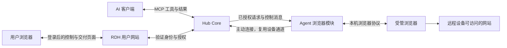

# 浏览器能力：用户任务、实现方案与验收计划

本文定义 RDH 浏览器能力要解决的用户问题、拟实现的行为、跨组件契约、实施顺序和验收方法，是本功能持续推进的统一设计入口。

状态：**P0 本机原型已验证，P0 总体验收尚未关闭；正式 Agent/Hub 浏览器能力尚未接入**。日期：2026-11-05。第 17.3 节记录实际结果；其他章节中的接口、默认值、容量和性能数字仍是拟议设计或验收目标。实施过程中在本文件更新决策、里程碑和证据位置；协议落地后，以对应机器可校验的契约为准。

当前原型位于独立分支 `work/browser-p0` 的 [examples/browser_p0](../examples/browser_p0/main.rs)，只使用本地测试数据，不向正式 Agent 增加浏览器操作。后续工作按本文的里程碑推进，不由某个浏览器库的现成 API 决定产品边界。

阅读入口：先看第 1–4 节的用户任务与体验；实现时看第 5–12 节的契约与边界；安排迭代和验收时看第 13–17 节；当前代码依据集中在第 18 节。

## 1. 用户问题与完成标准

用户已经将设备绑定到 RDH，希望对 AI 说出任务后，AI 就能在指定设备的网络、浏览器和登录环境中完成网页工作。用户不应先理解 CDP、调试端口、浏览器驱动或远程桌面，也不应为了恢复一次超时而重新描述整个任务。

“能打开网页、点击按钮”只是实现能力。用户最终需要的是：操作正确的设备和账号；必要时能参与登录或确认；知道任务是否真的完成；遇到中断时能继续或安全结束；取得可使用的结果。

### 1.1 典型任务

| 场景 | 用户表达示例 | 真正的完成条件 |
| --- | --- | --- |
| 查询远程内网页面 | “在办公室电脑上查本周待处理订单，按负责人汇总。” | 使用指定设备可达的网站和正确账号，覆盖指定筛选范围，返回可追溯的数据；未读取部分明确说明。 |
| 修改业务记录 | “把测试客户的联系电话改为这个号码。” | 改动目标唯一，权限范围清楚；保存后重新读取目标记录，确认新值，而非只报告按钮点击成功。 |
| 导出文件 | “在家里那台电脑上导出上月报表，给我下载。” | 文件生成完成，所属设备、来源和大小明确，用户能取得文件；保留期限和远程保存位置可见。 |
| 检查远程开发页面 | “打开开发机的本地服务，验证注册错误提示。” | 请求来自开发机网络环境；按步骤复现并返回实际页面证据，区分观察到的现象与推测。 |
| 需要登录的任务 | “使用办公室电脑上的浏览器处理这份表单。” | 用户能从当前设备进入受控接管页面完成支持的登录步骤，交回后 AI 在同一会话继续。 |

这些例子描述目标体验，不授权实施时操作真实业务账号。自动验收使用专门的测试站点和测试数据。

### 1.2 三个层次的成功

1. **操作完成**：驱动完成了指定导航、输入、选择或点击。浏览器接收事件不等于网站业务成功。
2. **结果验证完成**：观察到了预期状态，例如特定记录的新值、唯一确认编号或完整下载文件。
3. **用户任务完成**：任务范围内所有要求都有结果，用户能使用交付物；没有把未检查部分或不确定状态隐藏在“完成”中。

Agent 提供前两个层次的执行事实和观察；接入的 AI 根据用户任务作出第三层判断。RDH 不在 Agent 内增加一个自行调用模型的任务规划器。

## 2. 产品边界与交付范围

### 2.1 首次公开试用必须形成完整任务流程

首次公开试用应同时包含：设备选择与能力检查、浏览器准备、结构化观察、元素操作、支持的登录接管、暂停与恢复、结果验证，以及图片和受限文件交付。只完成内部导航和点击的阶段称为技术原型，不对外称为完整浏览器功能。

初始执行后端选择 Chromium 系浏览器，主体使用 Rust。浏览器引擎作为受管理的外部程序运行。AI 的输入和点击通过浏览器协议执行，不接入操作系统全局鼠标、键盘或桌面控制。

用户人工接管也限制在同一个网页视口内。人工坐标输入与 AI 的元素引用操作共用浏览器协议，但使用不同的控制权；不因此开放桌面坐标工具给 AI。

### 2.2 能力分组

| 交付层次 | 包含内容 | 明确边界 |
| --- | --- | --- |
| 内部原型 | 受管浏览器、临时会话、标签页、页面读取、元素引用、基本表单操作、结果观察 | 用于证明关键机制，不承诺远程用户能独立完成登录和交付。 |
| 公开试用 | 命名登录配置、远程人工接管、图片交付、受限下载/上传、恢复查询、兼容性与资源限制 | 只承诺发布矩阵和验收场景覆盖的能力；测试站点之外的成功率单独记录。 |
| 后续候选 | 已有浏览器接入、网页坐标操作、拖放、站点专用操作、更多浏览器引擎 | 由失败任务和使用数据决定顺序，不预先建立多后端框架。 |
| 当前不提供 | 操作系统对话框、桌面输入、自动解决 CAPTCHA、任意页面脚本工具、自动绕过网站限制 | 返回具体限制和可行下一步，不偷偷切换 shell 或桌面工具完成。 |

开放 Shadow DOM、普通 iframe、跨域独立渲染 iframe、页面弹窗和新标签页属于常规网页兼容性，应在公开试用前验收。封闭 Shadow DOM、Canvas、PDF 内嵌交互、浏览器内部页面和原生认证窗口的可操作范围分别报告，不能统一伪装成空页面。

“观察模式”表示 RDH 不主动发送页面操作，不表示网页后台脚本、导航或已有网络请求绝不会改变网站状态。通用网页控制也不能仅凭按钮文字可靠识别所有支付、删除或外部提交；相关产品承诺见第 7 节。

## 3. 从用户问题到方案与验收

问题编号用于关联实现和验收。不能以增加一个 API 代替问题已经解决的证据。

| 编号 | 用户问题与失败表现 | 解决方案 | 主要验收 |
| --- | --- | --- | --- |
| U01 | 多台设备名称相近，AI 操作错设备 | 只使用当前账号授权设备；会话固定设备；存在歧义时选择设备，不用在线设备替代离线目标 | T01、M01 |
| U02 | 设备已绑定，但浏览器没安装或不能启动 | 能力预检给出明确原因；优先探测合格本机浏览器，提供可批准的安装/配置入口 | T02、M02 |
| U03 | 用户不理解浏览器权限与文件、shell 权限的区别 | 独立浏览器授权；展示设备、登录配置、允许站点和操作范围 | T03、M01 |
| U04 | 网站只在远程内网可达 | 页面请求和 DNS 使用远程浏览器网络环境；连接失败展示发生位置，不转到 Hub 代访问 | T04 |
| U05 | 需要登录，但用户不在远程设备旁 | 同会话网页接管，用户直接输入；无支持的认证路径时明确阻塞原因 | T05、M03 |
| U06 | 多个账号或 AI 客户端串用登录状态 | 登录配置隔离、明确命名与所有者、同配置单一控制者；共享需用户显式选择 | T06、T18 |
| U07 | 页面很长，AI 看不到相关内容或上下文太多 | 默认任务相关语义信息；局部读取、范围引用、文本预算和遗漏原因 | T07、M04 |
| U08 | 多个同名按钮，页面刷新后引用指错元素 | 引用绑定会话、文档和节点；保留上下文；变化后拒绝旧引用并重新观察 | T08 |
| U09 | 元素被遮挡、禁用、动画中或在滚动容器里 | 操作前检查、受限等待、滚动和命中确认；失败原因可恢复 | T09、M05 |
| U10 | 中文输入、富文本或前端框架表单行为异常 | 区分替换文本、按键、选择和设置状态；验证输入事件和最终值 | T10 |
| U11 | iframe、Shadow DOM 或新窗口导致操作丢失 | 维护 frame/target 身份；明确新页面归属；只在可确认的目标上下文继续 | T11 |
| U12 | 加载慢，不知道是在等待还是卡住 | 操作期限、明确等待条件、可查询进度；不把 network idle 当作通用成功条件 | T12、M06 |
| U13 | AI 说成功，但业务没有保存 | 返回操作事实和任务相关后置观察；最终报告带验证依据和未验证部分 | T13、M07 |
| U14 | 导出的文件只留在远程电脑，用户拿不到 | 受授权的产物列表与下载入口；上传使用任务限定文件授权 | T14、M08 |
| U15 | HTTP 或网络超时后重复点击造成重复提交 | 沿用 operation ID 去重和结果查询；不确定动作禁止自动重放 | T15、T16 |
| U16 | 用户想暂停、接管或关闭，但 AI 继续操作 | 独占控制权、控制代次、独立停止通路；交接前等待已发送动作收敛 | T17、M09 |
| U17 | 两个 AI 或用户与 AI 同时操作同一会话 | 会话级操作串行；配置目录排他；接管后旧控制者被拒绝 | T18 |
| U18 | 撤销授权、解绑或切换账号后还能看到页面 | 调用与结果披露都重新授权；停止控制、撤销交付入口，隔离旧配置 | T19 |
| U19 | 浏览器崩溃、Agent 重启，状态被误判已恢复 | 新实例不复用旧引用；核验进程身份和配置锁；未知结果先核对 | T16、T20 |
| U20 | 浏览器挤占 CPU、内存或传输，影响现有文件任务 | 独立浏览器预算、低优先级截图、控制消息预留、明确容量拒绝 | T21、M10 |
| U21 | AI 宿主不支持图片、交互或资源链接 | 文本工具始终可用；图片能力实际验收；登录/文件提供登录后的网页入口 | T22 |
| U22 | 额度不足后无法停止任务或找回已有结果 | 清理、停止、状态查询不依赖新增任务额度；恢复查询不重复收费 | T23 |
| U23 | 敏感输入出现在对话、截图或日志中 | 人工模式隔离 AI 读取；输入不进入模型参数；审计只留安全元数据 | T24 |
| U24 | 不知道什么时候已结束、是否还占用资源 | 显示运行/等待用户/暂停/结束状态；说明会话、登录配置和产物各自的保留规则 | T25、M11 |

## 4. 用户看到的完整流程

### 4.1 首次使用

1. 用户在已连接 RDH 的 AI 客户端说明任务和设备。AI 读取设备目录；只在目标不明确时询问。
2. 预检返回浏览器是否启用、可用执行文件、支持的模式、登录配置、限制，以及升级或安装需求。浏览器不可用不影响已有文件与进程功能。
3. 若缺少权限或浏览器，提供一个设备设置入口，解释即将启用什么。安装行为、下载大小和来源可见；不让用户粘贴命令、调试端口或访问令牌来绕过正常流程。
4. 用户选择临时会话，或明确选择一个命名登录配置。默认不扫描、复制或接管日常浏览器的资料目录。
5. 创建会话并打开任务页面。AI 告知正在使用的设备、站点和登录配置；不同设备与配置之间的切换必须可见。

已有合适授权、浏览器和登录配置时，直接进入任务，不重复弹出初始化确认。安装失败时保留已有浏览器和设备绑定，输出可诊断原因。

### 4.2 登录与人工接管

当页面要求登录、验证码或用户处理特殊控件时，AI 返回“需要你登录”及登录后的 RDH 接管入口。用户在自己的设备上打开该入口，看到的是远程浏览器当前网页。

接管页固定显示：设备名、登录配置、实际站点、控制者、连接状态，以及“交回 AI”“结束会话”。会话标识不是访问凭据；即使链接被转发，访问者仍须登录并通过当前设备权限检查。

切换过程为：禁止新 AI 动作 → 增加控制代次 → 等待已发送动作结束 → 确认驱动没有仍可发送输入的在途工作 → 将网页控制交给用户。结果未知不能被当作驱动已经空闲；无法确认时只允许查看状态或结束并重建会话，不允许新旧控制者重叠输入。

开始人工输入前建立内容披露屏障：停止 AI 观察，丢弃旧控制代次中尚未交付的正文和截图，失效相应临时查看入口；Hub 在发送结果时再次检查控制代次。此前已经送达客户端的内容无法撤回。人工模式的新截图、字段值和页面正文只交付给当前人工控制者。

用户完成后点击“交回 AI”，接管页先展示即将开放给 AI 的标签页和站点。用户检查并移除仍包含秘密的输入、回显或页面，或关闭这些标签页；不能确认可披露范围时继续保持人工模式。临时输入缓冲随交接清除，但不自动修改或提交网站表单。确认后旧引用失效，AI 从新的观察继续。人工输入通路不把秘密作为模型参数传递，也不写入普通持久化记录；交回后按用户确认的范围恢复页面披露，不保证识别或清除网站中的全部敏感内容，也不能用自动打码替代这一步。

交回控制权不会自行唤醒已经结束的 AI 对话。支持续接事件的宿主由集成层通知原会话，并在恢复调用中核对主体和控制代次；通用路径在接管页显示“已交回，请返回原对话并说继续”。AI 随后查询原会话状态并重新观察，不新建浏览器或要求用户重述任务。公开试用必须验收这个完整往返；仅将服务端控制者改为 `ai` 不算恢复成功。

密码、验证码和敏感粘贴文本直接走接管页面到受控浏览器的数据通路，不作为模型工具参数，不进入普通日志、操作摘要和持久化请求体。TLS 保护客户端到 Hub、Hub 到 Agent 的传输；首版不宣称对 Hub 端到端加密，Hub 的转发进程属于受信任边界。

首次接管采用有界的网页截图刷新与浏览器输入转发，先满足表单、验证码和常见导航；不承诺视频、游戏或低延迟桌面体验。用户输入必须关联所见的画面代次和视口参数，过期画面、尺寸变化或不明确坐标应刷新后再输入。

仅支持网页内可完成的认证。依赖远程硬件安全密钥、操作系统生物识别或原生权限窗口时，提示需要设备旁的人处理，或使用站点支持的其他登录方式；不得承诺接管页能解决全部 MFA。

### 4.3 正常执行与结果交付

AI 读取页面、选择元素、执行动作并检查目标状态。每轮返回必要信息，不连续输出整页 HTML、完整可访问性树和重复截图。普通表单使用语义操作；截图用于需要视觉判断的检查和故障解释。

最终给用户的结果应包含：

- 使用的设备、站点和登录配置。
- 已完成的任务项，以及验证方式；例如“保存后重新打开记录，号码为……”。
- 可访问的文件、必要的页面链接或经过隐私处理的截图。
- 未完成、未覆盖或结果不确定的部分和下一步。
- 浏览器会话是否仍保留、何时自动关闭，以及登录状态是否保留。

网站显示成功提示但尚未核对业务记录时，应说明证据只到页面提示。结果查询不得为了证明第一次提交成功而再次提交。

### 4.4 暂停、断线与继续

“暂停 AI”停止接纳后续 AI 动作，等待当前动作收敛；页面已发出的请求和后台脚本可能继续运行。“结束会话”关闭 RDH 所拥有的浏览器资源。两者不得使用同一文案。

短暂断线后，AI 先查询操作和会话状态，再重新观察。会话仍有效时保留当前页面；Agent 或浏览器实例已变化时，旧动作和引用不可继续使用。无法确认的业务提交转为“结果待核对”，不给出诱导重复执行的“重试”快捷操作。

## 5. 核心对象与职责

### 5.1 最小对象集合

| 对象 | 含义与所有者 | 寿命 |
| --- | --- | --- |
| 浏览器会话 `session_id` | Agent 拥有的浏览器进程、标签页和控制状态；Hub 绑定其授权主体 | 可跨 RPC 和短暂重连，不跨 Agent 实例隐式恢复 |
| 登录配置 `profile_id` | 私有目录中的 Cookie、站点存储等；绑定设备身份和用户授权范围 | 临时配置随会话删除；命名配置按用户选择保留 |
| 页面观察 `observation_id` | 一次有范围、有预算的页面观察及引用映射 | 有界保留；文档或控制代次改变后失效 |
| 操作 `operation_id` | 使用现有回执框架记录一次变更的身份与结果 | 遵守现有回执和查询契约，不能作为网页事务保证 |
| 产物 `artifact_id` | 截图或文件的元数据、内容位置、来源与交付权限 | 独立到期，不由网页关闭自动代表已交付 |

“任务”是用户与 AI 的工作范围。首版不为它增加另一套服务端工作流引擎。会话可以记录任务说明供用户识别，但描述文本不产生权限。

同一登录配置初始只允许一个活跃会话拥有者。多个标签页共享该会话；不同任务不能在同一目录上同时启动浏览器。跨 AI 客户端共享配置需要用户明确授权，并仍受单一控制者约束。

### 5.2 组件边界



图中的网页访问发生在远程浏览器。用户网站不是网页代理；其接管画面和输入通过 Hub 路由到设备，设备不新增公网入站端口。

| 组件 | 责任 | 不承担的责任 |
| --- | --- | --- |
| AI 客户端与插件技能 | 理解任务、选择工具、整理结果、遵守授权和恢复规则 | 自行伪造主体、扩大权限或声明未知动作成功 |
| Hub Core | 鉴权、能力与主体绑定、操作准入、回执、结果披露和媒体交付协议 | 保存浏览器实时 DOM 副本、替设备访问目标站点 |
| 用户网站 | 设置、接管、确认、会话状态与产物下载 | 在前端秘密持有 Agent 凭据，或通过 URL 携带长期访问令牌 |
| Agent 浏览器模块 | 唯一实时会话状态、引用、动作、进程、预算与清理 | 在本地调用模型、自行推断用户授权 |
| 浏览器 | 网页执行、渲染、站点存储、网页网络请求 | 证明业务事务成功或代替 RDH 授权 |

Hub 仅保存授权、会话绑定和必要恢复元数据；Agent 保存实时浏览器状态。Hub 展示的状态必须标记更新时间和失联，不建立第二份可独立推进的页面状态机。

### 5.3 Rust 实现方向

复用 Agent 已有 Tokio、WebSocket 和 JSON 依赖，首先实现本功能所需的有限 CDP 命令与事件封装；共享一个连接读循环，按命令 ID 和 target session 分派结果。页面语义、操作检查和生命周期是 RDH 自有契约。

不预先生成和暴露完整 CDP API，也不向模型开放原始协议调用。依赖选择以跨平台启动、独立 iframe 会话、关闭、失联和期限处理的原型证据决定；如果有限封装的维护成本超出预期，在 P0 内记录替代依赖及取舍，再冻结正式实现。

拟新增 `src/browser/`，按实际责任拆分会话/进程、协议连接、观察/引用、动作和产物处理。平台专用启动和进程清理放到现有平台组织方式下。首次实现不增加独立 Agent 守护进程、插件服务或通用事件总线。

浏览器操作使用异步执行路径，复用现有准入、在途计数、控制连接 fencing 和回执收敛逻辑。不得为适配当前同步 `execute` 而把浏览器生命周期放入一次 `spawn_blocking` 调用，也不得复制一套与现有回执无关的完成协议。

## 6. 会话身份、并发与生命周期

### 6.1 可信主体必须到达 Agent

当前 Hub 有用户、OAuth 客户端和授权家族信息，但发给 Agent 的操作请求没有这些主体字段。浏览器会话隔离必须先补齐这一契约。

拟增加版本化的浏览器调用上下文，由 Core 根据已验证身份注入，至少绑定：用户、OAuth 客户端、授权家族、设备凭据代次、Agent 实例、会话和控制代次。外部工具参数中的同名字段一律不产生身份；不能只靠随机 `session_id` 作为授权。

接管页面使用已认证用户的会话管理授权。它可以在有权访问目标会话的前提下申请接管，但不能伪装成原 OAuth 客户端发送普通 AI 动作。权限撤销后，原主体的控制和内容读取一起失效。

浏览器能力通过独立版本号协商。缺少主体上下文或不支持版本的 Hub/Agent 组合，在分派前返回明确的升级需求；禁止降级成未隔离的旧操作。已有文件和进程能力继续按原契约工作。

### 6.2 控制权转换

会话运行状态与控制者分开表达：运行状态为 `starting / ready / closing / closed / lost`；控制者为 `ai / human / paused`。`waiting_user` 是等待原因，不是一个会自动继续执行的后台任务。

同一会话的页面动作和观察串行推进，避免焦点、对话框和共享站点状态相互干扰。不同会话允许有界并发。连接的读循环仍必须持续处理响应、崩溃和关闭事件，不能被动作串行锁阻塞。

暂停、交接和撤销增加控制代次。Agent 在接纳动作和真正发送有副作用命令之前检查代次；陈旧控制者不能靠已排队请求继续操作。多命令动作的每次后续输入也检查代次，并保证中途退出时释放已按下的浏览器按键/按钮。

控制权转换要确认两件事：驱动不会继续发出旧输入，浏览器也不会迟到执行已发送但尚未确认的旧输入。单纯超时、丢弃 future、清空本地队列或关闭 CDP 连接都不构成后一项证明。P0 必须验证具体协议的完成确认和多 target 排空方式；不能确认时保持暂停，或关闭并确认所属浏览器退出后重建会话。只有网站业务结果仍未知、浏览器输入已完成时，才可以交接并向用户保留未知状态。网站已收到的请求和后台脚本仍可能继续运行，交接不等于网站状态被冻结，也不伪称已回滚。

P0 已实测：页面忙碌时，输入调用在 25 ms 等待期限后返回未知，输入仍可在约 800 ms 后生效；期间 `Browser.getVersion` 已经返回。因此不能拿浏览器级命令的响应作为所有 renderer 输入的完成屏障。命令超时后必须继续持有其在途记录和容量，直到对应响应或连接失效；连接失效表示会话不能继续交接，不能等价为动作已经完成。当前证据覆盖固定文本输入，尚不证明所有多步骤按键、鼠标、frame 切换都具有同样的完成边界。

独占规则只约束 RDH 管理的输入通路。首版自动任务默认使用无头浏览器，用户从接管页参与；本机可见窗口作为显式选择的有人值守模式。操作系统用户直接操作可见窗口不受控制代次约束，不能承诺强独占。可见模式发现焦点/目标变化时停止并重新观察；需要强独占的任务必须使用受管无头模式。

控制会话按有限租期工作。初始建议：30 秒控制租期、在线时每 10 秒续期；撤销消息立即停止接纳，失联时最迟在租期到期后拒绝新动作。租期使用本地单调时钟计算剩余时间，不依赖两端绝对时钟完全一致。租期与已有集群连接 fencing 同时生效，不能相互替代。

### 6.3 生命周期规则

| 事件 | 必须执行的行为 |
| --- | --- |
| RPC 返回或 HTTP 取消 | 会话继续存在；已接纳操作仍保留在途所有权和回执，不自动重发 |
| Hub 短暂失联 | 禁止新动作；保持会话到有界宽限期；重连后先核对实例、主体与控制代次 |
| 人工接管页面关闭 | 暂停控制，等待重连或到期；不自动把未明确交回的登录页面交给 AI |
| 空闲到期 | 无在途动作后关闭临时会话；保留策略允许的命名登录配置和已登记产物 |
| 浏览器崩溃 | 会话标记 `lost`，引用全部失效；在途动作按证据收敛为失败或未知 |
| Agent 重启 | 创建新实例；不恢复旧动作执行；对遗留进程和目录做身份核对与受控清理 |
| 解绑或设备转移 | 拒绝新控制和内容披露，关闭所拥有浏览器；旧登录配置隔离，不自动授予新绑定 |
| 用户删除登录配置 | 先关闭使用它的会话，再删除私有数据；失败时报告未删范围，不显示“已清除” |
| 更新 Agent | 先正常结束会话；不在浏览器仍可能产生效果时释放运行实例所有权 |

进程清理使用 PID 与进程启动身份、受控配置目录和进程树所有权共同判断。不得按进程名杀死用户浏览器，不得把目录锁消失当作旧浏览器已退出的唯一证据。正常关闭与强制退出分别记录；强制退出也不能回滚网站已接收的请求。

## 7. 授权与人工参与的实际边界

浏览器授权独立于文件写入和 shell 权限。有效范围是本地策略、设备授权和本次会话授权的交集；AI 不能通过工具参数扩大范围。页面内容、链接标题、下载提示和工具结果都是数据，不能改变这个交集。

为减少打断，设置与任务授权只在缺失、范围变化或需要用户明确决定时出现。已覆盖的普通动作不逐次询问。接管、权限扩大、文件输入输出和高影响动作应展示具体对象与效果，不能只显示“允许操作浏览器”。

需要机器强制的确认使用服务端生成的一次性授权，绑定设备、会话、控制代次、动作和参数摘要、目标来源、有效期及实际登录用户。页面变化后重新核对；动作实质改变时原确认无效。模型提交 `approved: true` 不能代替授权记录。

**通用网页的动作含义不能完全由协议判断。** 点击普通元素也可能触发外部提交；导航和 GET 请求也可能产生站点副作用。首版不得承诺能自动识别并阻止任意网站所有高风险操作。可确定的高影响任务在执行前取得具体授权；无法可靠核对目标或影响的提交交给用户接管。若业务要求强制阻止全部未批准交易，应采用经过验证的站点专用操作及服务端控制，不能用模型判断替代。

站点策略至少覆盖主文档导航、重定向、弹出页和下载来源。只有检查初始 URL 不构成网络隔离；网页还可以加载资源、发起 WebSocket 和其他请求。要求严格网络范围的环境必须由浏览器网络配置、受控代理或 OS 策略执行，并对 DNS/重定向/子资源进行测试；相关原型不通过时，不交付“网络隔离”承诺。

普通导航只接纳 `http:` 和 `https:`；`about:blank` 仅用于系统创建空白页。AI 不得通过地址参数执行 `javascript:`，读取 `file:`，打开浏览器内部协议或唤起外部应用。链接点击、重定向和新窗口也要检查这些边界，不能只验证 `navigate` 参数。站点生成的 `blob:` 下载按文件产物契约处理，不由此开放任意特殊协议导航。P0/P2 必须证明可以在效果发生前拦截受限协议；做不到的路径禁用。该协议限制仍不等于严格的站点网络隔离。

浏览器保持自身沙箱，不以 `--no-sandbox` 作为启动失败的通用修复。CDP 连接不暴露公网；首版只连接本次启动且身份匹配的本机端点。回环端口不被描述为对同机恶意进程的隔离边界。浏览器子进程不继承 Agent 令牌及任意业务环境变量。

## 8. 工具与结果契约

以下是拟议接口，名称将在 P1 契约冻结时确定。能力按任务组织，避免把底层 CDP 命令全部变成工具。

### 8.1 面向 AI 的工具

| 工具 | 目的与关键参数 | 执行与恢复要求 |
| --- | --- | --- |
| `device_info` 扩展 | 返回 browser 版本、可用性、模式、操作和限制、不可用原因 | 不启动浏览器；不暴露本机敏感路径和登录内容 |
| `browser_open` | 指定设备、临时/命名配置、可选 URL；返回会话与页面 | 变更操作，使用回执；重复 operation ID 不能创建第二个浏览器 |
| `browser_sessions` | 查询当前主体可见会话及需要用户处理的原因 | 不返回其他客户端私有会话正文；不启动新工作 |
| `browser_tabs` | 列出当前会话的标签页、活动页与需要处理的对话框 | 只查询；标签页创建、选择和关闭放入变更动作，便于按现有操作名区分回执与计费 |
| `browser_observe` | 全页摘要、指定范围、交互控件、文本或按需截图 | 返回预算和遗漏原因；读操作不复用过期内容冒充当前结果 |
| `browser_act` | 带类型的动作：导航、点击、填入、按键、选择、设置勾选、滚动、标签页变更、对话框处理、`attach_file` | 用判别联合 schema 限定参数；变更使用回执，不接受任意方法名；文件动作还需专门授权 |
| `browser_wait` | 等待明确的 URL、元素状态、文本或下载条件 | 有界等待；超时表示条件未被观察到，不自动重复前置动作 |
| `browser_control` | 暂停、请求用户接管、恢复、关闭 | 使用独立的有限控制准入；恢复需要当前授权和新的观察 |
| `browser_artifacts` | 列出产物、取得受权交付入口 | 绑定原始主体与当前权限；不能凭 ID 读取任意文件 |
| 现有恢复工具 | 查询浏览器 operation ID 与调用状态 | 复用 `get_operation_status` 等入口，不增加相互矛盾的另一套状态查询 |

浏览器安装、登录配置管理和授权变更先通过认证后的设备设置页面完成。AI 可以返回操作入口和状态，但不能为了让任务成功而自动给自己加权限。

最初 `browser_act` 每次只有一个动作。仅当往返耗时的测量证明需要时，再增加有界动作序列：每步有前置条件，失败即停止，明确报告已执行步骤，导航后旧引用失效。批处理不宣称原子事务，不包含任意脚本和无限循环。

### 8.2 页面观察

页面观察不是原始 DOM 转发。先取得可访问性语义和必要 DOM 信息，组织为页面、区域、文本和交互节点，再按预算裁剪。保留标题、表单分组、表格行列、错误提示以及元素关联，避免同名按钮失去上下文。

拟议结果示意如下；它不是当前工具输出：

```json
{
  "session_id": "bs_demo",
  "tab_id": "tab_demo",
  "observation_id": "obs_demo",
  "document_generation": 7,
  "control_epoch": 3,
  "page": { "title": "测试客户", "url": "https://fixture.example/customers/42" },
  "scope": { "ref": "scope_contact", "label": "联系方式" },
  "nodes": [
    { "ref": "e_phone", "role": "textbox", "name": "联系电话", "editable": true },
    { "ref": "e_save", "role": "button", "name": "保存", "enabled": true }
  ],
  "coverage": {
    "complete_within_scope": true,
    "omitted": [],
    "frames_observed": 1,
    "frames_omitted": 0
  }
}
```

`complete_within_scope` 只描述声明范围和策略内的采集完成情况，不表示已发现整站全部内容。虚拟列表和无限滚动必须返回可继续读取的范围及终止条件，达到预算时说明覆盖不足。

元素引用在内部绑定会话、标签页、frame、文档代次和节点身份；区域引用只用于后续读取，不能用于点击。新观察不会把旧编号重新分配给另一个元素。引用映射数量和寿命有上限；无法核验时返回过期，不使用同名或相近 selector 猜测替代对象。

页面可能在采集过程中变化。观察开始与结束检查文档身份；跨导航直接丢弃本次结果。同一文档持续变化时，返回 `unstable` 或局部结果，不能声称得到原子页面快照。动作前还要重新验证引用和相关上下文，防止列表复用同一个 DOM 节点却已代表另一条业务记录。

### 8.3 动作与后置观察

动作执行顺序为：检查授权和控制代次 → 解析引用 → 检查当前目标和上下文 → 等待动作所需状态 → 发送浏览器命令 → 记录执行事实 → 按请求检查后置条件 → 返回当前状态和必要观察。

点击检查可见、启用、位置稳定、命中位置及遮挡。填入检查可编辑和目标类型；选择、勾选使用设置期望状态的语义。中文、组合字符、emoji、`contenteditable`、前端框架受控输入及键盘事件差异都要单独测试，不能仅验证 DOM 的 `value` 被赋值。

返回沿用现有 `execution_state`，同时区分动作事实与后置观察，不把它们合成一个模糊的成功值。例如：

```json
{
  "operation_id": "op_demo",
  "execution_state": "succeeded",
  "action": { "type": "click", "dispatch": "acknowledged" },
  "verification": {
    "status": "inconclusive",
    "reason": "navigation_observation_timeout"
  },
  "next_step": "observe_then_check_operation"
}
```

此示例只证明浏览器动作完成，尚不能确认业务保存。若浏览器命令本身的结果也丢失，`execution_state` 应为 `unknown`。额外观察失败、返回体过大或用户已断开，均不能把已经发生的动作改写为 `not_sent`。

导航和等待分别支持提交完成、DOM 就绪及用户指定条件。长连接、广告或后台轮询不应让所有任务一直等待 network idle。弹窗、下载、新标签页和页面崩溃以独立事件处理；事件丢失导致目标身份不可靠时，失效相关引用并重新同步。

对话框处理绑定会话、标签页和当前对话框身份，明确接受或取消；不能把确认框默认视为同意。`attach_file` 绑定当前观察中的文件输入引用与 `file_grant_id`，不接受任意本地路径。选择文件可能立即触发网站上传，因此它本身就是可能向站点披露内容的变更动作，不能只在随后点击“提交”时才检查权限。

### 8.4 回执与网站效果

新增浏览器变更必须同时加入 Agent 跟踪集合和 Hub 变更集合；回执安全摘要增加会话、标签页、动作类型、执行阶段和有限验证状态，不保存表单正文、Cookie、密码或完整页面。

沿用提交后 ACK、断线后补发完成元数据、重复 operation ID 只查询原结果的规则。首次操作 ID 应在产生副作用前可恢复；`browser_open` 响应丢失时能从状态/会话列表找回已有会话。

回执不保证网站事务恰好发生一次。Agent 在效果发生后、结果登记前崩溃时，结果可能永久未知。若网站本身提供请求编号或可验证记录，可用于核对；没有证据时请求用户处理，不自动重放。

## 9. 浏览器准备、页面兼容性与远程网络

### 9.1 启动与安装

预检依次检查本地授权、平台支持、配置目录排他、浏览器执行文件、版本/协议能力、运行依赖和所需显示模式。已安装的合格浏览器优先使用；人工指定路径属于设备配置，不接受网页或模型随意提供可执行程序。

缺少浏览器时提供托管安装候选。安装器需要版本和平台清单、完整性验证、可取消的进度、空间检查和原子就位；中断后可清理或继续，不破坏现有版本。浏览器更新必须经过兼容性验证，不因为 Agent 启动就静默升级所有浏览器。

默认使用经过验收的无头模式；有图形会话时允许用户显式选择有人值守的可见窗口，并展示第 6.2 节的并发边界。远程人工接管依赖网页截图与协议输入，不要求设备已经有桌面会话。操作系统原生窗口仍在边界之外。

Agent 的八种原生构建不等于浏览器拥有同样的分发矩阵。Linux musl Agent 能运行，不代表普通 Chromium 能在纯 musl 系统运行。浏览器支持按 OS、CPU、libc、实际浏览器版本和模式单独列出；不支持时仍允许 Agent 提供其他功能。

### 9.2 首轮验证与公开试用矩阵

下表区分已验证的原型组合和公开试用提案。当前机器是 Kylin，尚无 Ubuntu、Windows 和 macOS 的运行证据，不能用本机通过代替原拟平台验收。原方案将真实 Hub/MCP 宿主流程放在 P0，但它依赖 P1 的身份与工具契约；现调整为 P0 验证 Rust 驱动和独立用户浏览器的本地通路，P2/P3 验证真实宿主。P0 仍须补齐跨平台启动/清理和浏览器取得方式的证据，才能冻结相应支持范围。

| 阶段 | 远程设备与浏览器 | AI 宿主及用户入口 |
| --- | --- | --- |
| P0 已验证组合 | Kylin V11 SP1 x64、glibc 2.38；Headless Chrome 146.0.7680.153 与完整 Chromium 156.0.8078.79，均为无头模式 | Rust 原型驱动、独立浏览器中的本地接管页；没有经过 Hub/MCP，也未验证模型自动完成任务 |
| 首次公开试用最小设备矩阵（待验证） | Ubuntu 24.04 x64/glibc、Windows 11 x64、macOS ARM64；每种 OS 的最低版本和实际 Chrome 版本仍需原生证据 | 各设备均验收图文与纯文本路径；macOS Intel、Windows ARM64、Linux ARM64 和纯 musl 暂不作浏览器支持承诺 |
| 首次公开试用最小宿主矩阵 | 上述 3 种设备与右列 2 种宿主形成 6 个组合，每个组合运行同一任务集 | Codex 桌面客户端作为图文主路径；VS Code/Copilot 经现有 RDH 接入验收不依赖图片内容块的文本与受权链接退路；桌面及移动浏览器接管页 |

主路径图片渲染或某宿主无法完成所需工具契约时，P2/P3 应记录实测限制并调整提案，不假定已有插件等于宿主兼容。自动唤醒对话是独立可选能力；首发必须具备第 4.2 节的“返回对话并继续”路径。

公开试用必须同时覆盖“已有合格浏览器”和“浏览器缺失”两条准备路径。P3 为矩阵内每个平台提供可操作的安装或配置入口，并显示所需用户权限；若不能托管分发，使用经核实的官方安装流程并返回预检，不要求用户自行研究 CDP。浏览器包的来源、再分发条件和完整性验证方法在 P0 核定，未核定时不随 Agent 打包。

### 9.3 页面覆盖

| 页面情况 | 实现要求与降级行为 |
| --- | --- |
| 普通 HTML/ARIA | 合并语义和上下文，定位到真实节点；不向 AI 输出所有技术属性 |
| 缺少 ARIA 的控件 | 结合原生标签、标签关联和有界 DOM 信息；无法确定角色时标记，不伪造可操作性 |
| iframe 与独立进程 frame | 按实际 target/session 建立 frame 关系；跨域不是遍历失败的静默理由 |
| 开放 Shadow DOM | 显式遍历和定位，保持真实节点身份 |
| 封闭根、Canvas、PDF 或插件内容 | 返回部分覆盖及截图；AI 元素操作不支持时引导接管 |
| SPA 路由与节点复用 | 不只看 URL；校验文档、上下文和目标内容变化 |
| 虚拟列表/无限滚动 | 分段观察、去重并报告范围；有工作量上限，不承诺一次读取全部 |
| 多语言/缩放/高 DPI | UTF-8 边界、浏览器 CSS 坐标与截图像素转换分别处理 |
| JS 对话框/弹出页 | 显式报告并处理；不默默接受确认框或丢弃新页面 |
| 权限提示/证书错误 | 使用受控浏览器策略或用户处理；不静默忽略 TLS 错误 |

### 9.4 网络位置

页面请求、Cookie、代理、企业证书和 localhost 都属于远程设备浏览器。Hub 的网络可达性不能替代设备可达性。代理、证书和网络范围必须显式继承或配置，不能顺便导入 Agent 的全部环境变量。

对用户区分：设备离线、Hub 到设备失联、浏览器启动失败、远程 DNS/代理失败、网站响应失败和登录过期。诊断只返回必要类别与支持编号，默认不暴露完整内部 URL 查询串、请求头和认证材料。

## 10. 图片、文件与人工接管的数据通路

### 10.1 图片

截图是独立的可选结果。Agent 先限制像素数和编码后字节数，Hub 再检查最终 MCP 包装大小；不能只检查原始图片长度。MCP 返回宿主可识别的图片内容块，同时提供文本说明；仅在 JSON 中塞 Base64 不算图片交付验收通过。

无图片能力的宿主继续使用语义工具，并获得受权网页查看入口。图片过大时优先提供明确裁剪或降低分辨率的选项；不能静默改变坐标比例后继续使用旧坐标。

截图可能包含密码以外的敏感信息。人工模式下暂停面向 AI 的图片和正文披露；恢复前执行第 4.2 节的页面检查与披露确认，再获取新内容。自动打码只作为辅助，不能承诺完整识别所有敏感字段或画面。

### 10.2 文件产物

浏览器下载默认进入本会话的私有临时目录。开始下载不等于文件完成；校验浏览器完成事件、实际文件身份、大小和读取稳定性后登记产物。失败或中断的部分文件不作为可下载成品。

用户可以选择“保存在远程授权目录”或“从 RDH 下载”。前者复用文件根目录约束及覆盖检查；后者由登录后的交付接口鉴权，再从 Agent 有界分块读取并流式传输。链接中的 ID 不是 bearer 凭据，不把永久公共 URL 作为默认交付方式。

上传只能使用已批准的具体文件授权：绑定用户、设备、会话、目标站点、文件身份与摘要、大小、有效期和使用次数。来自用户当前设备的上传需先进入受控暂存区；来自远程设备的文件必须来自授权根目录。网页不能自行指定本机绝对路径，上传也不等于批准后续表单提交。

授权通过 `attach_file` 消费：先核对当前目标引用、站点和控制代次，再打开并核验文件；正式交给浏览器前，将一次授权占用绑定到该 `operation_id`。预检拒绝且尚未发送时可以释放占用；已发送或结果未知时不得补回使用次数，原操作重查不能再次上传。为避免路径在检查后被替换，浏览器只读取经校验并固定的私有暂存副本，不能把可变源路径直接交给浏览器。删除暂存副本不代表能撤回网站已取得的文件。

初始文件上限建议为单文件 32 MiB、每设备暂存 128 MiB、已完成产物保留 24 小时；均需实现硬性接纳检查和到期清理。浏览器自身下载期间的磁盘限制是额外证明义务：只在完成后检查大小不足以约束磁盘耗尽。P4 必须实现可取消下载及暂存预算，并测量超额窗口；没有可接受的边界时维持下载禁用，不能宣称资源已受限。

每次读取和新分块交付检查当前授权。撤销后停止后续交付；已经送达用户设备的数据无法收回。关闭会话、删除登录配置、删除产物是不同动作，界面分别说明。

### 10.3 接管传输

初始接管使用同一设备连接中的独立有界消息类别：控制、人工输入、画面。服务端用户入口通过既有身份系统访问，Core 路由到正确 Agent；不为接管引入设备侧公共监听器。

控制消息优先；画面只保留最新一张，旧帧可以丢弃，绝不无限积压。输入不按画面队列丢弃或重放；每次输入带唯一序号、控制代次、画面/视口身份，收到明确接纳结果后再推进。中文输入支持提交完整文本，普通按键和文本输入分开处理。

人工密码和验证码输入不进入通用持久化回执参数路径；接管使用有界、内存中的输入去重状态，断线后不自动重放未知输入。交接与结束仍使用可审计的控制操作，不记录秘密正文。

Hub 需要新建这一媒体/输入通路及其审计脱敏规则。当前结构化 MCP 返回和 2 MiB WebSocket 限制不能被当作已有远程接管能力。

## 11. 资源、期限与可观测性

以下是初始预算，P0 测量后可调整；调整必须记录依据。发布验收前冻结候选值，不因某次失败临时放宽门槛。

| 项目 | 初始预算或规则 | 超限时用户可见行为 |
| --- | --- | --- |
| 活跃浏览器会话 | 每设备 2 个；每命名配置 1 个 | 返回已有会话和容量原因，不杀死无关任务腾位置 |
| 标签页 | 每会话 8 个，弹出页也计数 | 拒绝或关闭新建但未接纳的页，并说明原因 |
| 页面动作 | 每会话 1 个，浏览器类全设备最多 2 个 | 及时返回 busy；不堆积无界队列 |
| CDP 在途命令 | 每连接最多 32 个；事件缓存有界 | 停止新动作；关键事件缺口触发重新同步或会话失效 |
| 页面采集 | 最多访问 50,000 个 DOM 节点、32 个 frame、8 层 frame/开放根嵌套；最长 2 秒 | 返回明确部分结果和遗漏原因，不绕过限制重扫整页 |
| 输出节点与引用 | 每观察最多 1,000 个输出节点；每会话最多保留 4,000 个有效引用 | 按范围裁剪；回收映射后返回引用过期 |
| 观察正文 | 最终 JSON 编码后最多 256 KiB | 建议缩小范围；保留足以理解遗漏的元数据 |
| 截图 | 最长边最多 1,920 像素、编码后最多 512 KiB | 明确缩放/裁剪，或返回过大错误及查看入口 |
| 单次工具结果 | 经实际 Agent 和 MCP 编码均低于现有上限，初始预留至少 25% 余量 | 不改变动作已发生的状态；返回安全摘要和后续获取方式 |
| 接管画面 | 默认最多 2 帧/秒，每会话仅缓存最新帧；繁忙时降速 | 显示画面更新时间和连接质量，不假装实时 |
| 单次动作与等待 | 使用现有总 RPC 预算；浏览器默认动作预算 10 秒，等待最多 15 秒并给返回留余量 | 可查询状态；已发出的动作不能因等待超时而重放 |
| 空闲会话 | 默认 30 分钟；人工登录无活动 10 分钟提示，继续需有效心跳/用户活动 | 提前显示到期；关闭会话不误称注销站点账号 |
| 失联宽限 | 最多沿用当前 300 秒；期间不接纳新动作 | 重连后核对身份；到期关闭所拥有会话 |

工作量、内存和时间预算必须在采集及协议接收阶段生效。若 CDP 返回本身可能超过预算，先限制协议帧，再通过局部获取或明确失败处理；不能等完整大树进入内存后才裁剪模型输出。

P0 的整树采集在 30,000 个段落的夹具上触发 2 MiB 消息限制，传输层报告 `message_capacity` 后关闭 CDP 连接。限制避免了 Agent 端继续接收超大消息，但代价是会话不可继续操作；这不满足正式产品对大页面局部读取的要求。P2 应从根节点按子树分段获取语义信息，并分别控制 frame、节点、深度、字节数和期限；不能把原型的 `getFullAXTree` 后裁剪方式直接提升为正式实现。P0 还验证了 32 个超时命令仍占据容量；正式实现拟在总计 32 个名额中给关闭和恢复探测预留 4 个，普通命令最多 28 个，具体调度和阻塞边界尚需验证。

浏览器进程内存与 Agent 自身内存分开测量。进程树监视和关闭只能提供检测后的限制，不能自动声称各平台具有相同的硬内存隔离。P0 决定平台可执行的限制方式和允许的超额窗口；资源不足时提前拒绝新会话。

观测记录包括支持编号、设备/会话/操作的安全标识、阶段耗时、浏览器版本、frame 数、节点数、输出字节数、遗漏原因、错误类别和清理结果。默认不记录页面文本、表单值、Cookie、完整 URL、截图和文件内容。详细诊断采集需要明确范围、保留期限和导出前检查。

指标分开记录：Hub 排队、设备往返、驱动工作、页面等待、结果编码、用户等待和模型推理。并行阶段不能直接相加；总时长使用同一任务边界测量。

## 12. 错误、恢复与用户提示

| 情况 | 对用户的表达要点 | 系统下一步 |
| --- | --- | --- |
| 设备离线 | “目标设备当前离线，尚未开始浏览器操作。” | 保留设备选择，不换机器 |
| 浏览器不可用 | 具体缺少安装、运行依赖、权限或支持版本 | 设置/安装入口，不提示用户自行找调试端口 |
| 登录过期 | “需要在此会话重新登录。” | 暂停 AI，进入接管 |
| 旧引用 | “页面目标已变化，需要重新读取。” | 只重读，不猜测替代点击 |
| 遮挡或禁用 | 返回原因和局部上下文 | 允许 AI 有界等待或处理已授权的遮挡 |
| 未覆盖页面 | 说明 frame、控件或预算限制 | 局部读取、截图或接管 |
| 动作前超时 | 明确尚未发送输入 | 可在新观察和有效授权下形成新尝试 |
| 动作后超时 | “操作可能已经生效，正在核对。” | 查询原 operation ID 与页面状态 |
| 观察失败 | 区分动作是否已完成 | 重试观察，不重试动作 |
| 浏览器/Agent 崩溃 | 说明会话丢失和未知操作 | 核对残留进程，用户决定是否新建会话 |
| 接管冲突 | 当前控制者与等待原因 | 拒绝旧控制代次，不让两端同时输入 |
| 权限撤销 | “当前连接已无权控制或读取此会话。” | 停止内容披露与输入，保留必要完成事实 |
| 文件中断 | 区分未生成、未完成、已生成但未交付 | 不重复网站导出；先查产物状态 |
| 额度用尽 | 已发生的操作状态仍可查询和清理 | 禁止新任务，允许受权停止/关闭/结果恢复 |

错误码面向程序保持稳定，用户文案解释影响和下一步。不得把内部异常堆栈、原始 CDP 数据或长期凭据作为普通错误信息。

## 13. 对外交付的产物与形式

| 使用者 | 交付物 | 用户如何获得和使用 |
| --- | --- | --- |
| 设备用户 | 包含浏览器能力的原生 `rdh`，能力预检和浏览器准备流程 | 沿用现有安装/更新入口；不要求安装 Node.js 或 Python 才能使用浏览器功能 |
| AI 用户 | 版本化 MCP 工具、清晰的参数和结果、恢复指引 | 沿用已连接的 RDH；一句任务开始，缺失配置时给出明确入口 |
| 需要登录/确认的用户 | 认证后的设备设置、会话接管、状态与结束页面 | 从 AI 返回的链接进入；支持桌面及移动浏览器，不要求用户就在远程机器旁 |
| 需要成果的用户 | 结构化结果、可查看的图片、受权文件下载 | 宿主能显示时直接展示；否则进入同一 RDH 交付页面 |
| 企业管理者 | 设备/浏览器权限、登录配置规则、站点限制和安全诊断 | 使用现有管理身份，查看有效范围及撤销结果 |
| 开发维护者 | Agent 模块、Hub 协议与路由、Web 页面、插件技能、测试夹具和证据 | 通过各自仓库维护，按一份功能验收计划发布 |

发布文档采用英文主文档和独立中文版本，包含快速开始、登录接管、暂停恢复、文件交付、权限、支持矩阵和常见失败。本文是设计与实施入口，不在功能未完成时改写现有 README 宣称已经支持。

浏览器下载包和 `rdh` 分开版本管理，发布清单记录实际验证组合。插件发布不能替代 Agent 或 Hub 升级；旧组合保持现有功能，并明确浏览器能力不可用的原因。

## 14. 分阶段实施计划

按能够证明用户任务的一小段完整流程切分，而非按“先把所有后端写完再做界面”切分。每阶段先本地针对性验证；涉及新平台或准备候选发布时集中进行原生 CI，不因每次文档或局部调整重复全平台运行。

| 阶段 | 实施内容与主要位置 | 依赖 | 退出条件与交付 |
| --- | --- | --- | --- |
| P0：关键约束原型 | 独立 Rust example：受管启动、CDP 会话、一个表单、跨域 frame、崩溃清理；验证本地网页截图接管输入和秘密日志边界，再补原生平台证据 | 本文初始设计 | 本机原型已通过；仍须补齐各目标平台、驱动突然退出恢复、输入完成边界和浏览器取得方式。第 17.3 节列出证据与未完成项，不提前标记 P0 全部完成。 |
| P1：身份和会话契约 | Hub 主体上下文、browser 能力协商、会话绑定/控制代次；Agent 异步分派与已有回执接入 | P0 关键机制通过 | 不同主体、旧版本、重复操作和权限撤销的契约测试通过；尚无用户授权时不能启动浏览器。 |
| P2：观察与动作 | `src/browser/` 的 frame、引用、局部观察、表单动作与后置条件；MCP schema、恢复摘要和图片结果 | P1 | AI 经真实 Hub 完成受控查询/修改任务；引用过期和未知结果处理通过；截图在实际宿主显示。 |
| P3：用户可独立开始与接管 | 设备设置、已有/缺失浏览器准备、命名配置、登录接管、暂停/交回/关闭；Core 控制与媒体通路、宿主续接退路 | P1；P2 可观察 | 不在远程设备旁的用户完成首次登录，回到原对话继续同一任务；旧输入、旧控制者、交回前后秘密披露测试通过。 |
| P4：文件与完整任务 | 下载/上传授权、私有暂存、分块交付、产物到期与额度规则；结果报告技能 | P2、P3 | 导出报表和上传测试文件的完整任务通过；部分文件、撤销及空间预算通过。 |
| P5：异常、平台与产品验收 | 故障注入、兼容性、性能、真实模型和人工可用性测试；支持矩阵和诊断 | P2–P4 | 第 15 节全部必测断言及第 16 节全部冻结门槛通过；未支持组合明确禁用，不以跳过代替通过。 |
| P6：候选交付 | 原生包、浏览器兼容清单、Hub 升级、插件、用户文档、发布前回滚演练 | P5 | 干净设备安装和旧版本组合检查通过；实际发布另记录版本、范围和直接验证证据。 |

P0 允许使用测试专用页面和隔离配置，不能引入真实账号来掩盖认证路径缺失。P3 是公开试用的必要条件；没有远程登录接管，不宣称满足“在任意位置通过 AI 操作已绑定设备”的目标。

### 14.1 预期跨仓库改动

| 仓库 | 拟改动责任 |
| --- | --- |
| Agent | `src/browser/`、`rpc.rs`、`session.rs`、`config.rs`、`policy.rs`、`receipts.rs`、`audit/`；受管进程与私有存储复用；能力和原生打包 |
| Server Core/runtime/contracts | 主体上下文、授权/控制、MCP 工具、变更分类、安全摘要、图片结果、媒体/产物路由、额度与审计 |
| Server 用户网站/Auth/Gate | 设备浏览器设置、接管页、产物交付、身份与 CSRF/来源校验、与 Core 的认证控制入口；不在前端直接持有设备凭据 |
| Codex/DSH/VS Code 插件 | 工具使用指引、设备与会话选择、登录/确认链接、未知结果恢复、结果展示；按宿主能力分别验收 |
| 测试与分发 | 本地站点夹具、协议/故障/原生测试、可复现测量脚本、兼容矩阵、说明文档和候选包清单 |

浏览器持久化元数据需要数据库契约时，在 P1 定义新增表、版本升级和回退边界。不得为本功能顺便改变既有回执保留、计费账本或不相关身份流程。

## 15. 验证方法与测试场景

### 15.1 分层验证

1. **单元与契约测试**：身份与代次、引用失效、预算、序列化、状态映射、脱敏。检验行为边界，不只复述实现分支。
2. **真实浏览器测试**：可控站点覆盖页面行为，通过站点端独立记录核对动作及结果，不能只相信 CDP 返回。
3. **Agent–Hub–MCP 集成**：真实网络通道、授权、回执、取消、图片与文件。独立检查普通响应与恢复响应。
4. **故障注入**：在接纳前、发送后、网站处理后、回执提交前后、ACK 前后和用户交接时断开连接或终止进程。
5. **原生与宿主验证**：在每个宣称支持的 OS/CPU/浏览器组合运行；在实际 AI 宿主检验工具、图片、链接和恢复。
6. **模型与人工任务评估**：固定任务集、版本和初始状态，用户或独立检查器核对业务结果；模型自己的总结不作为唯一判据。

任何未执行、跳过、只做交叉编译或仅使用模拟驱动的检查，都要保留对应标签，不计入原生或真实用户验收。

### 15.2 必测场景

| 编号 | 场景与关键断言 |
| --- | --- |
| T01 | 相似设备名、离线目标、账号切换：不误选设备，不自动替换目标。 |
| T02 | 无浏览器、错误路径、缺依赖、不支持版本、安装中断：原因准确，原安装和 Agent 能力保留。 |
| T03 | 未授权、旧 Agent/Hub、伪造主体字段、过期控制租期：分派前或效果前拒绝。 |
| T04 | 远程 localhost、内网 DNS、代理、企业测试 CA、重定向、特殊协议链接及弹出页：验证请求实际来自目标设备，受限协议在效果前拒绝，网络策略不只检查首个 URL。 |
| T05 | 远程用户登录、OTP、登录过期、用户关闭接管页：输入秘密不进入 AI 通路；交回前处理页面残留后能从原对话继续同一任务；不支持的原生认证明确报告。 |
| T06 | 两账号、两客户端、两配置、解绑重绑：Cookie、页面内容、引用和产物均不串用。 |
| T07 | 长文、表格、虚拟列表、50,000 节点、预算边界：上下文保留，遗漏真实，采集内存不随无限页面无界增长。 |
| T08 | 同名按钮、目标替换、同节点代表不同记录、导航中取快照：旧引用拒绝，不能点错相邻记录。 |
| T09 | 遮罩、禁用、动画、嵌套滚动、页面缩放：正确等待或明确失败，不用强制点击掩盖问题。 |
| T10 | 中文、emoji、组合字符、只读输入、React 类受控表单、富文本、选择和勾选：事件及最终站点值匹配。 |
| T11 | 同域/跨域 iframe、独立 target、开放根、封闭根、弹出页、对话框：身份正确、覆盖准确、没有静默丢失。 |
| T12 | 慢导航、后台长连接、永不满足条件、页面崩溃：有界结束，正确区分动作与等待。 |
| T13 | 成功提示后服务端拒绝、保存延迟、错误账号、仅保存草稿：最终报告不能夸大完成范围。 |
| T14 | 完整/中断/超限下载、上传文件被替换、越界路径、重复授权、选择后立即上传、授权占用后超时、过期交付链接：内容完整且权限正确；未知上传不恢复授权次数或重发。 |
| T15 | HTTP 超时、Core 重连、同 operation ID 重试、不同参数重用 ID：站点提交计数不能因 RDH 恢复增加。 |
| T16 | 网站接收后 Agent 崩溃、回执提交不确定、ACK 丢失：不自动重放，未知证据保留，不伪称零效果。 |
| T17 | 动作发送前后暂停、人工接管、租期到期与恢复同时发生，浏览器卡顿后恢复、响应延迟：单一控制者，浏览器仍可能迟到执行旧输入时禁止交接，按键/按钮得到释放。 |
| T18 | 多标签页焦点变化、两个客户端争用配置、外部用户修改可见窗口：拒绝冲突或重新观察，不并行猜测执行。 |
| T19 | 读取中撤销、接管中解绑、下载中撤销、旧凭据重放：停止后续披露与动作，已接收的数据边界如实说明。 |
| T20 | 正常退出、强制退出、PID 复用、浏览器遗留进程：只处理所属资源，不误杀用户浏览器，不误报清理完成。 |
| T21 | 慢消费者、图片过大、事件风暴、资源不足、传输队列拥塞：控制通路可用，既有文件/进程操作没有无界饥饿。 |
| T22 | 仅文本宿主、支持图片宿主、链接须登录、手机接管页：退路可用，不能把 Base64 当图片展示证据。 |
| T23 | 额度不足、重复状态查询、清理/关闭、失败计费：遵守既有账本规则，用户能结束资源并核对既有结果。 |
| T24 | 密码/验证码/敏感截图、页面提示注入、秘密出现在异常或登录后的页面回显：检查 AI 输出、Hub/Agent 日志、回执和暂存内容；在途观察和缓存不能绕过披露屏障，交回前的残留检查和未确认时保持人工模式有效。 |
| T25 | 临时与命名配置、会话到期、产物到期、配置删除失败：状态与实际磁盘/进程一致，用户知道保留了什么。 |
| T26 | 旧客户端/Hub/Agent 组合、浏览器更新、候选回退：能力声明准确，已有功能通过回归，未支持能力明确拒绝。 |

故障注入使用站点独立计数器和唯一业务记录标识作判据，同时检查 Agent/Hub 证据。不能因为最后页面看起来正常就认定没有重复效果。

### 15.3 数据集与测量条件

固定的候选任务集包含 30 个端到端任务：24 个正常任务（查询/提取 6、表单修改 6、登录/接管 4、文件交付 4、动态页面/多 frame 4）及 6 个恢复/限制任务。正常任务的预期是完成业务；恢复/限制任务的预期是恢复、准确报告未知或正确拒绝。每个任务在测试前固定分类、初始状态、授权范围、允许的人工步骤、时间上限、预期结果和独立检查方法。

每个宣称支持的设备/浏览器/模型/宿主组合完成同一任务集，每个任务从重置后的初始状态独立尝试 3 次。每个组合的正常任务分母为 72 次，恢复/限制任务分母为 18 次；两个比率分别统计，不用恢复场景的正确拒绝提高业务完成率。第 9.2 节最小矩阵因此需要 540 次任务尝试，并分别保留每个组合的结果，不能仅用总平均掩盖某个平台失败。扩展模型或浏览器版本形成新的声明组合，应记录相应验证范围。

计分使用以下规则：

- 正常任务在预定时限内完成全部要求，并通过独立检查，计为成功；部分完成、超时、错误账号、未知结果或错误报告均计为失败。
- 登录任务预先列出的人工认证和“回到原对话继续”允许存在，但计入人工次数与耗时。工程师介入、额外代操作或超出任务允许的帮助计为失败。
- 一次尝试内可进行契约允许的状态查询、重新观察和有界恢复，耗时及调用量全部计入；重放未知动作不能用来取得成功分数。
- 尝试结束后的重新运行是新样本，保留原失败，不能替换它。修复后重新验证受影响场景，候选发布仍提交该候选版本的完整冻结任务集结果。
- 平台缺失、宿主限制和测试设施故障分别记录；设施故障可在证明没有进入有效尝试后排除，但必须保留记录。产品能力不足不能在测试后改为不计分。

驱动性能参考环境初始设为 4 个可用 CPU 核、16 GiB 内存、SSD、无资源竞争；固定浏览器/构建版本、窗口大小、站点夹具和网络条件。常规页面为 10,000 个 DOM 节点以内、200 个交互控件以内；压力页面单列，不能混入常规延迟数字。

网络至少覆盖本地回环、100 ms RTT/10 Mbit/s、300 ms RTT/2 Mbit/s，以及注入丢包/断连场景。页面外部响应时间、人工等待和模型推理时间单独记录。协议测试和性能测试由一个执行器顺序运行，避免并行测量互相争用。

延迟样本每场景至少 100 次，记录预热方法、p50、p95、最大值及失败数。比较优化前后时，冻结代码和环境，采用交替次序的配对测量；未经测量不能写“更快”“节省 token”。

## 16. 验收指标与发布阻断项

下表数值是初始目标。P0 可根据测量提出修订，但必须说明用户影响和原因；候选发布测试前冻结。**M01–M16 均是首次公开试用的硬性门槛**，任何一项未通过都不能以“其他阻断项通过”替代；只能修复后复验，或在下一轮候选前显式修订范围/目标并重新验收。百分比同时报告分子、分母和样本范围，小样本零失败不构成普遍可靠性的证明。

| 编号 | 指标与统计边界 | 初始门槛 |
| --- | --- | --- |
| M01 | 正确设备/主体/配置/控制者；T01、T03、T06、T18、T19 的确定性测试 | 100% 通过；任何越权、串会话或错误设备效果阻断发布 |
| M02 | 已绑定且合格浏览器已安装的新用户首次成功打开任务页；至少 8 位参与者，半数无浏览器自动化经验 | 至少 7/8 无工程师协助完成；中位用时 ≤3 分钟；下载/第三方登录等待单列 |
| M03 | 测试账号的远程登录→交回 AI→继续任务；桌面和手机入口 | 8/8 能完成规定的网页登录流程；重复要求用户提供秘密或交回错误会话为阻断项 |
| M04 | 常规页面观察，设备侧驱动时间；固定夹具、每场景 100 次 | p95 ≤500 ms；压力采集在 2 秒工作期限内结束或返回明确部分结果 |
| M05 | 常规动作，元素已可操作到浏览器确认的驱动时间，不含网站后置等待 | p95 ≤300 ms；T08/T09 误点计数为 0 |
| M06 | 已安装浏览器的新进程到可用空白页；已有会话状态查询 | 启动 p95 ≤8 秒；回环状态查询 p95 ≤500 ms；超过时明确进度/原因 |
| M07 | 每个组合分别统计正常任务成功数/72、恢复或限制处理正确数/18 | 正常任务 ≥95%，即至少 69/72；恢复/限制任务 18/18；任何把未知/部分结果报告为全部成功的实例阻断发布 |
| M08 | 1 MiB 和 32 MiB 文件从生成到交付；完整性、权限、到期 | 摘要与字节数 100% 匹配；部分文件不作为成品；撤销后的新读取拒绝 |
| M09 | 暂停/接管请求到禁止新动作；设备收到控制后测量，网络时间另计 | p95 ≤250 ms；剩余动作期限内尝试排空旧输入，到期仍未确认时保持暂停并提供结束/重建入口，不能提前交接 |
| M10 | 100 次会话开关、2 小时受控运行、并发文件基准与浏览器任务 | 无遗留所属进程/配置锁；静置回收后 Agent RSS 增长 ≤20 MiB；既有文件基准 p95 退化 ≤10%，失败率不增加 |
| M11 | 正常关闭与到期清理 | 正常关闭 p95 ≤5 秒；10 秒内完成所属进程确认或报告未清理；不误杀无关进程 |
| M12 | 100 ms RTT/10 Mbit/s 下人工表单接管；输入到确认画面 | p95 ≤1 秒；300 ms/2 Mbit/s 下正确但可降帧，画面时间和输入待确认状态可见 |
| M13 | 不确定效果恢复：T15/T16 每个故障点至少 20 次 | 无 RDH 自动重放导致的额外站点提交；所有未知均保留未知或通过独立证据解决 |
| M14 | 每个宣称支持的平台组合及实际 MCP 宿主 | 必测用例通过；未执行/跳过不算通过；能力矩阵与实际交付一致 |
| M15 | 新用户完整任务中的交互负担 | 一次已授权任务不重复询问同一权限；无需手填 session/ref/调试地址；可恢复错误不要求重述完整任务 |
| M16 | 敏感数据和资源边界；遵守第 4.2 节的输入通路与页面披露范围 | T21/T24 全部通过；人工输入秘密进入普通日志/回执/模型参数、未确认交回就披露页面、无界队列或错误的安全承诺均阻断发布 |

30 个任务重复 3 次只用于候选门槛，不足以证明对任意网站的总体成功率。对试用期间的新失败按任务类型归类，不把不支持的场景临时移出分母来改善数字。

浏览器进程峰值内存、CPU、截图带宽、每任务模型轮次及输入输出 token 是初期观察指标，先报告基线，再确定优化目标；它们不替代第 11 节已经要求的容量和工作量限制。不能用减少观察或隐藏错误来满足延迟和 token 指标。

## 17. 实施中的决策与证据维护

### 17.1 尚需通过原型验证的决策

| 编号 | 当前提案 | 必须补齐的证据 | 最迟决定阶段 |
| --- | --- | --- | --- |
| D01 | 继续采用有限 CDP 封装，原型未新增依赖 | 两个 Linux 浏览器版本已通过固定场景；通用输入完成边界、按需子树采集和跨平台生命周期仍待验证 | P0/P2 |
| D02 | 第 9.2 节的最小矩阵；本机浏览器优先，缺失时提供安装/配置入口 | 精确版本、可取得的包及分发条件、依赖、安装路径和实际宿主表现 | P0 冻结，P3 交付 |
| D03 | 首次公开试用包含浏览器内人工接管与原对话继续 | 旧输入排空、低带宽与中文输入、交回前披露检查、手机操作、宿主续接退路和原生认证限制 | P0/P3 |
| D04 | 默认独立配置，不接管日常浏览器 | 首次登录成本、账号识别、持久配置选择与用户理解 | P3 |
| D05 | AI 元素操作优先，截图按需 | 相同任务上有/无截图的完成率、轮次、延迟和上下文成本 | P2/P5 |
| D06 | 浏览器类并发预算与媒体优先级 | 现有文件/进程任务退化、停止通路与慢消费者测试 | P2/P5 |
| D07 | 原生浏览器与文件/网络资源边界 | 平台限制实际能强制什么、超额窗口和不可提供的保证 | P0/P4 |
| D08 | 新浏览器操作的计费和免费恢复/清理 | 与现有账本和权益规则一致，用户可预期，额度为零时仍能结束资源 | P1/P4 |

这张表记录技术和体验的证明义务，不把普通实现选择都变成用户审批点。改变用户可见范围、隐私边界、额外安装或高影响行为时，再以具体方案说明影响并确认。

### 17.2 当前进度

| 项目 | 当前状态 | 证据或下一步 |
| --- | --- | --- |
| 用户问题、产品范围、实现逻辑与验收计划 | 已形成文档草案 | 本文；仍需按原型和试用证据更新 |
| 当前代码接入点与缺口核对 | 已进行只读核对；正式运行时未修改 | 第 18 节的源码位置与快照 |
| P0 本机原型 | 两个浏览器版本各 15 项检查通过 | 第 17.3 节及机器可读证据；P0 总体验收仍未关闭 |
| 正式 Agent/Hub、人工接管、图片/文件交付 | 未接入 | 原型不能作为正式 MCP 能力或身份授权实现使用 |
| 性能、跨平台、模型任务和人工体验 | 只有小型本地夹具的驱动基线 | Ubuntu/Windows/macOS、真实宿主、模型任务和人工体验未验证 |
| 发布与部署 | 未进行 | P6 后按实际版本和范围记录 |

每个阶段完成时，更新本表和受影响章节，并在提交/验收记录中保存：问题编号、源码提交、构建和浏览器版本、测试命令、环境、样本数、原始结果路径、失败/跳过项、限制和下一步。原始结果可放被忽略的 `.build/browser-validation/<run-id>/`；对外验收应附可长期取得的 CI 产物或发布附件，不能只依赖本机临时目录。

性能与任务结果输出机器可读 JSON，至少包含 `source_revision`、`environment`、`browser_version`、`client_model`、`scenario_id`、`seed`、`expected`、`observed`、`timings`、`usage`、`result`、`limitations` 和证据位置。不同来源的原始截图、日志和页面数据按隐私规则单独保存，不混入公共结果文件。

每次迭代优先解决阻断完整用户任务的问题，其次处理高频恢复困难，再优化已测量的时间、资源和交互负担。新增能力必须能关联到用户问题、交付形式和验收；不能仅因为协议支持就加入产品。

### 17.3 P0 本机原型结果（2026-11-05）

原型在独立分支 `work/browser-p0` 中实现，基于 Agent `1407620`。生产 `src/`、Cargo 依赖和正式工具目录未改变。原型复用现有 Tokio、WebSocket、JSON 与测试用 Axum；所有站点、账号字段和密码标记均为本地合成数据。机器可读记录见 [browser-p0-20261105.json](validation/browser-p0-20261105.json)，其中保存逐文件源码摘要、可执行文件摘要、原始计时样本、成功项、前序失败和验证限制。

最终两次运行使用同一份 Release 原型：Headless Chrome `146.0.7680.153` 和完整 Chromium `156.0.8078.79`，各 **15 项检查通过**。主机为 Kylin V11 SP1 x64、glibc 2.38、Rust 1.93.0；未固定 CPU 亲和性，也未隔离整台主机的其他负载。它们是原型证据，不是第 16 节的产品验收成绩。

| 验证内容 | 实际结果 | 能证明的边界 |
| --- | --- | --- |
| 启动和沙箱 | 使用私有新配置启动；CDP 进程清单中的 renderer 对应 Linux `Seccomp=2`、`NoNewPrivs=1`；未传 `--no-sandbox` | 证明这两个本机组合的 renderer 状态，不代替所有平台沙箱审计 |
| 页面语义、表单和输入 | 根据 AX 角色/名称取得 DOM 身份；输入中文、emoji、组合字符并点击保存；站点端保存计数及内容匹配 | 固定小表单通过；通用框架、富文本、输入法组合过程尚未验收 |
| 跨站独立 iframe | `a.test` 与 `b.test` 产生不同 target session；子 frame 点击由站点端独立计数确认 | 主页面 AX 树未包含子 frame 按钮，必须逐 target 采集；未证明任意层级 frame 完整覆盖 |
| 引用和可操作性 | 被替换节点、被遮挡目标、导航前引用均拒绝；开放 Shadow DOM 按钮可观察 | 未测试同节点复用后的业务语义变化，也未实现通用动画稳定等待 |
| 超时与交接 | 25 ms 输入等待超时，约 800 ms 后输入实际生效；浏览器级查询先返回时仍有 2 个命令在途；这时拒绝交接 | 已验证文本输入反例及保守拒绝；不能据此宣布所有 CDP 动作都能安全排空 |
| 命令容量 | 32 个超时命令保持在途，第 33 个拒绝；迟到响应后容量恢复 | 当前连接未给控制预留名额，正式方案须按第 11 节调整 |
| 本地人工通路 | 独立用户浏览器显示截图，并通过页面提交中文测试秘密；重复序号和交回后的旧请求拒绝；人工模式下原型观察入口拒绝读取 | 只是 loopback、临时访问键、固定视口的原型；没有 Hub 身份、真实远程网络、手机或人工可用性验收 |
| 秘密检查 | 清除测试输入后恢复观察，未出现测试标记；输出文本证据也未找到该标记 | 不覆盖网站回显、所有异常、图片 OCR 或生产审计链；原型测试密码不能替代通用隐私证明 |
| 大页面边界 | 30,000 个段落的整树结果触发接收上限，连接失效；随后关闭所属浏览器和配置 | 证明超限失败与清理；大页面成功读取仍未实现 |
| 关闭和浏览器崩溃 | 正常关闭、强制终止一个浏览器后的清理通过，另一个独立浏览器仍可响应 | 运行结束后无测试配置目录，记录的进程均已退出；未验证驱动被突然终止、进程组逃逸、PID 复用或跨重启恢复 |

驱动基线采用 5 次预热、100 次顺序采样，仅测同一小型夹具。观察包含文档身份检查和单 target AX 获取；填入包含目标检查、聚焦、全选及浏览器文本输入。它们没有覆盖远程网络、Hub 编码、模型推理和业务后置等待。

| 指标 | Headless Chrome 146 | Chromium 156 |
| --- | --- | --- |
| 观察 p50 / p95 | 1.20 / 2.61 ms | 1.24 / 1.64 ms |
| 填入含检查 p50 / p95 | 1.14 / 1.63 ms | 1.44 / 2.11 ms |
| 本轮首次启动到 CDP 可用（单样本） | 600 ms | 183 ms |
| 100 次观察/填入前后原型 RSS | 11,316 → 11,392 KiB | 10,772 → 11,408 KiB |

上述启动时间不是 p95，RSS 不是峰值或泄漏结论，也不包含浏览器全部进程的物理内存。两个浏览器未做配对比较，不能据此判定哪个更快。原始计时值在 JSON 中按大小排列，未保留采样时间顺序。

本轮发现并据此调整了五处方案：

1. **P0 与正式宿主解耦。** 原型先证明受控浏览器和独立用户浏览器之间的本地通路；真实 Hub/MCP 与对话继续依赖 P1–P3，不能由原型截图推导已经可用。
2. **逐 frame 组织观察。** 主 AX 树遗漏独立 iframe 内容，正式观察必须维护 target/frame 关系，并明确未覆盖范围。
3. **迟到输入保持所有权。** 超时不释放命令记录，不以浏览器级查询作为 renderer 输入屏障；断开的连接也不能交接。
4. **大页面改为分段采集。** 接收上限只是最后的失败保护，整树后裁剪不能满足工作量预算和可恢复的观察体验。
5. **进程身份不能依赖命令行可读。** 本机 renderer 的 `/proc/.../cmdline` 不可读，最初沙箱检查因此失败；改用 CDP 的进程类型与 Linux 状态关联。正式孤儿恢复仍需独立于活连接的进程身份记录。

前序原型运行失败均已保留：执行沙箱首先因回环端口 `EPERM` 阻断，改在许可的主机执行环境运行，未关闭 Chrome 沙箱；接管页初版错误地共享受控 CDP，输入被在途保护拒绝，改为独立用户浏览器后通过；沙箱检查的 renderer 分类问题按上文修正。原始运行记录位于 `.build/browser-validation/run-01` 至 `run-10-chromium`，最终证据为 `run-09-release`、`run-10-chromium`。这些目录是本机生成物；上述仓库内 JSON 保存可随分支审阅的结果。

复现前需有可用的 Linux x64 浏览器、可用的本机回环网络以及正常工作的浏览器沙箱。在此 worktree 根目录执行，输出目录必须尚不存在：

```bash
cargo build --release --locked --example browser_p0
target/release/examples/browser_p0 \
  /snap/chromium/current/usr/lib/chromium-browser/chrome \
  .build/browser-validation/reproduction-01
```

浏览器路径示例来自本次主机，其他机器须换成自己的绝对路径。成功时输出 `15 checks; status="passed"`，并生成 `results.json`、页面观察和两张测试截图；失败时保留失败原因，不能把已通过的前半段当作整轮通过。还应执行 `cargo fmt --all --check` 和 `cargo clippy --locked --workspace --all-targets --all-features -- -D warnings`；本轮两项均通过。

**P0 后续仍需完成的工作：**补齐目标平台的启动和清理证据；验证驱动突然退出与遗留进程恢复；扩展多步骤输入、frame 切换及连接失效的完成边界；证明受限协议在链接、重定向和新窗口路径中能在效果前拒绝；核定浏览器安装、分发和版本范围。当前原型仅拒绝直接导航参数中的特殊协议，不能作为通用浏览器隔离边界，也不能据此进入公开试用。

## 18. 已核对的当前代码边界

本节用于说明方案从哪里接入，不表示新能力已经存在。核对快照为 Agent `14076202f9d84c3d6cd32009e4b1c17eae8c9dbe`、Server `114a51953f29f7c26e1843c72301406e955ecda1`、Codex 插件 `0ffdc4bb1670633ad7ad01fb4869ca1d78ee5105`。Server 工作区另有身份与网站修改，本设计工作不修改它们；实现前应重新核对相关文件。

| 当前事实 | 源码依据 | 对本方案的约束 |
| --- | --- | --- |
| Agent 通过主动 WebSocket 接入 Hub，普通操作默认最多 8 个、响应预算 20 秒 | [rpc.rs](../src/rpc.rs)、[session.rs](../src/session.rs)、[架构](architecture.md) | 浏览器沿用已有设备通道和执行身份，需要独立有界的异步路径 |
| Agent 请求包含 ID、操作、参数、期限与可选回执，没有用户/客户端主体 | [rpc.rs](../src/rpc.rs) 的 `Request` | 必须新增可信主体契约，不能仅依赖客户端提供 session ID |
| Hub 已持有用户、客户端和授权家族，但当前下发消息不含这些主体 | [RequestContext](https://github.com/easelian/remote-device-server/blob/114a51953f29f7c26e1843c72301406e955ecda1/crates/runtime/src/types.rs)、[Core 分派](https://github.com/easelian/remote-device-server/blob/114a51953f29f7c26e1843c72301406e955ecda1/apps/core/src/runtime.rs) | Core 注入并绑定浏览器上下文，Agent 校验 |
| 当前 MCP 成功结果使用结构化 JSON；Agent/Hub 单帧上限为 2 MiB，MCP 还有编码后检查 | [Agent transport](../src/transport.rs)、[Core worker](https://github.com/easelian/remote-device-server/blob/114a51953f29f7c26e1843c72301406e955ecda1/apps/core/src/worker.rs)、[MCP 输出](https://github.com/easelian/remote-device-server/blob/114a51953f29f7c26e1843c72301406e955ecda1/apps/core/src/mcp_tools.rs) | 图片内容块、产物和接管通路需要明确新增及宿主验证 |
| Agent 回执跨重连、不跨进程重启，Hub 提交确认后 ACK | [receipts.rs](../src/receipts.rs)、[Hub 接收](https://github.com/easelian/remote-device-server/blob/114a51953f29f7c26e1843c72301406e955ecda1/apps/core/src/agent/receive.rs) | 去重和恢复可复用；不能承诺网站事务恰好一次 |
| HTTP 取消不丢弃已接纳的执行和结算 | [MCP 调用生命周期](https://github.com/easelian/remote-device-server/blob/114a51953f29f7c26e1843c72301406e955ecda1/apps/core/src/mcp.rs) | 暂停/接管需要显式协议，不能靠关闭 HTTP 实现 |
| 当前关闭流程等待搜索、进程和在途工作 | [Runtime::shutdown](../src/rpc.rs) | 浏览器、媒体和暂存资源必须进入同一生命周期收敛 |
| 插件技能指导 AI 尊重权限，实际权限由 Hub/Agent/OS 执行 | [插件操作技能](https://github.com/easelian/remote-device-plugin-codex/blob/0ffdc4bb1670633ad7ad01fb4869ca1d78ee5105/plugins/remote-device-hub/skills/remote-device-operations/SKILL.md) | 技能中的“先确认”不等于已有可强制执行的确认或接管协议 |

源码和实际行为发生变化后，应更新本节。其他功能的 CI、发布记录或性能结果不作为浏览器能力的验收证据。
