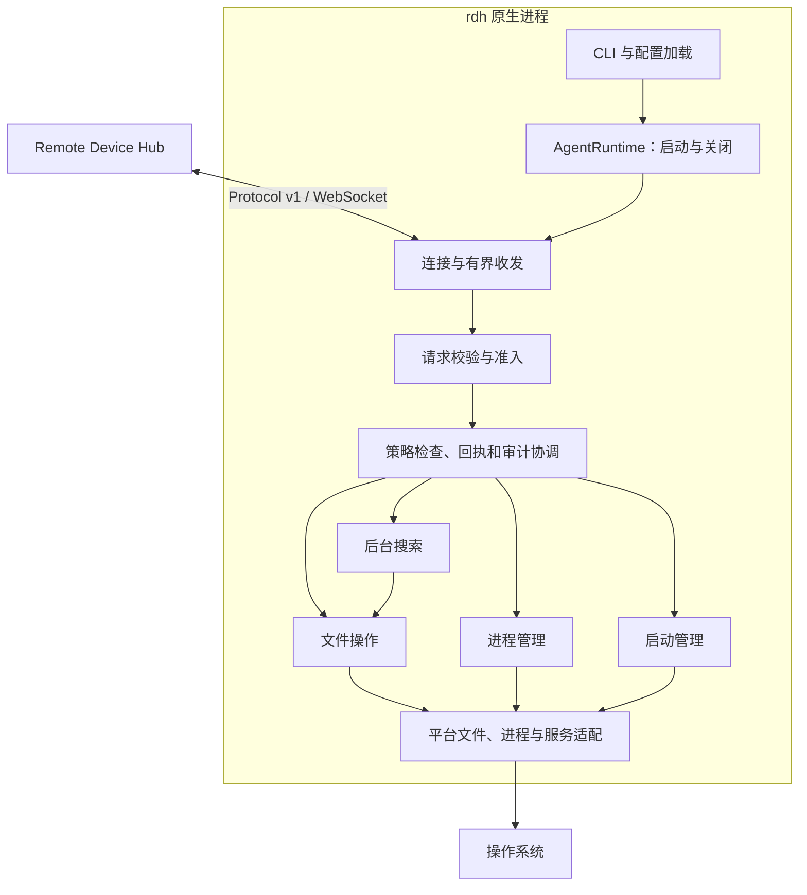

# Remote Device Agent Rust 重写设计

状态：实现中。日期：2026-10-28。本文保留完整目标；尚未完成的设计不代表已具备相应平台能力。

目标是把 Agent 的全部业务逻辑、后台运行、平台适配、构建和验证迁移到 Rust，交付可独立运行的原生 `rdh` 二进制。现有 Hub 协议、设备身份和用户工作流作为兼容基线。npm 留作后续安装渠道，不参与 Agent 的业务执行、服务启动或运行时更新。

本文依据 Agent `0.7.2` 的当前工作树，基于提交 `71f80b7ff7b289436fd042143e9f15d9c1b522d2`。调研时已有 README、分发文档、安装脚本、升级代码及本地配对脚本的暂存改动。Server 工作树基于 `4d932c17daedafabc921f48f76cb0f24f92dca2c`，同时包含尚未提交的 Rust Worker/runtime 迁移。这里的源码事实不代表已部署版本或生产验证结果。

## 当前实现和验证

`0.7.2-rust.1` 是未发布的开发版本。Linux 实现已覆盖配对、连接、文件操作、后台搜索、进程、操作回执、策略、审计和启动审批；支持 bubblewrap 与 POSIX 资源限制。受管原生安装支持停机后的版本切换、回滚和中断恢复，并提供显式指定用户 systemd 单元的实验性在线更新。特定旧版用户单元还可在人工确认停机后显式迁移或撤销迁移。安装锁、运行标记和任务检查约束更新过程。Node/npm 不是该二进制的运行依赖。

本机 Linux x86_64 上，Rust 工作区测试和静态检查通过；真实 bubblewrap 命名空间测试验证了网络隔离、只读挂载、敏感配置遮蔽和资源限制。Server 的 [原生兼容检查](../../remote-device-server/scripts/check_native_agent_compat.py)使用临时目录及本地 Hub，逐项执行了 23 个已声明操作的样例，并验证了配对、启动审批、审计和关闭。受管安装还验证了就绪身份与 Hub 返回的实例一致；独立测试覆盖断线、重连、离线升级后的新实例、异常退出和伪造对端。旧 Agent 的启动审批状态文件也经过双向互读测试。这些样例不覆盖全部边界，也不代表生产 Hub、外网代理或其他系统已完成验收。

旧版和 Rust 的文件指纹包含修改时间。部分纳秒时间在两种语言中有不同的默认数字输出，可能使同一文件在切换 Agent 后得到不同指纹；当前实现按旧版数字格式生成指纹。本机对同一文件的四种时间样例比较了两种实现的 `file_info`、`read_file_chunk` 和 `read_multiple_files`，另用 99,953 个有限浮点值与 Node 输出对照；这些样例不是对全部数字或文件系统的证明。

文件读取的成功、编码边界和无效参数也做了新旧实现对照；批量读取中的参数错误已对齐旧版，读取不到文件时 Rust 保留不暴露本机绝对路径的错误信息。目录分页支持旧版接受的超大非负整数偏移；超过目录末尾时返回空页。

异步入口按可用 CPU 数创建一至四个 Tokio 调度工作线程；版本、帮助和其他同步本地命令不创建 Tokio 运行时。该上限不包括阻塞任务池、后台搜索或子进程相关线程。在可见 128 个 CPU 的本机，使用同一个本地配对请求等待夹具分别采样一次，优化前后的 glibc 开发二进制线程数为 129 和 5；`--version` 的系统调用跟踪分别观察到 128 次和 0 次线程创建。这是单次资源采样，不是吞吐量或延迟基准。单 CPU 亲和性下的本地 Hub 样例通过了 23 项操作及受管就绪检查；另有单线程调度器测试覆盖普通请求名额占满时的状态查询与关闭。

同一台 glibc 主机上的 x86_64 musl 静态二进制也通过了 Rust 工作区测试；使用本地 Hub 和临时用户 systemd 单元验证了 23 项操作样例、就绪身份及空闲停机。这证明该二进制在此内核和测试环境中可运行，不代表已经在原生 musl 发行版或其他架构验收。

Linux ARM64 的 glibc 和 musl 目标均已交叉编译并通过工作区全目标静态检查。先前一轮源码在 QEMU 用户态模拟下各通过 95 项单元测试；自启动测试程序的完整用例受系统旧版 binfmt 模拟器限制，其环境隔离子用例已用新版模拟器单独通过。新版 QEMU 支持本次文件测试所需的 `openat2`。当前两个交叉编译的开发二进制通过模拟器包装器，分别与临时本地 Hub 完成了 23 项操作样例；此联测未覆盖受管服务和服务更新。先前还用 ARM64 musl 模拟进程验证了安装时预登记配置和拒绝模拟旧锁，未运行真实旧 Node Agent。以上结果不能代替真实 ARM64 上的完整测试、服务和 Hub 联测。

Windows x86_64 GNU 目标已交叉编译，默认构建在 Wine 中先前通过 19 项单元测试；最新两项默认特性门禁测试还验证了禁用时不会创建锁或修改配置。设备根目录和默认 shell 的 Windows 路径语法已与旧 Agent 的代表性样例对照：不完整 UNC、设备命名空间和不符合旧契约的 `SystemRoot` 会被拒绝。这些是配置语法检查，不能替代文件句柄与实际可执行文件的验证。`experimental-windows-private-storage` 构建选项包含实验性私有配置读取、排他创建、已有配置替换以及旧锁名称的获取、释放和显式恢复；默认构建仍拒绝 Windows 私有配置和锁操作。实验实现逐级持有目录句柄、拒绝重解析点及硬链接，并验证所有者和受保护 ACL。新文件先以私有 ACL 创建临时文件，验证后才写入并同步，最后使用句柄相对重命名，禁止覆盖现有配置；失败时只清理自己持有的临时文件。创建缺失目录要求其上一级已通过私有 ACL 检查，因此普通继承权限的目录和部分旧安装可能被拒绝，尚无自动迁移。两种 Windows MSVC 架构的原生单元测试已覆盖相对重命名、创建和恢复锁；目录元数据的断电持久性仍未验收。

`experimental-windows-files` 提供 Windows 文件与后台搜索后端。请求校验、编码、指纹、分页、搜索及写入准入使用共享实现；POSIX 与 Windows 模块分别持有文件对象并执行系统调用。Windows 逐级保留父目录句柄，按完整文件 ID 校验身份，拒绝重解析点和无效 Windows 名称，普通文件保留硬链接语义。目录列表读取链接对象的信息，不跟随其目标；未知重解析类型列为 `other`，不进入搜索。原子创建和移动不覆盖已有目标，更新失败后的临时清理区分是否已尝试发布。UNC 只有路径语法样例，尚无 SMB 运行验收，也不承诺目录元数据断电持久性。

提交 `5ef5f64` 的六个原生 Linux/macOS 目标已通过开发 CI。Windows x86_64 和 ARM64 的 89 个单元测试及文件／搜索网络会话测试通过，但随后都在旧版元数据对照中失败：接近 Unix 纪元的负时间戳与 Node 22 返回值不同。因此该提交的 Windows 文件兼容性尚未通过验收。工作区已按旧版 Windows 秒数转换修正协议字段和指纹，内部并发修改检测仍使用原始时间；对照用例增加了 2038 年及 2106 年边界，修正待原生复验。Wine 9.0 的预检不用于证明 ACL、重解析点或打开目标时的替换语义。

工作区还新增 `experimental-windows-processes` 和 `experimental-windows-startup`，两者默认关闭。进程后端在创建子进程时将其加入独立 Job Object，只继承三条标准流管道，持有工作目录边界并在恢复线程前检查取消。退出、期限到达和主动终止都等待主进程退出、Job 成员清空及输出排空后再释放任务容量。用户启动项通过 Task Scheduler COM 接口直接注册原生可执行文件；服务的未来启动设置使用 SCM，启用和禁用不启动或停止当前 Agent。管理员授权文件使用受保护 ACL 和句柄相对替换。

`rdh service-run` 提供 Windows SCM 入口，要求显式指定已有配对配置。SCM 停止请求通知同一个 Agent 运行时关闭；正常收尾和配置锁释放后才报告停止，配置缺失时不发起配对。新增测试覆盖 CLI 配对及身份复用、认证会话中的进程操作、原生任务设置和授权文件，以及临时 LocalSystem 服务的停止、子进程回收和重启。上述新增代码已通过 Windows GNU 的默认和全部特性全目标 Clippy。本机 Linux 的 127 个单元测试、15 个集成测试及旧版文件、搜索、进程对照通过。Wine 通过 2 个管道和 12 个进程预检，包括超时、取消、父进程异常退出、子孙进程清理及句柄继承限制；PowerShell、SCM 服务、Task Scheduler 和授权文件仍待原生 Windows CI，不应据此安装到生产服务。

Windows 系统信息已加入原生主机名和系统版本查询：主机名通过 `GetHostNameW` 读取，系统版本通过 `RtlGetVersion` 按“主版本.次版本.构建号”返回，不再直接使用 `COMPUTERNAME` 或始终返回空版本。每次主机名查询独立获取并释放 Winsock 引用，避免清理其他网络使用者；主机名或版本查询失败时，分别回退为 `device` 或空版本。`machine` 暂时保持 Rust 构建目标名称。Windows GNU 的默认与全部特性构建已通过全工作区静态检查，socket 保留和子进程环境变量干扰两个测试在 Wine 中通过。旧 Node 的主机名和版本字段对照已在 Linux 和原生 Windows x86_64、ARM64 MSVC 通过。

Windows 审计已加入 `experimental-windows-audit` 实验后端，该特性依赖私有存储特性，默认不开放。脱敏、哈希链、条数与字节保留、轮转和部分写入恢复使用共享逻辑；Windows 后端保留各级目录句柄，检查私有 ACL、重解析点、硬链接与完整文件标识，使用句柄相对重命名发布保留结果。替换失败后的清理沿用私有存储的候选身份检查。必需审计模式检查文件刷新结果，但不承诺目录项在断电后的持久性；Windows 文件刷新接口见 [FlushFileBuffers](https://learn.microsoft.com/en-us/windows/win32/api/fileapi/nf-fileapi-flushfilebuffers)。

拆分审计文件操作后，本机 Linux 的 127 个单元测试和 13 个集成测试、旧版审计与锁交接均通过。提交 `6f6e6b9` 的两种原生 macOS 架构已通过完整开发检查，包括审计单元测试与旧版交接。该提交的 Windows x86_64、ARM64 MSVC 检查也已通过：每个目标的 65 个单元测试覆盖共享审计、目录固定、身份替换和删除等待，旧版日志双向交接与保留量对照通过，默认构建的三个禁用门禁通过。以上结果不代表 Windows 完整 Agent 已验收。该轮 Linux x86_64 GNU 检查在服务试运行夹具的就绪断言处失败；夹具现显式控制 Hub 的 ready 消息，再等待 Agent 观察到就绪，修正已在提交 `5ef5f64` 的四个原生 Linux 目标通过。

实验锁使用 `<config>.node-lock`、`owner.json` 和 `.reclaiming` 名称，释放前核对 owner。显式 `--recover-lock` 先为所有配置获取恢复 guard，打开并校验全部锁与 owner，再读取完整进程快照；快照不包含当前进程、枚举失败或任一 owner PID 仍存在时均拒绝删除。快照机制依据 Windows 的 [Toolhelp 进程快照接口](https://learn.microsoft.com/en-us/windows/win32/api/tlhelp32/nf-tlhelp32-createtoolhelp32snapshot)；删除只针对已打开且通过私有 ACL 检查的对象句柄，关闭句柄后还需确认名称消失，删除仍在等待或无法确认时返回错误。操作者仍须先确认旧任务结束，且恢复者与旧 Agent 必须处于相同进程可见范围。PID 被复用时会保守拒绝；清理中途失败可能留下部分已恢复的锁或 guard，应检查现场，不能把错误当作完整恢复。

锁互操作夹具通过独立的旧 Node 与 Rust 进程，验证双方持锁时拒绝另一方获取或恢复、正常释放后交接，以及进程被终止并回收后的双向恢复。该夹具已在本机 Linux、原生 macOS 和 Windows 的两种架构运行通过。此前 Windows ARM64 的日志显示，旧 Node 前两次 PowerShell ACL 检查分别成功耗时约 24 秒和 25 秒，第三次仍在运行时，夹具的总计 60 秒期限已到；一次完整获取实际串行执行五次 ACL 检查。夹具现按每个动作的调用数量组合等待预算，保留旧实现每条命令的 60 秒限制，并把任何 ACL 子命令失败视为测试失败，避免将权限检查失败误计为正确互斥。修正后的锁互操作与审计交接已在原生 Windows ARM64 复验通过，分别耗时约 769 秒和 788 秒。Node 仅用于旧实现对照，不是原生 Agent 的运行依赖。

Wine 中的实验构建通过 33 项测试，其中进程快照样例覆盖本进程、存活子进程和子进程退出；另外 9 项依赖真实 ACL、目录固定或锁获取与恢复的测试未计入该结果。单独尝试的新恢复用例在获取锁时被 ACL 校验拒绝，尚未进入恢复流程：Wine 不保留文件 ACL 的保护标志，也允许重命名未共享删除权限的已打开目录。它无法证明 Windows 与旧 Node Agent 的互斥、锁恢复或句柄删除互通。设备文件、进程和启动管理尚未完成；完整会话集成测试尚未在 Windows 上启用。Wine 结果本身不能代表真实 Windows 或 MSVC 构建验收。随后两种 Windows MSVC 架构均通过 50 个单元测试和 2 个默认门禁，其中包含真实 ACL、配置替换、目录固定、删除等待及锁恢复用例；Windows x86_64 的完整开发 CI 还通过了锁互操作和默认可执行文件检查，后续提交 `6f6e6b9` 的两种 Windows 架构又各通过 65 个单元测试、3 个默认门禁及全部锁与审计交接检查。本地 macOS 交叉编译仍缺少 Apple SDK。

macOS 审计已有 `experimental-macos-audit` 实验实现，复用 POSIX 目录句柄、私有权限检查、脱敏、轮转和保留逻辑；默认构建仍拒绝打开日志。实验实现显式调用并检查 `fsync`，与旧 Agent 的同步接口一致；这不等于断电后数据完整性验收，Apple 的 [fsync 说明](https://developer.apple.com/library/archive/documentation/System/Conceptual/ManPages_iPhoneOS/man2/fsync.2.html)也区分了主机写入与驱动器实际持久化。实际审计源码及测试在独立编译夹具中通过了 macOS x86_64、ARM64 的默认与实验特性交叉类型检查；夹具使用随机数 API 检查桩，未链接或运行完整 Agent。两种原生 macOS 架构已通过审计单元测试和默认禁用门禁；两种架构的旧版审计日志交接与保留量对照也已通过。

macOS 启动管理已有 `experimental-macos-startup` 实验实现，默认不开放操作。它沿用旧版 LaunchAgent 名称、本地审批和 `/private/etc/remote-device-hub/startup-grants` 管理员授权路径，使用 `launchctl enable/disable` 改变未来启动状态；不装载、启动、停止或重启 Agent。新建用户注册先确认禁用，再排他创建 plist，直接传入原生 `rdh`、配置、Hub 地址和工作目录，不生成 Node 或 shell 运行包装，也不复制当前进程环境。已有注册须显式绑定，不会因绑定而改写其中的执行程序；系统 LaunchDaemon 仍须先在本机安装。

Linux 上的独立 plist 解析与执行夹具验证了特殊字符路径、参数、工作目录以及不覆盖已有注册；命令夹具覆盖状态确认和错误拒绝。共享启动命令读取器在持续输出时也检查期限，超过 64 KiB 时报告错误，不从截断输出判断启用状态。启动管理、配置、锁与授权的实际源码及其测试已分别通过两种 macOS 架构的默认与实验特性交叉类型检查，随机数 API 使用与审计检查相同的编译桩。Darwin `mode_t` 参数在调用前按 C 可变参数规则提升为整数；私有配置和侧车的目录发布使用受检查的 POSIX `fsync`，文件仍保留 `sync_all`。随后两种原生 macOS 架构通过了启动管理单元测试、默认门禁和独立 plist 参数执行夹具。服务装载、重登录、断电和外网就绪仍未验收。

macOS 文件和搜索已有 `experimental-macos-files` 实验实现，默认不声明相关操作。它与 Linux 共用读取、摘要、编辑、原子写入、目录、移动和搜索逻辑；Darwin 打开路径时使用目录句柄与 [`O_NOFOLLOW_ANY`](https://github.com/apple-oss-distributions/xnu/blob/xnu-7195.81.3/bsd/sys/fcntl.h)，并复核目录描述符路径和末级名称的身份。首次打开根目录前，代码在私有临时目录中验证普通路径可打开、末级和中间链接都被内核拒绝，然后清理自己的探测对象；无法确认能力或清理时拒绝初始化。元数据查询使用不跟随末级链接的 `fstatat`，不打开设备或 FIFO；普通硬链接按所选名称授权，原子替换只改变该名称，描述符设备别名被拒绝。移动使用 `renameatx_np(RENAME_EXCL)`，不退回可覆盖目标的调用。

共享逻辑的 Linux 文件、搜索与旧 Node 对照测试已通过，硬链接读取和替换还经过独立回归。实际文件与搜索源码、测试和旧实现对照程序通过了两种 macOS 架构的默认与实验特性交叉类型检查；随机数 API 使用编译桩，未链接或运行完整 Agent。首次原生文件测试在两个架构上均被能力探测阻止：同时传入 `O_NOFOLLOW` 和 `O_NOFOLLOW_ANY` 会触发 Darwin 的 `EINVAL`。实现现统一为 `O_NOFOLLOW_ANY`，能力探测分别覆盖调用者带或不带 `O_NOFOLLOW` 时的普通路径及链接拒绝；两种原生 macOS 架构已通过共享文件与搜索测试，以及旧版文件和后台搜索对照。该互斥规则可在 [Apple 的打开路径实现](https://github.com/apple-oss-distributions/xnu/blob/main/bsd/vfs/vfs_vnops.c)中核对。目录路径复核与实际 I/O 不是对外部改名的原子事务，不能据此声称文件根目录构成操作系统沙箱。

macOS 进程管理已有 `experimental-macos-processes` 实验实现，该特性同时启用实验文件后端；默认构建不声明进程操作。它与 Linux 共用任务准入、工作目录句柄、环境变量白名单、非阻塞输入输出、期限、离线保留和关闭逻辑。子进程通过 `setsid` 建立独立进程组，监督者使用 `waitid(WNOWAIT)` 保留已退出组长的身份，在回收前检查原进程组。

Darwin 后端通过 [`libproc` 进程接口](https://github.com/apple-oss-distributions/xnu/blob/main/bsd/kern/proc_info.c)枚举进程组，查询时显式包含僵尸进程。只有完整结果中仅剩身份匹配的已退出组长，才允许回收并释放任务名额；枚举失败、列表达到上限、组长缺失或查询权限不足均不能确认清理完成。其他成员即使已经成为僵尸进程，也须实际离开进程组，否则任务继续保留 `cleanup_pending`。该检查不覆盖主动脱离原进程组的进程，shell 仍拥有 Agent 用户的操作系统权限。

当前 Linux 完整工作区和旧 Node 进程行为对照已通过，新增故障样例覆盖不完整枚举、身份变化和查询失败。进程、文件、配置、策略及 sandbox 的实际源码、单元测试和进程对照夹具，通过了两种 macOS 架构的默认与实验特性交叉类型检查；随机数 API 使用编译桩，未链接或执行完整 Agent。两种原生 macOS 架构随后通过了共享进程单元测试、原生进程信息检查和默认禁用门禁。旧版行为对照发现正常退出的任务多报 `killpg: EPERM`：Darwin 的进程组信号遍历排除僵尸进程，没有可发送对象时仍可能返回 `EPERM`，见 [XNU 信号实现](https://github.com/apple-oss-distributions/xnu/blob/main/bsd/kern/kern_sig.c)。修复只在完整快照证明组内仅剩尚未回收的组长时接受这个返回值，其余权限错误和查询失败仍保留；两种原生 macOS 架构已通过这个回归、旧版进程对照，以及新增的网络会话和 RPC 并发测试。

Windows 私有配置替换已加入同一个实验特性。实现持有并校验旧文件和父目录的句柄，在私有临时文件写入、同步和 ACL 检查完成后，通过 `NtSetInformationFile(FileRenameInformationEx)` 发布；目标原本不存在时使用禁止覆盖的发布。该接口的目录相对名称与替换标志见微软 [FILE_RENAME_INFORMATION 说明](https://learn.microsoft.com/en-us/windows-hardware/drivers/ddi/ntifs/ns-ntifs-_file_rename_information)。已有目标必须通过身份、硬链接和 ACL 检查，不能退回删除后重建。系统不支持所需的替换语义时返回错误。发布报错后，只有确认候选仍位于原临时名称，才允许清理该候选；名称或身份无法确认时保留对象并报告结果未知，避免误删可能已经发布的文件。两种 Windows MSVC 架构的原生单元测试已验证旧读者保留、私有 ACL、并发创建、拒绝不安全目标，以及发布前后失败时只处理能够确认的对象；中断和断电恢复仍需验收，不承诺 Windows 目录元数据的断电持久性。

新增的 [Rust 开发 CI](../.github/workflows/rust-ci.yml)按八个目标配置了对应架构的运行器、固定工具链、全部实验特性的静态检查和优化配置测试，Windows 和 macOS 还单独运行默认特性门禁。Linux x86_64 和 macOS 运行旧版文件、搜索和进程行为对照；Windows 和 macOS 运行锁互操作夹具；macOS 还运行审计交接、原生 plist 语法检查和只读 launchctl 状态格式检查。Node 只用于旧实现对照，Python 仅用于独立解析及执行 LaunchAgent 参数夹具。矩阵一次运行一个任务，并与旧 CI 和发布校验串行；最终构建可执行文件时仍使用默认特性。

[草稿 PR #1](https://github.com/easelian/remote-device-agent/pull/1)的提交 `3c37a7c` 已在四个原生 Linux 目标上通过完整开发 CI，各包含 127 个单元测试和 13 个集成测试，以及默认二进制构建。安装恢复、离线升级、会话进程往返和升级就绪检查均通过。升级夹具现独立编译候选版本：原先直接修改优化二进制中的完整版本字符串，会漏掉编译器写入机器码的版本常量。本机负向对照确认该候选虽然能输出新版本，就绪身份仍会不匹配；独立编译候选通过了相同检查，测试期限未调整。

同一提交的两种原生 macOS 架构各通过 96 个单元测试、4 个默认门禁、一个配对会话集成测试，以及默认二进制构建。网络会话验证了配对、保存身份、认证连接、文件与进程往返、审计、启动审批请求及关闭；旧版锁、文件、搜索、进程和审计对照也全部通过。Windows 两种架构均通过 50 个单元测试及默认门禁；x86_64 的完整开发 CI 通过，ARM64 停在上述旧 Node 锁夹具的组合期限处。完整开发 CI 通过不等于安装、服务迁移、长期运行或断电恢复已经验收。

本机真实用户 systemd 临时单元和本地 Hub 联测还覆盖了空闲停机：运行中的任务会阻止停机；脱离进程组并进入该单元子 cgroup 的进程也会阻止停机；清理这些进程后，Agent 自行退出并释放配置锁。临时单元由 systemd 收集。该验证不代表自动升级、系统级服务或其他平台已验收。

另一个本地 Hub 联测使用临时链接的可重启用户单元和分别编译的三个开发版本，验证了活动任务阻止更新、成功切换和就绪、候选配置校验失败及候选持续离线时恢复旧服务、控制器在试运行期间被终止后的恢复，以及持久化提交后的向前恢复。测试还检查了不安全单元设置的拒绝、服务环境变化检测和配对凭据保持。已接受状态的中断通过重建持久化记录验证，恢复时运行中的任务未被停止。该测试只覆盖本机用户 systemd 与本地 Hub，不代表生产服务、远程网络或正式发布已验收。

完整 Linux 测试需要先构建独立的升级候选。以下命令在仓库根目录执行，要求当前 Rust 为 `1.93.0`，主机为 Linux x86_64 glibc；输出目录必须是新的绝对路径。其他 Linux 目标还需准备相应编译器，并为候选构建与测试指定相同的目标。

```sh
rdh_test_workspace="$(mktemp -d /tmp/rdh-native-tests.XXXXXX)"
cargo run --locked -p xtask -- native-test-candidate \
  --target x86_64-unknown-linux-gnu --out "$rdh_test_workspace/candidate"
RDH_NATIVE_TEST_CANDIDATE_DIR="$rdh_test_workspace/candidate" \
  cargo test --release --locked --workspace --all-targets --all-features
```

构建器复制当前 Rust 源码，修改工作区版本及锁文件中对应的本地包版本，保留依赖版本与校验值，再独立编译候选。成功后输出目录中有 `rdh` 和记录版本、目标、源码摘要与二进制摘要的 `candidate.json`。候选固定标记为 `release_ready: false`，仅用于测试。升级与就绪测试在启动夹具前检查这些字段；缺少候选时直接报错，不跳过测试，也不修改可执行文件的版本字节。

可以在开发环境生成单个目标的归档、独立二进制和本地 canary 索引：

```sh
cargo run --locked -p xtask -- native-development \
  --target x86_64-unknown-linux-gnu --out /tmp/rdh-native-development
```

构建工具检查 Rust 编译器版本、目标二进制架构和运行依赖的许可证文件，并在清单中记录源码提交、工作树状态和摘要。当前工作树没有项目自身的 `LICENSE`，生成物固定标记为 `release_ready: false`；它不是发布包。

开发版可用 `rdh install-native --prefix ABSOLUTE_DIRECTORY` 创建一个新的私有安装目录；若目标已存在，命令会拒绝覆盖，也不会迁移旧 Node 安装。准备复用已有配置时，可加上 `--config ABSOLUTE_PATH`：命令先获取与旧 Agent 共用的配置锁，校验配置、策略、文件根目录和 sandbox 准备，再在新安装中登记配置路径，不复制 token。锁被旧 Agent 持有时拒绝创建；可获得锁并不证明旧任务已经结束。该校验使用当前命令的环境，不检查旧服务的实际网络环境或 Hub 就绪，也不更改服务、配置或旧版本指针。若目录已创建后同步或释放锁失败，命令会报告需要检查的状态；不要把报错当作安装目录不存在。

`rdh upgrade --check --index FILE --channel canary` 只检查 schema 2 的原生索引。离线切换和回滚分别使用 `rdh upgrade --no-restart` 与 `rdh rollback --no-restart`，且受管 Agent 必须已经停止。离线切换中断后使用 `rdh upgrade --recover` 恢复；如果同时存在已确认进程退出的残留运行标记，还需显式传入 `--recover-lock`。离线命令不会自动重启服务或执行切换后的在线验收。

Linux 提供只读的旧安装检查，路径和单元名称需要由操作者显式指定：

```sh
rdh migrate --inspect --prefix /absolute/path/old-install --config /absolute/path/device.json --service-unit rdh.service
```

该命令核对旧版本目录、包版本和配置格式，输出旧程序各主要文件的摘要。指定用户 systemd 单元时，运行中的单元以 `scope: running-process` 报告，核对主进程、程序及入口文件、显式配置参数和锁 owner；稳定停机或失败的单元以 `scope: unit-definition` 报告，观察启动定义、主进程和 cgroup 状态及锁是否存在。停机时没有可验证的进程实例。对于旧安装器和旧启动管理器生成的特定脚本格式，检查器只读取并解析脚本中的单引号字面量，不执行脚本；`argument_source` 标明参数来自运行进程、单元定义、可识别的脚本格式或尚未验证。包含其他命令、链接或不安全权限的脚本不会按该格式确认；相对或无法解析的配置路径返回 `null`。另一个 Agent 持有同一配置锁时，即使所选单元已停机，输出仍会显示锁存在。可以省略 `--service-unit`，只检查目录和配置。

输出的 `startup` 记录旧配置侧车是否可读取、已有绑定、未过期的待审批模式以及启动状态锁和恢复 guard 是否存在；不输出审批请求 ID。指定用户单元时，`binding_matches_user_unit` 仅比较绑定模式和名称，不证明单元是否启用或最终执行哪个程序。状态文件不存在与无法安全读取分别报告为 `missing` 和 `unavailable`。如果已有绑定仍指向旧服务，Rust Agent 复用该配置后的启动管理操作仍可能启用旧服务；需要先核实并迁移实际服务定义，不能把绑定名称相同当作迁移完成。

输出中的不匹配或 `null` 不是迁移授权；`migration_authorized` 始终为 `false`。检查不锁定旧安装，也不证明制品来源、Hub 已就绪或设备任务已结束。它不启动或停止服务，不修改版本指针或凭据，不能执行迁移。除预期的 `current` 指针外，安装路径和文件中的符号链接、其他用户可写的安装文件、非当前用户的安装以及无法核对的身份会被拒绝。检查依赖 Linux `openat2`；服务观察要求用户 systemd，运行进程观察还要求 pidfd 和 `/proc`。systemd 可以卸载不再引用的停机单元；检查会读取单元定义。如果所检查的状态、进程或启动命令在两次观察中不一致则返回错误，这不保证完整服务配置或观察结束后的状态稳定。

服务观察还会列出进程初始执行环境中出现过的代理、Node 网络选项和证书相关变量名称，不输出变量值；不可读取或格式不明确时返回 `null`。这只是进程启动环境的观察，不判断代理是否生效，也不包含进程后来修改的环境。`NODE_USE_ENV_PROXY`、`NODE_OPTIONS` 或证书设置不会自动转换为 Rust 设置，迁移时仍须在本机核对实际服务环境。

本机使用旧版 `0.7.2` 归档和离线回环地址，在随机临时用户单元中验证了上述主进程、配置、Hub 地址及锁 owner 的对应关系，并验证另一配置和地址会被报告为不匹配，另一份二进制会被拒绝。旧 Agent 为临时停机单元创建的启动绑定也被正确读出；测试构造了两种旧版脚本格式，核对停机时解析到的参数，并实际启动安装器格式的脚本以核对运行进程参数。附加命令和脚本符号链接保持未验证。检查结束后临时单元被清理；这不证明旧 Agent 已空闲，也不代表生产服务迁移已验证。可用 [检查夹具](../scripts/check-legacy-inspection.py)在具备用户 systemd 的 Linux 开发环境重跑；该夹具会执行传入的旧版归档，只能使用可信的测试归档。

另一项[本地交接测试](../../remote-device-server/scripts/check_legacy_native_handoff.py)使用临时 Hub 和前台进程，让旧 Agent 配对后依次启动 Rust Agent 与旧 Agent。测试检查旧 Agent 持锁时无法准备原生安装，旧进程退出后可以在首次启动前登记同一配置，并验证新旧锁双向互斥、Rust 实例就绪，以及手动恢复旧 Agent 后读取 Rust 写入的文件；旧版本指针保持不变。待审批交接样例由旧 Agent 创建请求，Rust 检查器只报告待审批模式，Rust Agent 随后识别并由本地命令拒绝该请求。上述样例在 x86_64 的 glibc 和 musl 开发二进制上通过；musl 二进制运行在本机 glibc 系统上。测试没有修改 systemd 服务，不能据此声称自动迁移或生产回滚已完成。

### 已停机用户服务的实验性迁移

先用 `install-native --config` 准备独立的原生安装。确认旧服务及其所有工作已经结束、原生安装中的所有 Agent 均已停止，并确保操作期间不会有其他程序启动或修改这些服务。旧 Agent 没有可认证的空闲冻结接口，配置锁、空 cgroup 和 systemd 停机状态不能证明已经脱离这些边界的任务也已结束。检查实际服务环境和设备的代理、证书设置后，由安装所有者显式执行：

```sh
/absolute/path/native/current/rdh migrate --offline --prefix /absolute/path/old-install --config /absolute/path/device.json --service-unit rdh.service
```

目前只接受已有持久用户 systemd 单元及启动侧车绑定一致的两种旧格式：旧安装器的 `run-agent` 和旧配置生成的 `.startup-run`，均要求精确匹配受支持的单元模板、显式配置与 Hub 参数。安装器格式还要求旧启动器与已识别的 `0.7.2` 格式一致。自定义脚本、系统服务、瞬态单元、额外 drop-in 或钩子、无法安全核对的路径和配置别名均会被拒绝。控制器获取原生安装锁、配置锁和启动状态锁，校验配置、策略和 sandbox 准备，并反复检查单元没有进程、cgroup 或待执行任务；校验使用当前命令的环境，不证明服务的实际网络环境或 Hub 就绪。

成功时命令原子写入该单元专属的 `90-rdh-native-migration.conf` 并请求 systemd 重新加载；原单元、旧脚本、旧版本指针、配置和待审批请求保留。旧脚本中的工作目录、`XDG_CONFIG_HOME` 和 `XDG_STATE_HOME` 会转为等效的单元设置，其他服务设置保持原样。命令不启动、停止、启用或禁用服务；成功仅表示重新加载后的启动定义通过本机检查。应自行检查服务环境后启动，并用 `rdh upgrade --probe-profile` 与 Hub 的设备状态确认新实例。旧安装器模板的 `KillMode=mixed` 保持不变，因此当前实验性在线服务更新入口会拒绝该单元；不能把迁移成功当作在线更新已受支持。

需要撤销时，在再次确认服务及工作已经停止后执行：

```sh
/absolute/path/native/current/rdh migrate --undo --prefix /absolute/path/old-install --config /absolute/path/device.json --service-unit rdh.service
```

撤销只移除可核对的迁移 drop-in，重新加载并检查旧启动定义，不启动旧服务。记录使用原生安装的私有 ID 对原始配置、旧单元、脚本、旧版本文件摘要及用户管理器环境计算摘要，不把 token 或管理器环境原文写入 drop-in；它用于检测变化，不证明旧制品来源，也不能防御能读取该安装私有文件的同一用户。上述输入或服务环境发生变化、出现其他 drop-in 或状态无法确认时，撤销会拒绝并保留现场。

迁移控制器异常退出时，先检查所选单元、drop-in 和任务状态。仍需撤销且已确认相关进程及其工作结束时，可在 `--undo` 后加 `--recover-lock`；该选项只回收能确认 owner 进程已退出的配置锁和启动状态锁。无法确认 owner、锁创建中断或恢复 guard 残留时仍会拒绝，需要人工检查。中断后的 systemd 缓存可能仍是旧定义，也可能已加载新定义；控制器不会自动隔离或终止随后由其他来源启动的服务，报错不代表回退已经完成。

[本地迁移夹具](../../remote-device-server/scripts/check_legacy_native_service_migration.py)使用旧版 `0.7.2` 归档、临时 Hub 和随机创建的禁用用户单元，分别测试两种脚本格式。它检查运行任务时拒绝切换或撤销、设备身份及待审批请求保持、Rust 启动与旧服务恢复、配置别名和硬链接拒绝、变更的旧脚本及其他 drop-in 保留；还在写入迁移文件和撤销重命名后终止控制器，验证必须显式恢复死进程锁，并重建两个中断状态。x86_64 glibc 额外样例将迁移后的服务更新到独立编译的候选版本，再撤销迁移；安装器格式样例只在测试期间为该临时单元设置并恢复 `KillMode=control-group`。夹具会执行传入的旧归档，只能使用可信测试制品。这些是本机用户 systemd 与本地 Hub 的开发测试，不代表断电、生产服务或其他平台验收。

如果更新进程在切换前退出并留下配置的 `.node-lock`，先确认锁中的进程已经退出；如有待恢复的切换，先完成上述切换恢复。然后使用当前版本执行 `rdh --server HUB_URL --config ABSOLUTE_PATH --recover-lock --pair-only`，恢复该配置锁并验证已有配对。此步骤不会启动后台 Agent。

受管安装记录该安装实际使用过或安装时预先登记的配置路径，不记录 token。升级时在持有配置锁的情况下，由候选二进制读取每条已登记配置及其策略，检查文件根目录和 sandbox 准备；失败时不切换版本，包括首次启动前的升级。需要检查具体错误时，可运行候选版本的 `rdh validate-config --config ABSOLUTE_PATH`。这一检查使用执行更新时的环境，不检查尚未登记的配置、真实服务环境、必需审计日志的可写性或 Hub 就绪。回滚恢复已有版本，不要求旧二进制实现该检查。停机后可用 `rdh upgrade --list-profiles` 查看已登记路径；对于不再使用或已删除的配置，可用 `rdh upgrade --forget-profile ABSOLUTE_PATH` 只移除登记项，不删除配置。以后由此安装再次使用该配置时会重新登记。

运行中的受管 Linux Agent 可用 `rdh upgrade --probe-profile ABSOLUTE_PATH` 查询本次连接状态。返回 JSON 包含进程、配置、版本、设备 ID、Agent 实例 ID、连接代号及是否处于试运行隔离状态；只有当前连接收到 Hub `ready` 并完成运行时绑定时命令才返回成功。探测通过本机只读抽象 Unix 套接字核对同用户对端凭据、运行标记、当前二进制和 pidfd 对应的存活进程，不传送设备 token；进程退出后不能用残留标记冒充就绪。断开连接后状态会清除，重连使用新连接代号。该结果是 Agent 在响应时最新观察到的状态；网络静默故障可能要等心跳才能发现，不是对 Hub 的额外往返检查。探测要求同一网络命名空间以及可用的 pidfd 和 `/proc`，受限环境不满足时会失败，不把失败当作在线。

`rdh upgrade --stop-if-idle ABSOLUTE_PATH` 是显式的本机停机命令，不切换版本或重启服务。Agent 在冻结新操作准入后检查活动 RPC、待发送结果、已知未确认回执、后台搜索和进程清理，并检查所在 systemd 单元或 scope 及其子 cgroup 是否只剩 Agent 自身；无法证明这些条件时拒绝停机并恢复准入。该检查目前要求可见的统一 cgroup v2、`/proc` 和同一网络命名空间，无法识别或检查时保守拒绝。通过后 Agent 自行关闭；命令在确认进程退出、运行标记消失和配置锁释放后返回成功。请求或确认超时时结果可能未知，应先检查进程和运行标记再重试。已完成的进程输出和搜索历史仍是内存状态，不会跨重启保存。

实验性用户服务更新需要显式指定现有单元、配置和 schema 2 原生索引。将下面的单元名称和绝对路径替换为本机实际值；命令由拥有该受管安装的用户执行：

```sh
rdh upgrade --inspect-service rdh.service --service-config /absolute/path/device.json
rdh upgrade --service-unit rdh.service --service-config /absolute/path/device.json --index /absolute/path/channel.json
```

检查成功时输出包含单元名、主进程、版本和实例 ID 的 JSON；更新成功时输出已验证的单元及版本。文中的本地联测使用了临时单元和索引，不能把示例路径当作实际安装路径。

控制器先核对单元、主进程、启动命令、cgroup、当前二进制及 Hub 实例，下载并预检候选版本，保存持久化记录后再请求旧实例空闲退出。新版本启动后先连接 Hub，但在本地提交并激活该实例前拒绝设备操作，回复 `not_sent`。候选版本校验或就绪失败时，只有能够确认试运行实例已安全退出、旧服务可重新启动并就绪，才报告回滚成功。提交后的结果不确定时只向前恢复，避免停止可能已接收新任务的实例。中断后使用当前或事务内旧版本执行 `rdh upgrade --recover-service`；只有已确认残留进程退出且需要清理其锁时才加 `--recover-lock`。恢复无法证明安全条件时会保留记录并报错，不能把报错当作已回滚。

该入口目前只支持可重新启动的用户 systemd 服务，要求同一安装只有一个运行中的受管 Agent、显式配置路径、统一 cgroup v2、可用的 pidfd 和 `/proc`。单元须直接执行 `current/rdh` 或使用本实现生成的对应启动脚本，且没有额外启停钩子、`OnSuccess/OnFailure`、`Restart=always` 或 `EnvironmentFile`；其余详细设置也会在检查时约束。直接启动命令若重复指定 `--root`，路径必须为绝对路径并与已配对配置一致；检查器识别 systemd 的 `$$` 字面美元符号，不推断其他环境变量展开结果。控制器对单元的本地环境和用户管理器环境计算带私有安装 ID 的摘要，不把环境变量原文写入更新记录或状态输出。系统服务、瞬态单元、其他启动管理器、无法观察的并发管理操作以及非统一 cgroup 环境尚不支持该入口。检查当前已知工作和服务 cgroup 不能证明刻意逃离这些边界的进程已经结束。

尚未完成的工作包括更广泛的旧安装迁移和部署验收、macOS 和 Windows 平台实现、八目标构建与各平台运行验收、正式发布签名与渠道，以及后续 npm 分发。原有 Node 实现和服务应保留，直到相应迁移与回滚验收完成。

## 1. 重写目标与完成条件

| 目标 | 完成条件 |
| --- | --- |
| 原生运行 | 下载对应平台产物即可执行配对、连接和设备操作；机器没有 Node/npm 时，前台、用户启动项和系统服务均能运行。 |
| 完整替换 | 文件、搜索、进程、操作回执、策略、审计、启动管理、升级和回滚均由 Rust 实现；最终删除 TypeScript 实现及 Node 构建、测试链。 |
| 兼容现有设备 | 保留 Protocol v1、现有配置字段、设备 ID、token、根目录、策略、配置发现顺序和服务绑定；升级不要求正常设备重新配对。 |
| 明确资源归属 | 请求超时、断网、进程退出与资源回收分别建模；任务、输出、队列、句柄和回执均有上限及回收条件。 |
| 覆盖现有平台 | Linux glibc/musl、macOS、Windows 的 x86_64/ARM64 共八个目标有明确产物和验收记录。 |
| 可维护、可回退 | 一个运行时 crate，以模块划分职责；替换前验证新旧配置互读、互斥运行和安装回滚。 |

Rust 的内存安全不能替代路径约束、子进程权限、取消语义和回滚验证。性能收益通过同机、同工作负载的测量确认，本设计不提前承诺内存、延迟或包体积的下降比例。

“完全替换”覆盖 Agent 自身，不要求重写操作系统 shell、systemd、launchd 或可选的 bubblewrap。安装入口可以保留只负责下载、校验和调用二进制的 Shell/PowerShell 脚本；它们不承载设备操作逻辑。用户执行的远程命令也可以自行使用其设备上的 Node，这不构成 Agent 的运行依赖。

## 2. 必须保留的行为

### 2.1 功能与兼容边界

当前 [Agent 能力声明](../src/agent.ts)最多包含 23 个操作，其中两个启动管理操作按实际后端是否存在声明。

| 能力 | 操作或行为 | Rust 设计要求 |
| --- | --- | --- |
| 设备和恢复查询 | `device_info`、`get_operation_status` | 保留能力、限制、策略报告和执行结果状态。 |
| 文件 | `list_directory`、`read_file`、`file_info`、`read_file_chunk`、`read_multiple_files`、`write_file`、`edit_file`、`make_directory`、`move_file` | 保留命名根目录、分页、编码、摘要冲突检查和写入规则。 |
| 同步搜索 | `search_files` | 保留单次请求返回的匹配、访问量和截断状态，不改成后台任务接口。 |
| 进程 | `start_process`、`read_process`、`list_processes`、`write_process_stdin`、`terminate_process` | 保留 Agent 创建的任务、输出游标、输入与终止语义。 |
| 后台搜索 | `start_search`、`get_search_results`、`stop_search`、`list_searches` | 保留 literal 搜索、截断原因、分页、取消及过期。 |
| 启动管理 | `get_startup`、`set_startup` 及本地 `startup` 命令 | 保留 `none/user/service`、本地批准、管理员授权和既有注册绑定。 |
| 本地生命周期 | 配对、配置锁、策略、审计、升级、回滚 | 全部纳入替换验收，不以“能连上 Hub”作为完成标志。 |

默认 CLI 行为与 `--server`、`--profile`、`--config`、`--root`、`--name`、`--pair-only`、`--no-browser`、`--recover-lock` 保留。原生主命令使用 `rdh`，安装时提供 `remote-device-agent`、`remote-device-hub` 兼容入口。`startup`、`upgrade`、`rollback` 的现有用法逐项纳入 CLI 用例，新增参数不得复用现有参数的其他含义。

主配置继续采用现有 JSON 契约，不把 Rust 内部字段、网络代理或发布渠道写入配对配置。策略和启动管理继续使用独立文件。配置路径、公共域名别名、旧 `remote-device-host` 目录和自定义 `--config` 的复用逻辑也属于兼容范围，见 [config.ts](../src/config.ts)、[server-selection.ts](../src/server-selection.ts) 和 [startup.ts](../src/startup.ts)。

### 2.2 资源基线

以下是当前源码的默认边界，首个 Rust 版本沿用。它们不是 Rust 实现的测量结果，也不是所有值都允许用户调整。

| 资源 | 当前边界 |
| --- | --- |
| RPC | 最多 8 个普通操作；`get_operation_status` 有一个独立准入名额；默认回复期限 20 秒，并接受 Hub 剩余执行预算。 |
| 握手与心跳 | WebSocket 握手 15 秒；发送 hello 后等 ready 10 秒；在线心跳间隔 20 秒。 |
| 传输 | 入站消息和出站单消息各最多 2 MiB；发送预算 4 MiB、16 条消息；单次发送期限 5 秒。 |
| 文件 | 文本文件与写入内容最多 1 MiB；分块读取文件最多 64 MiB，单块最多 64 KiB；批量读取最多 16 个文件及 256 KiB 内容预算。 |
| 进程 | 默认并发 4，配置上限 16；最多保留 64 个任务；每任务最多保留 256 × 1024 个 Unicode 码点输出；默认执行期限为 300 秒与配置上限的较小值。 |
| 搜索 | 并发 2；活动期限 30 秒；深度 30；访问条目 10,000；结果最多 1,000 条或 256 KiB；每页最多 200 条；保留 16 个记录，完成后最多保留 300 秒。 |
| 离线进程保留 | 普通断网后最多 300 秒，成功重新进入 ready 才取消离线计时。 |
| 回执 | 内存最多 1,024 条；完成后默认保留 3,600 秒；未完成项不因 TTL 被移除；Agent 重启后不恢复。 |
| 审计 | 默认开启；每设备跨启动保留最多 1,000 条，同时受现有字节数和轮转文件数限制。 |

依据：[agent.ts](../src/agent.ts)、[transport.ts](../src/transport.ts)、[files.ts](../src/files.ts)、[processes.ts](../src/processes.ts)、[searches.ts](../src/searches.ts)、[operation-receipts.ts](../src/operation-receipts.ts) 和 [审计说明](hardening.md)。

现有文档与实现有差异。例如 Server 协议表仍把 `make_directory` 描述为创建一级目录，Agent 的实现和回归用例已经支持递归创建；旧分发说明的目标数量也落后于八目标发布工作流。迁移前以源码、测试和双方实际互通样本逐项解决这些差异，不把旧文档或旧实现的偶然行为直接当成新契约。

## 3. 运行架构

采用一个原生进程。Agent 主动连接 Hub，继续不提供本地 HTTP/MCP 监听。一次进程运行对应一个配置身份；不同 profile 使用独立进程，配置和状态按身份隔离，保留既有目录布局。

图中实线表示请求调用或协议通信。所有模块均在同一个 `rdh` 进程内，只有 Hub 和操作系统位于进程外。



### 3.1 代码组织

初始 Cargo workspace 包含一个运行时 crate 和一个开发工具 crate。以下是计划目录；当前实现仍在演进，模块拆分可能与示意不同：

```text
Cargo.toml
Cargo.lock
rust-toolchain.toml
crates/rdh-agent/
  src/
    main.rs             # CLI 入口
    lib.rs              # 供集成测试调用的有限接口
    app.rs              # 组装、运行、关闭
    cli.rs
    config/             # 配对配置、策略文件、profile 锁
    pairing.rs
    protocol/           # v1 消息、参数、结果和错误映射
    network/            # HTTP/WS 共用的本地网络策略
    session.rs          # 连接状态、握手、心跳、重连
    rpc.rs              # 请求准入、执行任务和回复等待
    receipts.rs
    files/
    processes/
    searches.rs
    policy.rs
    audit.rs
    startup.rs
    update.rs
    platform/           # unix/linux/macos/windows 的必要差异
  tests/
    fixtures/           # 协议、配置、编码与失败样本
xtask/                  # 产物检查、打包、验证编排
packaging/              # 薄安装入口、平台元数据；npm 包装以后加入
```

`protocol` 仅定义外部契约，不依赖网络或操作系统；业务模块不持有 WebSocket；平台模块不决定远程操作是否获准。`app` 负责组装，`rpc` 负责一条可读的请求处理路径。平台差异使用条件编译和具体类型封装；只有确有多个实现或故障注入需求的边界才引入 trait。

不直接依赖 Server 的内部 runtime crate。Server 同样采用 Rust，并不意味着设备文件操作需要依赖其数据库、账户或调度实现。两端首先共享协议样本和 schema；以后只有协议类型形成独立版本边界时才考虑抽出公共 crate。

### 3.2 状态归属

| 所有者 | 持有内容 | 释放条件 |
| --- | --- | --- |
| `AgentRuntime` | 配置身份、profile 锁、根目录句柄、进程/搜索管理器、回执、审计、已接纳的操作任务 | 完成受控关闭；普通 WebSocket 重连不销毁。 |
| 单次连接 | reader/writer、握手与心跳状态、连接代号、发送队列、回复等待者 | 本次连接关闭；它不拥有设备任务。 |
| 单次操作任务 | 已验证参数、并发许可、回执关联、实际 I/O 及结果 | 实际执行结束或确认未开始；回复超时不释放仍在执行的许可。 |
| 单个进程任务 | child、进程组或 Job Object、stdin、输出读取、执行期限和退出状态 | 子进程已回收、输出处理和平台资源清理完成。 |
| 单个搜索任务 | 目录句柄、取消标记、搜索许可及结果缓存 | 遍历退出并关闭句柄后释放活动许可；结果按 TTL 保留。 |
| 审计写入任务 | 文件句柄、轮转状态、有界写入队列 | 所有可能产生日志的任务停止后 flush 并关闭。 |

运行时维护任务集合，关闭时逐项等待。只有短时间访问内存状态时持锁，禁止持有全局互斥锁等待文件 I/O、子进程或网络。发送同时按消息数量和序列化后的字节数计费，计费持续到 writer 完成或丢弃该消息；不能只给 channel 设置条数上限。

### 3.3 请求处理与关闭

请求依次经过：信封和参数校验 → 策略检查 → 操作及回执容量准入 → 必需资源准备 → required 审计写入并同步 → 执行 → 更新回执和完成审计 → 尝试回复。任何等待结束后、实际开始产生效果前，重新检查关闭状态和剩余预算。

回复等待者和执行任务必须分开。回复期限到达时返回兼容的超时与 `execution_state`，执行任务继续持有许可并记录最终结果。文件任务进入 `spawn_blocking` 后不能通过丢弃 future 假装取消；Tokio 明确说明已开始的阻塞任务不能被 `abort` 停止，因此许可也必须随实际任务存活。[Tokio spawn_blocking 文档](https://docs.rs/tokio/latest/tokio/task/fn.spawn_blocking.html)

关闭按以下顺序进行：

1. 停止准入，停止新的连接尝试和进程启动。
2. 取消搜索，终止需要停止的进程，停止回复等待。
3. 等待实际文件操作、进程回收和搜索清理完成，收集任务错误。
4. 写入最终审计、关闭文件和网络资源，再释放 profile 锁。

清理超过期限时报告未完成状态，不能把它计为干净退出，也不能提前释放目录锁让另一个 Agent 接管仍有副作用的任务。不可中断的系统 I/O 仍可能阻碍关闭；服务管理器强制结束后按残留锁恢复规则处理。Rust 的析构不会使任意系统调用具备取消能力。

## 4. 协议、网络与操作恢复

### 4.1 保持 Protocol v1

配对继续使用 `/api/pair/start`、`/api/pair/poll`；WebSocket 使用 `/agent/<device_id>` 和 Bearer token。发送 `hello` 后等待 `ready`，才接收设备操作。保留 `request/result`、`operation_result/operation_ack`、`execution_budget_ms`、`execution_ms` 和现有能力字段。hello 的 `info` 序列化后不得超过 16 KiB。

消息采用明确的 Rust 类型，但校验强度逐字段对齐现有契约。主配置拒绝未知字段；不能把同样规则未经核对套到所有可扩展协议对象。整数范围、空值与省略字段、JSON 中 `1.0` 的接受方式、字符串长度单位和错误码均需样本验证，不能直接依赖 `serde` 的默认行为推断兼容。

`AgentError` 统一携带稳定错误码、执行状态、允许公开的摘要及本地诊断原因。对外不能泄露 token、命令全文、文件内容或代理凭据。`device_info` 仅声明已实现并通过相应平台验收的能力。

连接 lease 是 Server 的实验扩展，现有 Node Agent 未实现。首版以常规 v1 为兼容目标，不声明 `connection-lease-v1`；启用该扩展的 Hub 不在本次首版互通承诺内。将来增加时独立验证 nonce、generation、过期和所有权规则，不把本地连接代号冒充服务端 lease。依据：[Server 协议](../../remote-device-server/docs/protocol.md)。

### 4.2 连接状态

连接状态为 `Connecting → AwaitingReady → Online → Offline`。普通网络错误进入有抖动的退避重连；收到认证拒绝或当前契约规定的致命关闭码则停止重试并清理任务。

第一次由在线转离线时启动 300 秒进程保留期限，失败的重连尝试不得延长它。重新 ready 后恢复接纳并取消离线计时。超过期限后停止遗留任务，连接循环可以继续尝试；之后重连成功只允许创建新任务，不恢复已经清理的进程。

每次连接都有本地代号。旧连接产生的迟到回复不得进入新连接；操作完成后可以更新运行时回执，再通过当前 ready 连接通知 Hub。reader 与唯一 writer 分离，控制消息也使用有界容量；缓冲超限或发送长期阻塞时结束连接，实际操作仍按自身生命周期收尾。

### 4.3 回执只恢复结果，不重放操作

第一版保持内存回执，不引入持久任务数据库。`instance_id` 每次 Agent 启动重新生成，回执绑定实例和 `operation_id`。同一 ID、相同参数不得重复执行；不同参数返回冲突；另一实例的请求在产生效果前拒绝。摘要指纹与 JSON 规范化单独做兼容样本，不记录参数明文。

未 ACK 的完成回执在重连后重新发送。ACK 只停止再次发送，不立即删除用于识别重复操作的记录。运行中记录不按 TTL 清理；容量耗尽时在执行前拒绝新操作。进程重启、记录过期或结果不可确认时返回 `unknown`，不根据审计日志自动重放文件写入、stdin 或命令。

本机对照样例分别让旧 Node 和 Rust 判断参数是否等价，覆盖对象键顺序、嵌套数组、Unicode、数字舍入、冲突和 ACK；八个并发请求使用同一 ID 时，Rust 仅有一个获得新回执。该样例检查回执准入，不证明所有网络故障或进程重启后可以恢复执行结果。

需要区分三个结论：RPC 已回复、操作已经产生效果、命令最终成功退出。例如 `start_process` 成功只证明创建任务成功；终态由 `read_process` 和 `process_exit` 审计提供。完成审计失败也不能把已经成功的文件写入改写为“未执行”。依据：[回执实现](../src/operation-receipts.ts)及 [RPC 完成路径](../src/agent.ts)。

### 4.4 本机网络策略

默认直连，代理地址、认证、绕过列表和证书配置仍属于设备本地启动环境。Rust 拟使用 `RDH_USE_ENV_PROXY=1` 显式开启环境代理，按兼容规则读取 `HTTP_PROXY/HTTPS_PROXY/NO_PROXY` 及小写变体；主配置和 Hub 参数不接受机器代理设置。

HTTP 配对、更新下载和 WebSocket 必须使用同一份已解析网络策略。默认直连需要显式关闭 HTTP 库的自动代理探测；`reqwest` 提供了关闭自动系统代理的接口，不能假定库默认值符合产品默认值。[reqwest ClientBuilder 文档](https://docs.rs/reqwest/latest/reqwest/struct.ClientBuilder.html#method.no_proxy)

WSS 经代理时使用 CONNECT 并在隧道内验证目标 TLS；设备 Bearer 不进入代理认证头。TLS 选用 Rustls，配置系统信任来源和可选的本地 CA 文件，HTTP/WS 保持一致。配对和带设备凭据的连接不跟随跨来源重定向；更新下载使用独立、无设备 token 的请求上下文，并限制重定向与响应体大小。

`NODE_USE_ENV_PROXY`、`NODE_OPTIONS` 等旧启动设置不在 Rust 中继续解释。切换前检查实际服务环境，明确迁移有效配置；发现旧设置时仅提示变量名，不输出凭据。远程命令默认继续不继承代理、Agent token 和网络调优变量。此项是原生迁移的显式兼容变化，必须用直连、代理、NO_PROXY、自签 CA 和 HTTPS CONNECT 夹具验收，不能只测试一次 HTTPS 请求。

## 5. 文件与搜索

文件操作围绕启动时验证并持有的根目录句柄实现。业务层接收“根目录名称＋相对路径”，平台层负责逐级打开和实际读写。路径检查与打开不能仅靠先 `canonicalize`、再用原字符串操作。

Linux 优先使用受根目录约束的打开方式；兼容回退仍需逐级目录句柄、禁止跟随链接和身份验证。macOS 使用对应的 POSIX 目录相对操作。Windows 使用原生句柄、文件身份和 reparse point 检查，保留盘符、UNC、保留名称、尾随点空格和 ADS 拒绝规则。平台能力不足时明确拒绝相应操作，不能默默退回更弱的路径检查。

首版在 Agent 内串行化文件变更，读操作和其他任务可以并行。等待变更许可仍占有界 RPC 容量，过期后若尚未开始则拒绝执行。这样可以明确处理 Agent 自身两个写请求使用同一旧摘要的竞争；外部编辑器、其他进程或硬链接别名仍可能修改文件，不能宣称摘要检查是跨进程原子事务。

必须保留以下语义：

- 新建文件和更新文件分别处理空/非空 `expected_sha256`；精确编辑只能匹配一处，并保留已有 UTF-8 BOM。
- 文本读取识别 UTF-8 和带 BOM 的 UTF-16 LE/BE，游标保持源文件字节单位；不得把 Rust 字符索引替换成文件偏移。
- 分块读取以 Base64 保全原始字节；只读 fingerprint 不能替代更新冲突使用的完整 SHA-256。
- 写入使用同目录临时文件、原子替换和适用平台的同步操作；不完整的写入不能覆盖正式文件。
- 递归创建目录沿用深度上限和每级检查；移动仅支持当前契约允许的普通文件、不覆盖目标、不跨根目录或文件系统。
- 目录排序、Unicode case folding、批量结果预算和局部失败报告均通过旧样本对齐。路径不能无提示地有损转换成另一个文件名；无法通过现有 JSON 契约表达的名称需明确跳过或报错并计数。

搜索直接使用 Rust 文件层，不调用外部 `rg/find`。同步 `search_files` 与后台搜索可以共享遍历逻辑，但各自保留原有回复和资源边界。保留当前 literal 模式，不在重写时引入 regex、索引数据库或文件监听服务。遍历在有界阻塞任务中执行，定期检查取消和期限。宣布搜索 `stopped/expired` 与释放活动许可分开：工作线程关闭目录句柄后才归还许可。源码依据：[files.ts](../src/files.ts)、[posix-fs.ts](../src/posix-fs.ts)、[searches.ts](../src/searches.ts)及 [运行时回归用例](../test/runtime-regression.test.mjs)。

后台搜索在接纳时检查根目录名称和相对路径语法；路径合法但目录不存在或无法安全打开时，先返回搜索 ID，再通过结果查询报告 `failed`。初始状态为 `queued`，不表示目录已经打开；调用方应继续查询最终状态。文件访问错误不包含本机绝对路径。保留记录达到上限时，优先移除较早结束且已清理的任务。新旧实现的独立进程样例比较了失败任务、参数错误、分页、排序、内容预览及符号链接；这些样例不能证明所有文件系统和竞争情形一致。

兼容旧版时，后台搜索传入空字符串 `path` 会让结果路径带一个前导 `/`；这只是结果中的旧式前缀，不是主机绝对路径。其他文件操作仍要求相对路径，复用结果前需要去掉该前缀；使用 `.` 可以避免这个边界。搜索访问文件时始终另行构造受根目录约束的相对路径。

文件名搜索的大小写折叠尚不能承诺与所有旧安装完全相同。旧实现使用 Unicode 13 的例外表，其余字符依赖所运行 Node 的小写映射；当前 Rust 1.93 使用同一例外表和标准库 Unicode 17 的小写映射。本机逐个比较 Unicode 标量值时，Rust 与 Node 22.23.3 的结果相同，与使用 Unicode 15.1 的 Node 22.11.0 有 55 个字符不同。例如，搜索 `U+1C8A` 时，Rust 和较新 Node 可以匹配名为 `U+1C89` 的文件，而该旧 Node 不匹配。旧运行时版本本身会改变结果；正式发布前需要明确要冻结的 Unicode 契约，不能把这次样例当成跨版本完全兼容。

同步内容搜索的预览还有一个明确边界：旧版按 500 个 UTF-16 单元截取，恰好截断代理对时会返回单独的代理项；Rust 在该处省略未完整的字符，以保持有效 Unicode，因此此边界的同步预览与旧版不同。后台搜索仍按 500 个 Unicode 码点截取，与旧版一致。

`search_files.content` 在 Hub 接口中是布尔值；Rust 对非布尔值直接报错。旧 Node 实现会按 JavaScript 真值处理这些值，因此直接发送非布尔参数的客户端可能观察到不同结果。

## 6. 进程与平台适配

每个任务有一个明确的监督者，持有子进程、输入通道、输出缓冲和平台终止对象。创建进程之前预留并发与保留记录容量；启动失败保留可查询的 `failed` 任务和脱敏后的 OS 错误。stdin 写入按任务串行化，输出持续读取，不因没有客户端读取而阻塞子进程。

输出环形缓冲按现有 Unicode 码点游标分页，并另计实际分配字节。UTF-8 跨块解码、无换行的大输出、stdout/stderr 同时输出、丢弃旧输出和 stdin 背压均为必测项。两条输出流保留可观察顺序，不承诺恢复操作系统未提供的全局写入顺序。

本机对单条输出流比较了 77,536 组字节与分块样例，Rust 与 Node 22.11.0、22.23.3 的拼接结果相同；其中 3,568 组在不同的解码调用中输出字符。这个比较不证明 stdout 与 stderr 的交错顺序一致，也不覆盖所有字节组合。

| 平台 | 计划实现 | 验证重点 |
| --- | --- | --- |
| Linux/macOS | 独立进程组、明确的组终止与 wait/reap；保留 shell 选择和环境规则。 | 子孙持有输出管道、父进程先退出、超时、重复终止、退出时仍在启动。 |
| Windows | 通过原生 API 创建并在运行前纳入 Job Object，再恢复执行；设置受控进程树回收策略，代替 `taskkill` 尽力清理。 | Job 分配失败不得放行执行；嵌套 Job、服务上下文、管道继承、句柄泄漏、管理员/普通用户。 |
| Linux 可选隔离 | 继续支持显式配置的 bubblewrap；缺少隔离能力时拒绝启动，不降级。 | 根目录重叠、只读约束、配置/审计隐藏、网络开关和环境变量。 |

Tokio 的 `Child` 默认在句柄丢弃后仍可运行；必须显式终止和等待，不能把 `kill_on_drop` 当作完整进程树回收。[Tokio 进程文档](https://docs.rs/tokio/latest/tokio/process/index.html#droppingcancellation)

Windows Job Object 管理的是被纳入的进程集合，仍有不同进程创建途径和 breakaway 等边界；实际实现需要验证并限制相应行为，不能把它描述成完整安全沙箱。[Microsoft Job Objects 文档](https://learn.microsoft.com/en-us/windows/win32/procthread/job-objects)

POSIX 进程组也不约束主动脱离进程组的程序。shell 继续拥有 Agent 操作系统用户的权限，文件根目录和写路径策略不约束 shell。资源限制的现有单位必须保留；若用原生 rlimit 替代 shell `ulimit`，尤其要验证文件大小块数等单位转换。Windows/macOS 不支持的隔离配置继续明确拒绝。

进程输出游标以 Unicode 码点计数，超出当前输出范围的有限非负整数仍返回空页，并保留请求的游标值。与旧版对照的样例覆盖了多字节输出、标准输入、缓冲区丢弃和大游标；无效参数仍报告未执行，部分标准输入写入的结果仍按原有不确定状态处理。

## 7. 本地状态、审计与启动管理

### 7.1 配置与互斥

正常升级直接读取既有凭据，不改 token、不重配对、不把设备绑定转发给另一个自定义来源。写配置采用私有临时文件和原子替换；Unix 验证所有者及 `0600/0700`，Windows 用原生 SID/ACL 检查和写入，替换当前通过 PowerShell 执行的内部权限操作。

迁移期必须与旧 Agent 共用同一互斥协议，包括现有 `<config>.node-lock`、owner nonce、恢复 guard 和别名路径。该历史文件名仅用于互斥兼容，不表示保留 Node 运行依赖。不能只换成一个旧 Agent 不识别的 Rust 文件锁，否则新旧进程可能同时执行同一设备请求。

锁恢复沿用保守规则：只有确认旧所有者已经结束才恢复；权限不足不等于进程不存在。正常关闭验证锁仍属于本进程才释放；未完成清理或异常退出保留恢复线索。后续更换锁格式必须同时解决旧版本回滚互斥。

### 7.2 策略与审计

策略保留操作 allowlist、只读根目录、受保护路径、环境变量继承和沙箱设置。策略拒绝必须发生在效果之前，返回既有结构化错误。`device_info` 和恢复查询保留审计故障时的诊断可用性，避免因为日志写失败而无法确认已发生的操作。

`policy_revision` 的跨实现兼容性尚有差异：即使同一组限制的报告字段相同，旧 Node 与 Rust 的摘要也可能不同，因为两者序列化摘要输入的方式不同。旧版样例中，仅调整根目录键的顺序也会改变摘要。Rust 样例在相同配置重建运行时后保持摘要不变，修改受保护路径后摘要改变；这些样例不证明两种实现的摘要可以直接比较。迁移时应核对实际限制、根目录和服务环境，不能仅凭摘要变化判定策略已改变；正式发布前需要明确跨实现的比较契约。

审计继续采用私有 JSONL、有界保留和脱敏字段，不引入数据库。单一写入者处理短写、轮转、损坏尾部恢复和 hash chain。默认审计失败反映在健康状态中；`audit.required=true` 时，开始记录写入并 fsync 成功之后才执行操作。

本机临时目录中的交接测试依次由旧 Node、Rust 和旧 Node 写入同一日志，验证跨启动保留 1,000 条、轮转文件和每次启动内的记录链，并检查样例内容未明文进入日志。各写入者顺序运行；该测试不覆盖并发写入、断电或其他平台的文件系统行为。

若效果已经完成而完成记录失败，回复和回执必须保留可确认的执行状态，不能建议自动重试。进程最终退出单独记录一次 `process_exit` 并关联原请求。hash chain 的计算需固定 JSON 序列化样本；跨启动、轮转和截断的限制保持如实报告，不把本地日志描述为不可篡改存储。

### 7.3 启动管理

保留 `none/user/service` 及现有 pending/approve/deny/grant/revoke/bind 行为。远程启用仍需本地批准或已有管理员授权；启动管理不自动提权，改变未来启动方式不隐式启动或停止当前连接。服务安装和账户迁移与远程启用授权分开处理。

Linux 注册 systemd 用户/系统服务，macOS 注册 LaunchAgent/LaunchDaemon；使用系统管理接口或参数化调用系统工具，避免把用户输入拼成 shell 命令。Windows 使用 Task Scheduler 与 Service Control Manager，`rdh.exe` 自身实现服务入口，最终替换 Node、PowerShell 运行包装和额外的 shawl 服务宿主。具体注册名称从已绑定安装读取，不把历史默认名当成所有设备的真实服务名。

依据：[profile-lock.ts](../src/profile-lock.ts)、[platform.ts](../src/platform.ts)、[audit.ts](../src/audit.ts)、[startup-cli.ts](../src/startup-cli.ts)、[startup-native.ts](../src/startup-native.ts)和 [hardening.md](hardening.md)。

## 8. 原生产物、升级与后续 npm 渠道

### 8.1 原生产物先独立成立

先形成以下八个 Rust 目标的构建和运行验证矩阵：

| 系统 | Rust target |
| --- | --- |
| Linux x86_64，glibc / musl | `x86_64-unknown-linux-gnu` / `x86_64-unknown-linux-musl` |
| Linux ARM64，glibc / musl | `aarch64-unknown-linux-gnu` / `aarch64-unknown-linux-musl` |
| macOS Intel / Apple Silicon | `x86_64-apple-darwin` / `aarch64-apple-darwin` |
| Windows x86_64 / ARM64 | `x86_64-pc-windows-msvc` / `aarch64-pc-windows-msvc` |

每个产物包含 `rdh`/`rdh.exe`、许可证和构建元数据，不包含 Node、JS bundle、npm 依赖或 Python 运行时。Unix 分发归档和 Windows ZIP 使用同一版本来源。版本写入 Cargo workspace 元数据，tag、二进制 `--version`、manifest 和以后的 npm 包版本必须一致。

锁定工具链、`Cargo.lock` 和构建依赖，发布记录源提交、target、最低系统要求、摘要、许可证及验收结果。Linux 最低 glibc、macOS 最低版本、Windows 最低版本和 CRT 策略在构建原型后冻结；不能仅凭 Rust target 可编译就宣称支持任意旧系统。旧 JS TGZ 的 64 KiB 大小门槛不适用于原生包，需要按实际原生产物重新设定预算。

产物、清单和测试日志放在忽略目录 `.build/`、临时目录或外部制品库；仓库保留设计、兼容样本和 changelog。正式公开发布阶段再接入签名/来源证明、平台签名及渠道晋级；单独的 SHA-256 校验只能检查内容一致性。

### 8.2 更新与回滚

升级逻辑由 Rust 实现，保留版本目录、渠道、rollout bucket、安装 ID 和上一版本信息。升级控制器是同一个原生二进制的管理运行模式，独立于待重启的 Agent 实例；不要求服务进程在终止自己后继续完成健康检查。

更新执行下载与校验 → 校验解包路径和产物 → 验证新二进制版本与配置可读性 → 检查活动任务 → 停止旧服务并确认退出 → 切换平台安装指针/服务目标 → 启动 → 检查就绪 → 保留回滚点。首版默认阻止升级中断仍在运行的设备任务，操作员先处理任务再重试。

就绪检查需要关联新版本、实例及这次启动后成功的 Hub ready，不能仅检查进程存在或匹配旧日志。Linux 开发版提供上述只读本机探测，无需本地 HTTP 服务；自动更新控制器仍需确认服务进程身份，并将本次启动的实例和连接代号纳入验收。离线时只能判定本地启动成功，不能据此宣布已与 Hub 互通；自动切换的在线验收条件应在开始前确定。

Unix 可继续使用原子指针替换；Windows 采用版本目录和显式服务目标切换，不覆盖正在运行的 EXE，也不假定普通用户具有创建符号链接的权限。切换步骤持有安装管理锁并保存最小的 pending 更新记录，进程中断后可判断旧/新目标和回滚动作。新版本失败时恢复旧程序、原服务注册及配置；配置不可逆升级必须另行设计，首版不引入。

旧 Node 升级器会检查归档中的 `node` 并通过 JS 入口验证版本，不能直接消费纯 Rust 归档。因此首次迁移使用专门的原生迁移安装入口，读取既有安装布局和服务绑定；不能把 stable 指针直接改为 Rust 包让旧升级器自行尝试。旧版本在新版本连接与操作验收完成前保留，验收之后再按保留策略清理。依据：[upgrade.ts](../src/upgrade.ts)、[build-runtime.sh](../packaging/build-runtime.sh)。

### 8.3 npm 只包装已验证的原生发布

OpenAI 官方文档提供独立安装与 npm 等入口。本项目借鉴“多种安装入口对应同一产品”的方式，以下 npm 结构是本项目的后续方案，并非声称已复刻 Codex 内部发布脚本。[Codex CLI 官方文档](https://developers.openai.com/codex/cli/)

后续 npm 主包负责选择 OS/CPU/libc 对应的原生产物，平台包携带已经验收的二进制。npm 上架不能另行编译一套业务实现。原生 CLI 先稳定，npm 包名和命令别名再统一确认；兼容旧 `remote-device-hub` 使用方式作为默认迁移方向。

npm 客户端本身依赖其安装环境，这与 Agent 独立运行是两个条件。优先验证安装后命令直接指向原生可执行文件的方案；如 npm 的平台选择需要安装脚本，它仅负责安装/链接。若选择 Node 启动 shim，则该 npm 命令仍有 Node 启动依赖，必须作为单独的产品取舍说明，不能算“所有入口均已脱离 Node”。当前不把这种 shim 设为既定方案。

注册服务时始终使用稳定安装目录中的原生二进制，不绑定 npx 临时缓存。npm 管理的文件由 npm 更新，原生自管理安装由 `rdh upgrade` 更新；两者不能互相覆盖。以后验证 npm 时再检查全局安装、离线包、禁用安装脚本、平台匹配、权限和卸载残留。本阶段不实现或发布 npm 包。

## 9. Rust 依赖选择

以下为候选选型，版本和 feature 在原型通过后锁定；不能把“使用某个库”当作平台行为已验证。

| 用途 | 首选方向 | 约束 |
| --- | --- | --- |
| 异步运行 | Tokio、tokio-util | 网络和管道异步；文件、哈希和搜索进入有界阻塞任务；明确 shutdown/cancellation 所有权。 |
| JSON / CLI / 错误 | Serde、serde_json、clap、thiserror | 外部边界保留协议语义；内部使用类型化结构；CLI 必须跑旧参数用例。 |
| HTTP / WebSocket / TLS | reqwest、tokio-tungstenite、Rustls | 统一代理和信任策略；禁用不需要的 features；WebSocket 代理接入单独验证。 |
| 摘要与随机数 | SHA-256/HMAC 库、操作系统随机源 | 摘要规则固定样本；token 与 nonce 不使用非密码随机数。 |
| 平台访问 | rustix 等 Unix 封装；windows/windows-sys 等 Windows API 封装 | unsafe 限制在平台模块，逐处解释句柄、生命周期和前置条件。 |
| 诊断 | tracing 等结构化日志 | 与产品审计分开；按允许字段记录，默认不输出业务正文或凭据。 |
| 归档与版本 | Rust 归档、压缩及 semver 库 | 解包拒绝路径穿越、异常链接和不允许的文件；不依赖外部 Node 打包工具。 |

首版无需 SQL 存储、通用插件框架、嵌入式 JS、FFI 调用旧 Agent 或多进程 RPC 框架。`xtask` 只用于开发与发布，不随设备 Agent 常驻。

## 10. 实施顺序与退出条件

实施可以在仓库中暂时保留旧实现作对照，但每个 Rust 能力都独立执行，不运行 Node 子进程代理业务。旧源码的保留仅服务于验证和回滚，最终交付移除它。

| 阶段 | 工作 | 阶段退出条件 |
| --- | --- | --- |
| P0：冻结兼容与验证高风险接口 | 固定源码快照、23 个操作清单、CLI/配置/编码/错误样本；做 Windows Job/ACL/服务、原生文件访问及 HTTP/WSS 代理的小原型。 | 关键平台 API 有实际运行证据；协议分歧已列明；最低系统和依赖选型可冻结。 |
| P1：建立最小完整路径 | Cargo workspace、CLI、配置发现与互斥、配对、网络连接、ready/heartbeat、`device_info`、受控关闭。 | 无 Node 环境中完成配对和认证连接；使用旧配置连接成功；新旧 Agent 不能同时占用同一 profile。 |
| P2：文件、策略与审计 | 完成文件操作、编码、路径边界、required 审计和 literal 搜索。 | 正常和失败样本通过；读改写、SHA 冲突、搜索取消与审计失败均有端到端证据。 |
| P3：进程和完整恢复 | 进程组/Job Object、stdin、输出、回执、RPC 超时、断网保留和清理。 | 启动→读取→输入→终止完整路径通过；断网、迟到结果、重复 ID、撤销、容量满和关闭竞态通过。 |
| P4：原生安装与替换 | 三平台启动管理、迁移入口、原生归档、升级控制器、回滚、八目标 CI。 | 真实安装布局及服务身份下通过安装/重启/升级失败/回滚；Hub 原生二进制兼容检查通过。 |
| P5：移除旧链路 | Rust 测试替代全部所需 Node 用例；移除 TS、vendor/ws、esbuild、Node 脚本及旧运行时包；统一文档。 | 核心构建、测试和运行均无需 Node/npm；最终文件清单与实际依赖检查通过；所有支持平台有明确验收结果。 |
| 后续发布阶段 | npm 平台包、注册表发布、签名、渠道晋级和用户安装体验。 | 单独验收，不作为提前引入 Node 运行依赖的理由。 |

P1/P2 是内部验证产物，只声明已经完成的能力，不替换正常用户安装。需要完整服务的测试设备也不得在同一 profile 上并行启动新旧 Agent；差分验证使用独立临时目录和身份。

跨仓库需要配套调整的点已经可定位：

- [check_agent_compat.py](../../remote-device-server/scripts/check_agent_compat.py) 目前检查 Node TGZ，并通过 `npm exec` 启动。增加直接指定原生二进制/归档的模式，复用公开协议断言；旧模式只在迁移窗口保留。
- [sync-deployment.py](../../remote-device-server/scripts/sync-deployment.py) 目前向 Agent 的 `src/deploymentDefaults.ts` 输出部署默认值。改为 Rust 可读取的生成数据，并保留独立仓库构建和漂移检查；VS Code 等其他消费者按自己的格式生成。
- [分发路由测试](../../remote-device-server/tests/test_agent_distribution.py) 和管理页面包含 Node 要求及 TGZ 名称假设。根据实际产物类型显示安装说明，禁止继续把原生包描述为 Node 包。
- Server 工作树中的 [Rust Worker Agent 接口](../../remote-device-server/components/worker/src/agent.rs) 和实际 Agent 集成测试需要接入原生制品。是否支持某项扩展按冻结后的两端制品共同验收，不依赖 Server 尚未稳定的内部模块。

这些是后续实施的配套范围，本次设计不修改 Server 或客户端代码，也不改变 MCP 工具接口。

## 11. 验证与验收

### 11.1 用例以行为为依据

复用现有测试中的行为和失败条件，将必要样本迁移为 Rust 测试及语言无关的协议夹具。迁移期间可以在隔离环境运行旧 Node 版本生成对照；最终 Rust 必需 CI 不依赖该对照进程。动态 ID、时间等只归一化确属非契约的字段，不隐藏编码、游标、排序或错误状态差异。

| 验证层 | 必须覆盖的结果 |
| --- | --- |
| 契约与配置 | 缺字段/未知字段、数值边界、Unicode 长度、错误码、旧配置/策略/锁互通；每个宣告的操作都有成功及拒绝用例。 |
| 文件和搜索 | 路径逃逸、symlink/reparse、路径替换竞争、摘要冲突、磁盘满/短写、UTF-8/UTF-16、批量部分失败、取消后句柄与名额回收。 |
| 生命周期 | 超时后仍在执行的 I/O、旧连接迟到回复、8 个操作占满后的恢复查询、回执容量/TTL、ACK 丢失、离线期限、撤销、重复停止。 |
| 进程 | 快速退出与启动失败、无换行大输出、stdin 阻塞、父先子后退出、Windows Job 分配失败、Agent 关闭及异常结束后的清理边界。 |
| 审计 | required 开始记录失败时无效果；完成记录失败时保留效果状态；日志脱敏、轮转、尾部修复、保留量跨重启。 |
| 网络 | 默认直连、显式代理、NO_PROXY、TLS 失败、本机 CA、CONNECT 凭据分离、慢读方、超大消息与队列满。 |
| Hub 集成 | 公开配对→保存配置→认证 WS→文件读改写→进程退出→断网恢复→服务重启，覆盖目标 Hub 制品。 |
| 安装与服务 | 无 Node、路径带空格、用户与系统身份、开机/登录启动、旧安装迁移、失败更新回滚和卸载保留用户配置。 |

现有重点证据入口包括 [agent.test.mjs](../test/agent.test.mjs)、[operation-receipts.test.mjs](../test/operation-receipts.test.mjs)、[runtime-regression.test.mjs](../test/runtime-regression.test.mjs)、[hardening-regression.test.mjs](../test/hardening-regression.test.mjs)、[platform-storage.test.mjs](../test/platform-storage.test.mjs)、[startup.test.mjs](../test/startup.test.mjs)、[profile-lock.test.mjs](../test/profile-lock.test.mjs) 和 [agent-proxy.test.mjs](../test/agent-proxy.test.mjs)。迁移测试时按风险追踪覆盖关系，不要求机械保留旧测试数量或内部实现断言。

### 11.2 平台与性能证据

编译、交叉编译或模拟环境不能代替目标系统上的 ACL、进程树和服务验证。Linux glibc 与 musl 分别执行；macOS 两种架构、Windows 两种架构分别记录实际测试环境。某目标缺少运行证据时明确标注，不计入已验收支持列表。

性能测量固定机器、系统、源码/产物摘要、配置、文件集、操作并发和网络夹具，分别记录：原生直接启动到可用、已配对到 ready、空闲 RSS/CPU、文件与进程操作延迟、压力后 RSS/句柄/线程/任务数、打包后体积。旧 Agent 直接启动其 bundle 与新二进制做同条件比较；npm 冷缓存安装时间单独记录，不能混入运行时启动收益。

先取得旧实现和 Rust 原型的基线，再冻结性能预算。必须先满足行为与资源上限，再评价性能。测试结束后任务、句柄和队列应回到可解释的有界水平；反复重连或操作不得造成持续增长。持续运行和故障注入的时长、重复次数在执行前固定，保留失败样本，避免只挑选成功结果。

## 12. 实施前仍需收敛的事项

以下不阻塞本轮设计交付，但必须在相应阶段给出结论：

1. P0 冻结八目标最低 OS/libc、Rust 工具链及依赖 feature，验证 Windows ARM64 的实际 API 和构建路径。
2. P0 固定契约差异清单，特别是 Unicode、JSON 数值、目录创建和错误执行状态；扩展能力不能只看名称相同。
3. P4 冻结原生 manifest 版本、旧安装迁移识别和就绪检查规则，验证实际服务名称、账户和本机网络配置迁移。
4. 后续发布阶段决定 npm 平台选择与原生命令入口的具体机制，以及包名和签名发布策略。

本文的设计阶段未替换现有服务或发布任何包；后续实现和本机验证状态见文首。
